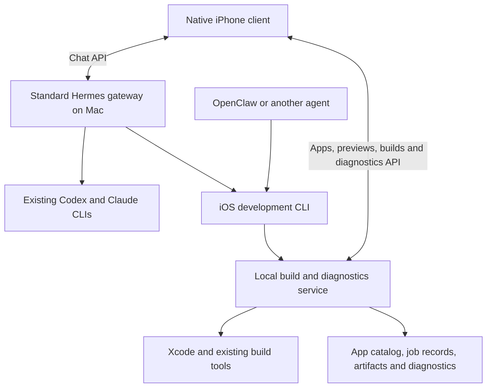

# Architecture

Status: UIKit client, stock Hermes API integration and Rust build/diagnostic core implemented, updated 2026-10-04. Signed version 5 is installed and launched on the phone. Native Mac app import, persistent app metadata, real screenshot refresh, navigation checks and simulator transition inspection are verified. See [evidence](validation.md).

## Ownership

Remote phone connections use user-managed Tailscale and appropriate authentication/HTTPS. The CLI executes on the Mac, or through an explicitly configured remote execution path to it.

Hermes owns identity, memory, sessions, model configuration, and agent task coordination. The development tool owns local build jobs and artifacts, independently of chat history. A build job is an execution record, not another agent task planner. Our client presents both kinds of state without copying the coordinator's database.

The presentation uses UIKit/Core Animation with a horizontal 3D app picker → flat threads, and a separate builds sheet. Names and actual thread content are visible; metadata summaries/capture captions stay off the primary surfaces. The Mac app catalog owns names, summaries, project/scheme identity and latest preview metadata; conversation content remains in Hermes. SceneKit displays a live procedural phone with a real screenshot texture, preserving the image's aspect ratio. Transition progress rotates the mesh with quaternion interpolation and adjusts its camera. Rendering runs continuously only during movement; an idle view redraws when its scene changes. Spatial transitions move the actual phone, title and control views; interactive back can cancel or complete without a screen fade. No screenshot means a neutral empty display, never invented screen artwork. The client contains no SwiftUI or additional agent runtime.

App records live in `apps/<app-UUID>/app.json` under the private Squircle store. Registration deduplicates canonical Xcode project path plus scheme. Name/summary edits preserve app identity. Each screenshot publication copies the supplied bounded PNG into a private immutable file with a new preview UUID; the mutable app record points to the latest one. It retains capture time, caption, source and optional build/revision association. The authenticated API serves image bytes, not arbitrary filesystem paths. Build synchronization imports only newer captures and preserves agent-edited names, summaries and newer previews. These records require no model calls or separate memory database.

The implemented Add app flow browses Mac directories, inspects Xcode schemes and
imports an existing iOS application through the neutral service. The native
client and `app browse`/`inspect`/`import` CLI commands share the same authenticated
APIs. Import persists an optional `build_request` on the app record; the client
uses it before historical build settings, preserving local thread associations
on duplicate imports. Older records still fall back to job history. Plain
`app register` remains metadata-only. Import does not build, change the Xcode
project or invent a preview; signing warnings may need resolution before a
successful archive. Real native/API import, folder/scheme selection and relaunch are verified; the
version 5 phone update is installed. [Request contract](cli.md#import-an-existing-app).

## Core tools and service

The Rust `squircle` CLI is the primary agent interface, with progressive help and structured output. See [CLI design](cli.md). It invokes Xcode's own command-line tools with literal arguments and retains their artifacts. No Hermes imports, model credentials, or LLM dependency belong in the development core.

`squircle serve` runs an Axum HTTP service in the foreground, bound to loopback by default. It owns asynchronous builds and private disk-backed records, artifacts, tickets and diagnostics. An exclusive store lock prevents duplicate services. One Xcode job runs at a time; request IDs deduplicate retries. A disconnected caller leaves its job running. Graceful shutdown cancels jobs; restart marks unfinished records interrupted, without automatic reruns. Login-service supervision is deferred.

Control and diagnostic bearer tokens are separate. Expiring URL tickets authorize installer-compatible manifest/IPA downloads. The service terminates no TLS itself: users provide trusted HTTPS routing. Probe persists unsent diagnostics and retries while active. PLCrashReporter supplies crash capture; Squircle offers a local Xcode symbolication command. [Limits and lifecycle](verification.md#limits-and-lifecycle) describe the prototype's boundaries.

## Existing integration surfaces

- **Client:** use the stock Hermes Desktop WebSocket JSON-RPC protocol (`hermes serve`, `/api/ws`). Native sessions, full tool events, requests, background replies and controls replace the limited Sessions/Runs adapter in the personal build. [Protocol support and limits](hermes-client.md).
- **Agent discovery:** a short skill can teach coordinators to use the CLI. OpenClaw already has shell execution and skills; actual access to the Mac executable, signing environment, and permissions must be verified. [OpenClaw exec](https://docs.openclaw.ai/tools/exec), [skills](https://docs.openclaw.ai/tools/skills)
- **Optional Hermes plugin:** useful for hooks, notifications, tool registration, or proxying domain endpoints onto one gateway address. Its documented API can add routes, but the plugin should delegate to the neutral core. [Plugin guide](https://hermes-agent.nousresearch.com/docs/developer-guide/plugins/)
- **Optional MCP:** add an adapter only if a client benefits. Do not duplicate build logic in it. [MCP support](https://hermes-agent.nousresearch.com/docs/user-guide/features/mcp)

CLI portability does not automatically make the native chat client compatible with another coordinator. Keep its transport replaceable; implementing an OpenClaw chat adapter is separate work.

Custom routes need explicit authentication. Diagnostic upload credentials must not grant agent-control access. Installation downloads use URL authorization compatible with the system installer. This Mac's private HTTPS routes are configured and tested.

The personal client bundles the existing connection configuration during signing.
Stock Hermes native authentication and the iOS Keychain handle chat credentials;
Squircle retains its independent build/diagnostic credentials. There is no manual
token form or new gateway wrapper. With explicit approval, this Mac's private
HTTPS 8444 route targets stock `hermes serve` on loopback 9119; Desktop's
**Mac Hermes** connection uses the same server and default profile. Squircle
remains on loopback 8787 via HTTPS 8443. See the [native client details](hermes-client.md)
for lifecycle, migration and upstream limitations.

Run builds outside request handlers. Keep artifacts and complete logs in dedicated persistent storage, independent of the agent's tool-result previews.

## Coding agents and persistence

Hermes already ships [Codex](https://github.com/NousResearch/hermes-agent/blob/main/skills/autonomous-ai-agents/codex/SKILL.md) and [Claude Code](https://github.com/NousResearch/hermes-agent/blob/main/skills/autonomous-ai-agents/claude-code/SKILL.md) orchestration skills. First verify executable discovery, existing login, working directory, approvals, completion reporting, and any needed resume behavior from the actual Hermes process. No custom execution bridge is needed for the current path. The client can read
referenced standard Claude event logs through Hermes’s stock file API; see
[coding visibility and authentication](coding-visibility.md).

Hermes's model credentials do not authenticate a standalone CLI. A shell-launched worker is not automatically a structured Hermes subagent, and Hermes's approval endpoint may not answer a nested CLI prompt. Validate those boundaries before designing worker controls in the client.

Hermes's ordinary subagent calls and background processes are not automatically restart-durable workflows. Its [Kanban subsystem](https://hermes-agent.nousresearch.com/docs/user-guide/features/kanban/) provides persisted agent tasks, handoffs, and recovery mechanisms. Keep local build-job recovery in the development service. Session history surviving is different from an interrupted computation resuming.

Start with the normal Hermes coordinator runtime. Its optional [Codex app-server runtime](https://hermes-agent.nousresearch.com/docs/user-guide/features/codex-app-server-runtime) currently excludes some native memory/search/delegation tools during turns. Using a model provider, launching a coding CLI, and changing the Hermes runtime are distinct choices.

## When to add a wrapper

A future Mac launcher can simplify setup and version checks without vendoring Hermes. Keep the client's transport separate from its UIKit presentation and use thin coordinator adapters only when needed. Preserve ordinary Hermes access if our client is absent, and preserve development-tool operation if Hermes is absent. No additional orchestration server is planned.
