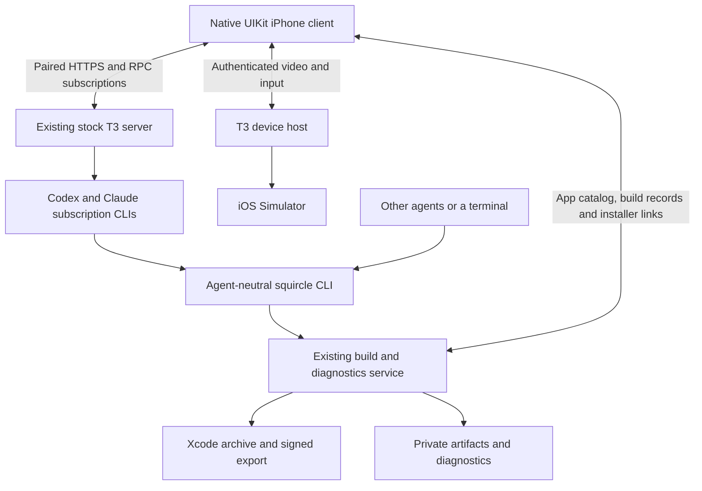

# Architecture

**2026-10-05:** native client on the user's existing, unmodified T3 Code 0.0.45
server. The active Hermes integration has been removed. Implementation evidence
and limits are in [native migration](t3-native-migration.md); earlier Hermes
milestones remain in [historical validation](validation.md) and Git history.

## Ownership

T3 owns projects, persisted threads, provider processes, live tool events,
approvals/questions, cancellation and device sessions. Squircle neither runs a
second coding-agent backend nor copies T3's database. Native project IDs come
from T3. Squircle matches the existing Mac app catalog/build recipes to canonical
checkout paths; multiple schemes under one checkout currently select its first
matching app record rather than independent native picker entries.

**App agents (2026-10-12):** each app's agent is a T3 thread on T3's
"squircle" Claude instance (Squircle's plugin supplies its system prompt and
a per-turn hook) in the project's folder; its workers are ordinary T3
threads. The service holds its own paired T3 session, records which agent owns
which worker, and wakes an agent when a worker finishes. It runs no model.

The independent Rust CLI/service owns durable Xcode jobs, app metadata, PNG
captures, IPA/dSYM storage, expiring HTTPS installer pages and diagnostic uploads.
Coding agents discover it through `--help`, `capabilities --json`, `help workflow`
and command-specific help. The native builds sheet consumes its structured
records. A signed build, an issued URL, installation and manual launch are
separate evidence states. Remote phone launch/LLDB are outside the initial scope.

## Boundaries after the October 2026 review

These describe the source after fix waves W1–W9 of the
[code review](code-review-2026-10.md). The Rust suite (unit, CLI, HTTP
contract and service lifecycle tests) passes; native changes are described
from source and have not been checked on the phone. Open checks are listed in
the review's status section.

**HTTP service.** Control and diagnostic authentication run as route
middleware before any body is read. Every refusal, Axum's own query, path,
body, size and method rejections included, uses the versioned JSON envelope
`{schema_version, ok: false, error: {code, message, retryable, next_step}}`.
`retryable: true` only when the request was refused before any side effect
(`service_draining`, `upload_busy`, `inspection_busy`); a mutation whose
outcome is unknown is never retryable. Captures stream into a private staging
file, one at a time, after a Content-Length check. Authentication and paths
use immutable settings; diagnostics have their own lock; slow file work runs
on blocking workers. An app whose preview bytes are missing still lists, with
`preview_unavailable`, and republishing repairs it.

**Install evidence.** An install ticket records `download_started_at` when the
service opens the IPA and `downloaded_at` only after every byte was handed to
the connection (`GET /v1/install-links/{token}`). Neither proves installation
or launch; `launch_observed` comes from the app's own diagnostic event. The
phone's update curtain waits for every byte sent.

**App agents.** One operation lock per project serializes creation and
resets; a persisted reservation finishes under the same thread ID. `POST
/v1/agents` takes an optional `runtime_mode` (`approval-required`,
`auto-accept-edits`, `auto`, `full-access`; default `full-access`), applied
when the thread is created; a fresh start keeps its predecessor's mode;
workers run `full-access`. `GET /v1/agents` returns `cli`, the service's own
invocation, which the phone uses in worker prompts. Wake-ups go through a
persisted outbox with stable message IDs and retries; resets stay pending
until they succeed. Worker cleanup deletes a branch only when its base
contains it, or when `git cherry` finds every non-merge commit and the branch
has no merge commits, and only at the tip it inspected. Discard stops a
working worker and waits for T3 before removing files. Context goes to the
deepest matching project root.

**T3 connection (Rust).** One supervised task per connection with
connect/liveness deadlines; either half failing closes it; dropping the client
cancels it; pending requests are removed on every exit path; the outbox is
bounded; error text is clipped on character boundaries.

**Simulator sessions.** A start is a saved reservation with a rollback guard
that kills the recorder and owes the device close. Recovery signals a saved
recorder PID only while its command line names that session's file. Device
closes are retried with backoff. On service shutdown `Sims::shutdown` refuses
new starts, stops and files recordings and closes T3 device sessions within
ten seconds; anything cut off is recovered from the ledger at the next start.

**Builds and media.** One process-group runner (deadline, cancellation,
output limits) runs xcodebuild, codesign, simctl, inspection and
symbolication, including overlay signing. The Mach-O editor range-checks
every structure before changing a byte. The overlay cache key includes the
Xcode/SDK build and settings, and entries are reused only when their manifest
digest matches. `media add` writes this Mac's data directory privately and
refuses a non-loopback `--server`; `POST /v1/t3/threads/{thread}/media`
publishes through the service. Tool images are deduplicated by a hash of the
whole payload; Home's thread fallback accepts only T3 `device_screenshot`
captures; a supplied symbol file must carry the image's UUID.

**Native model.** `SquircleModel` addresses conversations as `.thread(id)` or
a per-conversation draft; a send captures its destination, model, mode and
attachments and returns a `SendOutcome` to the conversation that sent it,
which adopts only the thread its own send created. Step details commit to
their own thread and retry. T3 ending a subscription reconnects or
resubscribes with backoff. `close()` invalidates sessions and cancels watcher
tasks. Caches are bounded (`BoundedCache`, `RecentCache`) and emptied on
memory warnings; downloaded video files are deleted when evicted; disk writes
go through one generation-checked `DiskCache` actor. Keychain items are
updated in place. Asset URLs get the T3 bearer only on the configured origin.

**Overlay.** Captures own their recorder (idle / recording / stopping); every
stop finishes it, and a replaced or disconnected scene cancels it.
Performance captures judge each frame against its own refresh period and skip
inactive/background gaps. The jelly idles at a low rate and stays still under
Reduce Motion.

## Native transport and presentation

`T3Gateway` speaks the verified Effect RPC JSON Request/Chunk/Ack/Exit protocol.
HTTP and input/RPC WebSockets use a normal paired T3 session, scoped to
orchestration read/operate. The RPC socket's upgrade carries the session's
bearer like any HTTPS request (T3 0.0.45 accepts it; no ticket round trip);
the device helper socket still uses a short-lived ticket. HTTPS requests
reject redirects. The personal build seeds the device Keychain from ignored
private configuration; the initial session expires after 30 days. Re-pairing
currently requires updating the private build configuration. No credentials or
private probes belong in Git.

Snapshots recover server-owned state on reconnect, but only when needed:
the shell and an open thread resubscribe with `afterSequence` from what the
phone already holds (this session or the disk cache), so T3 replays only
the events since, or sends a snapshot when the gap is too large (2026-10-15:
a long agent thread's snapshot is about 600 KB). A revert falls back to a
snapshot. The Squircle service answers GET JSON with an ETag (unchanged
polls get an empty 304) and gzip; the phone polls builds, apps, agents,
simulators, tasks and the open thread's media in one parallel round every
4 s. Sequenced events deduplicate
replay and append streaming text deltas; an empty final text event preserves the
accumulated response. The client does not retry a message command automatically
when an acknowledgement is missing. It presents a retry error and refreshes
state instead. Native controls send T3's own approval/question/interrupt commands.

**Presentation (current source; see AGENTS.md for the product decisions).**
`StudioViewController` holds one `Route` (`grid`, `app`, `thread`) and derives
every frame, visibility and interaction from it (`sync()`/`applyScene()`).
Home is a grid of still device portraits that `DeviceStage` renders once;
nothing draws a live 3D scene. Tapping an app pushes its agent's conversation;
other threads push over it from the Tasks sheet's Threads tab. Builds are a
secondary sheet. Simulators an agent is using float as a flat PiP/deck
(`SimulatorDock`) over the app's conversations.

`ThreadViewController` is the one conversation implementation for the app and
the injected overlay. Its host supplies capabilities through
`ConversationHost`: shared `SimulatorFeeds`, whether it can bring a live
simulator large (`expandsSimulators`; the overlay cannot, so its live
simulator rows are previews, not buttons) and which simulators are in sight.
`SimulatorFeeds` shares one T3 H.264 stream per simulator and streams only
while a live cell is in a window and its conversation is visible; Home drops
the dock's simulators. `close()` ends its streams and observer tasks. Rows
live in `ThreadCells.swift`, the composer in `ThreadViews.swift`.

`T3DeviceStream.Lifetime` is stopped or running(generation, task, phase). Connecting
owns a partial attempt; interactive owns a nonoptional video/input pair; retrying
owns neither. One authenticated H.264 AVCC request starts video, then its first decoded frame
precedes the input WebSocket's screen-config handshake. Input remains disabled
until both succeed. Either connection failing closes both, obtains a fresh ticket
and retries with bounded backoff. Startup has a deadline; idle images are valid.
Cancellation closes real resources and generation checks reject old callbacks.

AVCC framing and VideoToolbox decode run on a serial background delegate queue.
Hardware decoding is required on the physical phone. Each decode completes before
the next starts, without temporal buffering; all encoded reference frames are
preserved. Only the newest decoded picture waits for UIKit. The display drops
pictures when busy instead of accumulating playback. The host's one-off JPEG seed
is ignored. There is no MJPEG request, decoder, priming stream or fallback.
Touch coordinates map into the letterboxed image. A channel owns its ordered
gesture queue; gestures never replay into a replacement channel. Native pinch and
an exclusive human/agent input lock are not implemented. Video uses T3's existing
authenticated HTTPS proxy; input uses its WSS endpoint. No host encoder, relay or
agent service is added. End-to-end phone/cellular latency remains unmeasured.

T3 0.0.45 caches native capture sessions across generic `simctl shutdown`/reboot.
Use its supported `device.shutdown` before `device.open` to release the capture.
A stale valid image cannot be inferred from an idle feed. The current client
has no restart control; simulators are opened and closed for agents by
`squircle sim start`/`stop`. Never automatically restart an agent's apps.
Transport tests run in a separate simulator so Xcode does not reboot the streamed
target. Supported resets previously restored live host capture on QA and Cards.

Apple Device Hub can shadow simulator touch through its guest input-ownership
flag. The earlier user-approved Cards-Verify repair worked, but a repair can close
running simulator apps. Do not silently restart backboardd or automatically
attach Apple's viewer during the normal workflow.

## Deployment boundary

The Mac's existing T3 desktop owns its server. The existing build service uses
loopback plus an already configured HTTPS route. Tailscale remains user-managed;
this implementation made no network setup changes. Packaged startup supervision
is still pending. Do not change the independently installed Hermes or other
services simply because the iPhone client no longer uses them.
