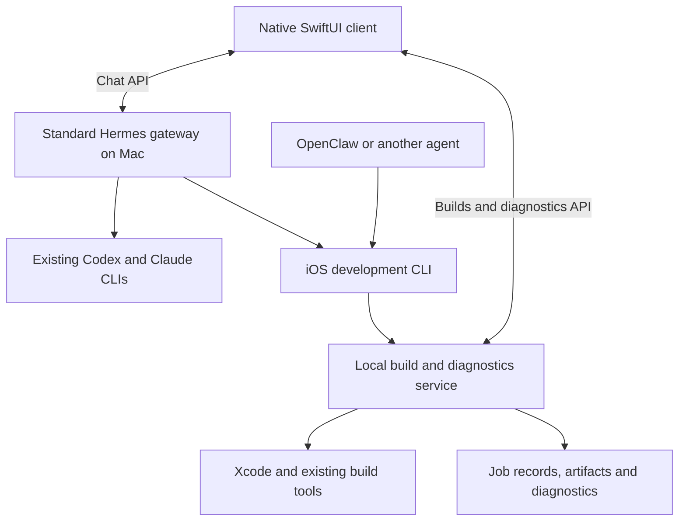

# Architecture

Status: Rust build/diagnostic core implemented, updated 2026-10-04. Hermes integration and the controller client remain proposed; no cellular end-to-end validation yet. See [evidence](validation.md).

## Ownership

Remote phone connections use user-managed Tailscale and appropriate authentication/HTTPS. The CLI executes on the Mac, or through an explicitly configured remote execution path to it.

Hermes owns identity, memory, sessions, model configuration, and agent task coordination. The development tool owns local build jobs and artifacts, independently of chat history. A build job is an execution record, not another agent task planner. Our client presents both kinds of state without copying the coordinator's database.

## Core tools and service

The Rust `squircle` CLI is the primary agent interface, with progressive help and structured output. See [CLI design](cli.md). It invokes Xcode's own command-line tools with literal arguments and retains their artifacts. No Hermes imports, model credentials, or LLM dependency belong in the development core.

`squircle serve` runs an Axum HTTP service in the foreground, bound to loopback by default. It owns asynchronous builds and private disk-backed records, artifacts, tickets and diagnostics. An exclusive store lock prevents duplicate services. One Xcode job runs at a time; request IDs deduplicate retries. A disconnected caller leaves its job running. Graceful shutdown cancels jobs; restart marks unfinished records interrupted, without automatic reruns. Login-service supervision is deferred.

Control and diagnostic bearer tokens are separate. Expiring URL tickets authorize installer-compatible manifest/IPA downloads. The service terminates no TLS itself: users provide trusted HTTPS routing. Probe persists unsent diagnostics and retries while active. PLCrashReporter supplies crash capture; Squircle offers a local Xcode symbolication command. [Limits and lifecycle](verification.md#limits-and-lifecycle) describe the prototype's boundaries.

## Existing integration surfaces

- **Client:** use Hermes's documented Sessions/Runs HTTP APIs and SSE, including history, approvals, cancellation, and capability discovery. Keep stable session/run IDs and reconcile after reconnect. The generic Chat Completions endpoint alone is insufficient as the persistence design. [API documentation](https://hermes-agent.nousresearch.com/docs/user-guide/features/api-server/)
- **Agent discovery:** a short skill can teach coordinators to use the CLI. OpenClaw already has shell execution and skills; actual access to the Mac executable, signing environment, and permissions must be verified. [OpenClaw exec](https://docs.openclaw.ai/tools/exec), [skills](https://docs.openclaw.ai/tools/skills)
- **Optional Hermes plugin:** useful for hooks, notifications, tool registration, or proxying domain endpoints onto one gateway address. Its documented API can add routes, but the plugin should delegate to the neutral core. [Plugin guide](https://hermes-agent.nousresearch.com/docs/developer-guide/plugins/)
- **Optional MCP:** add an adapter only if a client benefits. Do not duplicate build logic in it. [MCP support](https://hermes-agent.nousresearch.com/docs/user-guide/features/mcp)

CLI portability does not automatically make the SwiftUI chat client compatible with another coordinator. Keep its transport replaceable; implementing an OpenClaw chat adapter is separate work.

Custom routes need explicit authentication. Diagnostic upload credentials must not grant agent-control access. Installation downloads need URL authorization compatible with the system installer. HTTPS setup is still required for the proposed distribution route.

Run builds outside request handlers. Keep artifacts and complete logs in dedicated persistent storage, independent of the agent's tool-result previews.

## Coding agents and persistence

Hermes already ships [Codex](https://github.com/NousResearch/hermes-agent/blob/main/skills/autonomous-ai-agents/codex/SKILL.md) and [Claude Code](https://github.com/NousResearch/hermes-agent/blob/main/skills/autonomous-ai-agents/claude-code/SKILL.md) orchestration skills. First verify executable discovery, existing login, working directory, approvals, completion reporting, and any needed resume behavior from the actual Hermes process. No custom agent bridge is assumed necessary.

Hermes's model credentials do not authenticate a standalone CLI. A shell-launched worker is not automatically a structured Hermes subagent, and Hermes's approval endpoint may not answer a nested CLI prompt. Validate those boundaries before designing worker controls in the client.

Hermes's ordinary subagent calls and background processes are not automatically restart-durable workflows. Its [Kanban subsystem](https://hermes-agent.nousresearch.com/docs/user-guide/features/kanban/) provides persisted agent tasks, handoffs, and recovery mechanisms. Keep local build-job recovery in the development service. Session history surviving is different from an interrupted computation resuming.

Start with the normal Hermes coordinator runtime. Its optional [Codex app-server runtime](https://hermes-agent.nousresearch.com/docs/user-guide/features/codex-app-server-runtime) currently excludes some native memory/search/delegation tools during turns. Using a model provider, launching a coding CLI, and changing the Hermes runtime are distinct choices.

## When to add a wrapper

A future Mac launcher can simplify setup and version checks without vendoring Hermes. Begin with a client abstraction inside SwiftUI and optional thin coordinator adapters. Preserve ordinary Hermes access if our client is absent, and preserve development-tool operation if Hermes is absent. No additional orchestration server is planned.
