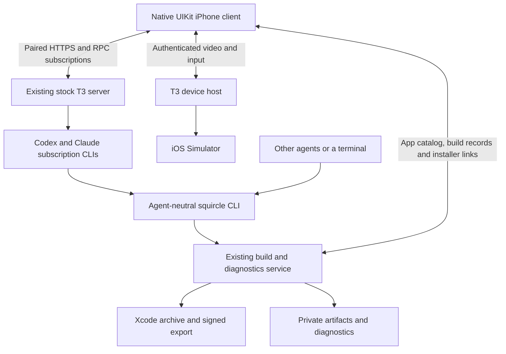

# Architecture

**2026-10-05:** native client on the user's existing, unmodified T3 Code 0.0.45
server. The active Hermes integration has been removed. Implementation evidence
and limits are in [native migration](t3-native-migration.md); earlier Hermes
milestones remain in [historical validation](validation.md) and Git history.

## Ownership

T3 owns projects, persisted threads, provider processes, live tool events,
approvals/questions, cancellation and device sessions. Squircle neither runs a
second coding-agent backend nor copies T3's database. Native project IDs come
from T3. Squircle matches the existing Mac app catalog/build recipes to canonical
checkout paths; multiple schemes under one checkout currently select its first
matching app record rather than independent native picker entries.

The independent Rust CLI/service owns durable Xcode jobs, app metadata, PNG
captures, IPA/dSYM storage, expiring HTTPS installer pages and diagnostic uploads.
Coding agents discover it through `--help`, `capabilities --json`, `help workflow`
and command-specific help. The native builds sheet consumes its structured
records. A signed build, an issued URL, installation and manual launch are
separate evidence states. Remote phone launch/LLDB are outside the initial scope.

## Native transport and presentation

`T3Gateway` speaks the verified Effect RPC JSON Request/Chunk/Ack/Exit protocol.
HTTP and input/RPC WebSockets use a normal paired T3 session, scoped to
orchestration read/operate, and short-lived WebSocket tickets. HTTPS requests
reject redirects. The personal build seeds the device Keychain from ignored
private configuration; the initial session expires after 30 days. Re-pairing
currently requires updating the private build configuration. No credentials or
private probes belong in Git.

Snapshots recover server-owned state on reconnect. Sequenced events deduplicate
replay and append streaming text deltas; an empty final text event preserves the
accumulated response. The client does not retry a message command automatically
when an acknowledgement is missing. It presents a retry error and refreshes
state instead. Native controls send T3's own approval/question/interrupt commands.

UIKit/Core Animation retains the horizontal 3D app picker and spatial transitions
into the flat thread list, with builds in a secondary sheet. Actual simulator PNGs
appear on the procedural SceneKit device; missing captures remain empty. The
thread has a compact interactive simulator view and an in-place expansion.
Conversation text and tool detail views are native. The final build’s representative
gallery/workspace open/close transition was inspected frame by frame on rendered
simulator output; broader gesture/phone visual checks remain separate.

`ThreadViewController.Preview` is the single presentation state: automatic,
hidden, paused(target), restarting(target), or visible(target, stream). Only the
visible case owns a stream. Hiding cannot be reversed by an unrelated chat event;
backgrounding/navigation stop resources, and returning reconnects the saved target.
A selected target comes directly from T3's validated `device.open` response.

`T3DeviceStream.Lifetime` is stopped or running(generation, task, phase). Connecting
owns a partial attempt; interactive owns a nonoptional video/input pair; retrying
owns neither. One authenticated H.264 AVCC request starts video, then its first decoded frame
precedes the input WebSocket's screen-config handshake. Input remains disabled
until both succeed. Either connection failing closes both, obtains a fresh ticket
and retries with bounded backoff. Startup has a deadline; idle images are valid.
Cancellation closes real resources and generation checks reject old callbacks.

AVCC framing and VideoToolbox decode run on a serial background delegate queue.
Hardware decoding is required on the physical phone. Each decode completes before
the next starts, without temporal buffering; all encoded reference frames are
preserved. Only the newest decoded picture waits for UIKit. The display drops
pictures when busy instead of accumulating playback. The host's one-off JPEG seed
is ignored. There is no MJPEG request, decoder, priming stream or fallback.
Touch coordinates map into the letterboxed image. A channel owns its ordered
gesture queue; gestures never replay into a replacement channel. Native pinch and
an exclusive human/agent input lock are not implemented. Video uses T3's existing
authenticated HTTPS proxy; input uses its WSS endpoint. No host encoder, relay or
agent service is added. End-to-end phone/cellular latency remains unmeasured.

T3 0.0.45 caches native capture sessions across generic `simctl shutdown`/reboot.
Use its supported `device.shutdown` before `device.open` to release the capture.
The client offers an explicit restart because a stale valid image cannot be
inferred from an idle feed. Never automatically restart an agent's apps.
Transport tests run in a separate simulator so Xcode does not reboot the streamed
target. Supported resets previously restored live host capture on QA and Cards.

Apple Device Hub can shadow simulator touch through its guest input-ownership
flag. The earlier user-approved Cards-Verify repair worked, but a repair can close
running simulator apps. Do not silently restart backboardd or automatically
attach Apple's viewer during the normal workflow.

## Deployment boundary

The Mac's existing T3 desktop owns its server. The existing build service uses
loopback plus an already configured HTTPS route. Tailscale remains user-managed;
this implementation made no network setup changes. Packaged startup supervision
is still pending. Do not change the independently installed Hermes or other
services simply because the iPhone client no longer uses them.
