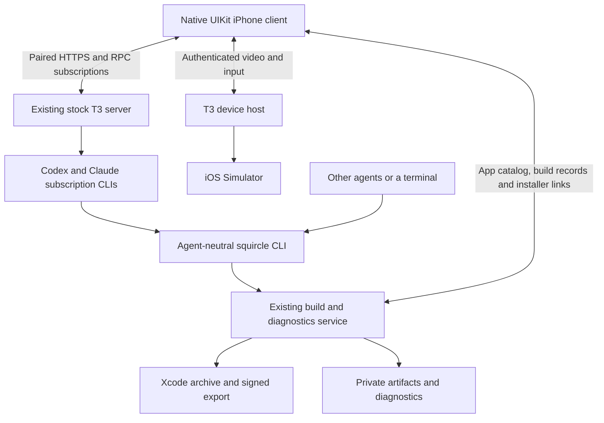

# Architecture

**2026-10-05:** native client on the user's existing, unmodified T3 Code 0.0.45
server. The active Hermes integration has been removed. Implementation evidence
and limits are in [native migration](t3-native-migration.md); earlier Hermes
milestones remain in [historical validation](archive/validation.md) and Git history.

## Ownership

T3 owns projects, persisted threads, provider processes, live tool events,
approvals/questions, cancellation and device sessions. Squircle neither runs a
second coding-agent backend nor copies T3's database. Native project IDs come
from T3. Squircle matches the existing Mac app catalog/build recipes to canonical
checkout paths; multiple schemes under one checkout currently select its first
matching app record rather than independent native picker entries.

**App agents (2026-10-12):** each app's agent is a T3 thread on T3's
"squircle" Claude instance (Squircle's plugin supplies its system prompt and
a per-turn hook) in the project's folder; its workers are ordinary T3
threads. The service holds its own paired T3 session, records which agent owns
which worker, and wakes an agent when a worker finishes. It runs no model.

The independent Rust CLI/service owns durable Xcode jobs, app metadata, PNG
captures, IPA/dSYM storage, expiring HTTPS installer pages and diagnostic uploads.
Coding agents discover it through `--help`, `capabilities --json`, `help workflow`
and command-specific help. The native builds sheet consumes its structured
records. A signed build, an issued URL, installation and manual launch are
separate evidence states. Remote phone launch/LLDB are outside the initial scope.

## Boundaries after the October 2026 review

These describe the source after fix waves W1–W9 of the
[code review](code-review-2026-10.md). The Rust suite (unit, CLI, HTTP
contract and service lifecycle tests) passes; native changes are described
from source and have not been checked on the phone. Open checks are listed in
the review's status section. The second review's fixes refine several of
these; [its contracts](#state-ownership-contracts-review-b-2026-10-15) take
precedence where they differ.

**HTTP service.** Control and diagnostic authentication run as route
middleware before any body is read. Every refusal, Axum's own query, path,
body, size and method rejections included, uses the versioned JSON envelope
`{schema_version, ok: false, error: {code, message, retryable, next_step}}`.
`retryable: true` only when the request was refused before any side effect
(`service_draining`, `inspection_busy`); a mutation whose
outcome is unknown is never retryable. Captures each stream into their own private
staging file after a Content-Length check; they never wait for each other
(a single upload slot let one phone app suspended mid-send refuse every
later upload, 2026-10-15). Authentication and paths
use immutable settings; diagnostics have their own lane; slow file work runs
on blocking workers. An app whose preview bytes are missing still lists, with
`preview_unavailable`, and republishing repairs it.

**Install evidence.** An install ticket records `download_started_at` when the
service opens the IPA and `downloaded_at` only after every byte was handed to
the connection (`GET /v1/install-links/{token}`). Neither proves installation
or launch; `launch_observed` comes from the app's own diagnostic event. The
phone's update curtain waits for every byte sent.

**App agents.** One operation lane per project serializes creation and
resets; a persisted reservation finishes under the same thread ID. `POST
/v1/agents` takes an optional `runtime_mode` (`approval-required`,
`auto-accept-edits`, `auto`, `full-access`; default `full-access`), applied
when the thread is created;
workers run in their agent's mode unless `thread spawn --runtime-mode`
overrides it, mapped per provider (`auto` stays auto on Claude, Codex,
Cursor and Grok; Antigravity takes auto-edit). `GET /v1/agents` returns `cli`, the service's own
invocation, which the phone uses in worker prompts. Wake-ups go through a
persisted outbox with stable message IDs (M16, `src/fsm/coordinator/`):
each attempt's command ID is saved before it is sent; a lost answer goes
again as the same command at its saved retry time, which T3 answers from its
receipt; only T3's refusal makes a new command; a recipient gone from a
current shell is recorded as undelivered. Every `agents.json` change is
saved before it is read or acted on (C00). Resets stay pending until they
succeed. Worker cleanup deletes a branch only when its base
contains it, or when `git cherry` finds every non-merge commit and the branch
has no merge commits, and only at the tip it inspected. Files are removed
only after T3 confirms the session stopped (review B below). Context goes to
the deepest matching project root.

**T3 connection (Rust).** One supervised task per connection, with no
time limits (2026-10-24): a call ends with T3's answer or the socket closing,
which a stopped T3 does at once on loopback and TCP keepalive makes happen for
a vanished remote peer; either half failing closes it; dropping the client
cancels it; pending requests are removed on every exit path; the outbox is
bounded; error text is clipped on character boundaries. A command goes out
exactly as its intent saved it (ID and time included); a typed T3 failure is
a refusal, while a lost answer, the 45-second budget or T3's internal error
leaves the outcome unknown.

**Simulator sessions.** A start is a saved reservation with a rollback guard
that kills the recorder and owes the device close. Recovery signals a saved
recorder PID only while its command line names that session's file. Device
closes are retried with backoff. On service shutdown `Sims::shutdown` refuses
new starts, stops and files recordings and closes T3 device sessions; anything a
supervisor cuts off is recovered from the ledger at the next start. The
watchdog looks again when T3's thread states change, a recorder exits (a
kernel event) or the ledger is saved, and otherwise only at the policy's next
due time; a start waits for simctl's own "Recording started" line.

**Builds and media.** One process-group runner (cancellation, its caller
going away, output limits; no deadline) runs xcodebuild, codesign, simctl, inspection and
symbolication, including overlay signing. The Mach-O editor range-checks
every structure before changing a byte. The overlay cache key includes the
Xcode/SDK build and settings, and entries are reused only when their manifest
digest matches. `media add` writes this Mac's data directory privately and
refuses a non-loopback `--server`; `POST /v1/t3/threads/{thread}/media`
publishes through the service. Tool images are deduplicated by a hash of the
whole payload; Home's thread fallback accepts only T3 `device_screenshot`
captures; a supplied symbol file must carry the image's UUID.

**Native model.** Conversations, sends, the connection and refresh are
described under review B below. Step details commit to their own thread and
retry. `close()` invalidates sessions and cancels watcher tasks. In-memory
caches are bounded (`BoundedCache`, `RecentCache`) and emptied on memory
warnings; disk writes go through one generation-checked `DiskCache` actor.
Keychain items are updated in place. Asset URLs get the T3 bearer only on the
configured origin.

**Overlay.** Captures own their recorder (idle / recording / stopping); every
stop finishes it, and a replaced or disconnected scene cancels it.
Performance captures judge each frame against its own refresh period and skip
inactive/background gaps. The jelly idles at a low rate and stays still under
Reduce Motion.

## State ownership contracts (review B, 2026-10-15)

From fix packages W1–W8 of the [second review](code-review-2026-10-b.md);
its status section says what is tested and what is only in code. The rule
throughout: T3 owns execution, Squircle owns its records and operation
journals; a replica carries where it came from, and only a *current*
observation may stop, remove or close anything. Stale or unknown is shown,
never acted on. Saved files keep their earlier keys or are read by an
adapter; the wire shapes below are unchanged unless stated.

**Shell observations (`src/agents.rs`).** `Agents::observe(id)` returns
`Observed<Option<ThreadObservation>>`: `unavailable`, `stale{epoch}` (the
service's T3 session is offline or resyncing) or `current{epoch}` (T3's
snapshot arrived for this session; `None` means T3 has no such thread).
`ThreadObservation {turn, execution, waiting, failed}` decodes T3's row
once; `execution` is `stopped / idle / running / unknown` and a turn
waiting on a question or approval counts as running. `busy()` is running or
unknown. Tasks and simulator sessions act only on `current`; push and some
display paths still read the row string (`worker_state`).

**Worker operation identity (W1).** `thread spawn` reserves the worker
before T3 hears of it: a new thread ID, message ID and the whole
`thread.turn.start` command (with T3's create-thread and worktree bootstrap)
are saved as `stage: {bootstrapping: {message_id, command}}` in
`agents.json`, then sent. It becomes `active` when the dispatch succeeds, T3's
shell shows the thread, or T3 already has that message. If none of these,
the CLI says to run the same spawn again: a live worker with the same
coordinator and branch is finished under the same IDs (`existing: true`),
never started twice. Nothing re-sends a reservation on service restart; the
shell or a repeated spawn finishes it. Archive of a reservation T3 never saw
drops it (`never_started: true`).

**Stop before removal (W1).** `thread archive` needs a current shell. A
session that isn't stopped is stopped first; one that is running or waiting
on the user needs `--discard`. Files are removed only with a `StopReceipt`,
which only a current observation of a stopped (or absent) session can mint;
`wait_stopped` gives up after 30 s and removes nothing. Order: stop → stopped
→ remove files (`stage: files-removed`) → T3 `thread.archive` →
`archived`. `thread cleanup` needs the same receipt.

**Restarts (W1).** `agent restart` queues `lifecycle: restart-queued`
and runs only when a current observation shows the agent not busy, read again
immediately before stopping. The agent keeps one thread for good (2026-10-30;
no fresh starts). Any turn,
including one started after the request, defers it; there is no turn-ID
fence. Failures back off 8–256 s. The service's own T3 reconnect resets its
1–30 s backoff only after a session that reached a current shell and lasted
60 s.

**Wakes (W1).** Worker events are `{turn, kind, request?}` (`kind`
`done / error / needs-you / working`), not colon keys. A wake is `queued`,
then `outcome-unknown` (saved) before dispatch with its stable message ID;
on retry an `outcome-unknown` wake already in T3 counts as delivered.
Delivery sets each worker's `notified` and removes the wake in one save.

**Task revision and worker-turn signal (W2/W3).** See
[tasks](task-tracking.md#model). The service passes `Signals {revision,
workers: [{thread, turn, phase}], builds: [{build, phase}]}`, built from
memory only: current shell observations (`turn` is T3's
`latestTurn.turnId`) and the job index. Not current, or not known, is
`missing`, never news. A tick applies only to a task still at the revision
it read; an explicit status records the observation read with it. Changes
are saved before they are visible.

**Build jobs (W3/W5).** A `Job` is an origin (`project{request,
provenance}` or `imported`) and a phase (`queued / running /
succeeded{output, preview} / failed / cancelled / interrupted`);
`PreviewState` (`absent / queued / capturing / ready / failed`, keeping the
prior image) and install `TransferEvidence` (`not-started / opened /
completed`, forward only) replace optional-field combinations.
`jobs/<id>/job.json` keeps its flat keys; a validating adapter reads it and
a contradictory record is skipped with a message on stderr, not defaulted.
`Jobs` (`src/store.rs`) loads the directory once at start (marking
unfinished jobs interrupted), then owns records, revisions and live
build/preview leases (at most 16); list, status and task signals read it.
If saving a finished job fails, the result is still served as
`persistence_error` and the service drains. `xcode::build` returns
`BuildArtifacts` (`archive{archive, ipa, app, dsyms}` or `simulator{app,
dsyms}`), adapted to the saved `BuildOutput`.

**Helper processes (W5).** `run_bounded` keeps the helper's leader
unreaped (`waitid(WNOWAIT)`) so its process group ID can't be reused, and
kills the whole group on leader exit (reported by the kernel, `src/kq.rs`),
cancellation or drop before reaping. T3 database reads run read-only until
they end or their caller drops them (which interrupts SQLite), with a 64 MiB
output cap. The symbol tool runner follows the same order.

**Build notification app identity (W3/W4).** When a build finishes the
service resolves its catalog app (project + scheme, or an import's bundle
ID) and the alert's `squircle` payload carries `app` (catalog ID) with
`build` and `bundle`. The phone's `PushTarget` is `app(project | bundle |
catalog, thread?)` or `build(id, app?)`. A target it can't resolve yet
waits for a fresh catalog; "not found" shows only when connected with a
loaded catalog. DEBUG `SQUIRCLE_OPEN_TARGET` opens a payload as if tapped.

**A worktree's build is its repository's app (2026-10-22).** A build of a
linked git worktree (T3's worktrees) records the same project in the main
checkout (`source_main_project`, read from the worktree's `.git` file and
`commondir` at submission, and for older builds on load while the worktree
exists). App registration and build ownership use that project, so a
worktree no longer creates its own app record. The phone's Builds list for
an app is every build its agent or workers started plus any build of a
checkout inside its T3 project, newest first, whatever the scheme.

**Push delivery (W4).** Per phone and app a `Link` has a `Stage`
(`absent / starting / running{activity, acked}`) and a `Flight` (`idle /
sending(generation) / waiting{until, failures}`): one send at a time, and a
reply for an older generation is ignored. What the service wants per app
is `show / pausing / hide`. 429, 5xx and network errors retry (an alert
gets four attempts, 2, 8 and 32 s apart, under one collapse ID; activity
sends back off up to 5 minutes). An activity's token is kept, and saved, until its End is
accepted or Apple says the token is gone. The current-step read is keyed by
agent thread and turn, runs only when some phone can receive it, one at a
time, and a result for an older turn is dropped. The phone registers tokens
as `unsent / sending / acknowledged` and sends presence in order (newest
wins), renewed every 4 minutes while in the foreground.

**Simulator sessions (W8; machines M18–M20 since step 3, see
[fsm-architecture](fsm-architecture.md)).** A session's phase carries each
phase's data (`starting / recording / stopping / filing / finished(media) /
failed`); its recorder is identified by PID, start time and a command line
naming that session's file. Its T3 device session is a `DeviceLease`
(`opening / open / close_owed(retry) / closed`; a close is never given up)
and the pool's release is its own owed obligation; the session reserves its
simulator, and counts against the limit, until both are settled. A turn ends
a session only when T3 currently shows it idle or gone for 8 s; busy,
needs-you or unknown never does. `/v1/sims` keeps its flat keys (`state`,
`recorder_pid`, `media_id`, `release_pending`, …) plus `device_session`;
`sims.json` adds the receipts (schema 2) and older ledgers convert on open.

**Conversations and sends on the phone (W6/W7).** A conversation is
`ConversationID` = `draft(UUID, app, agent)` or `thread(ID, app)`; the
controller holds its own and follows the model's successor when its draft
becomes a thread. That adoption happens as soon as T3 creates the thread,
before the first turn is sent, so a refused turn still belongs to the new
thread. A send is a `PendingSend` with a message ID (and turn and create
command IDs) fixed when it starts, phase `preparing / creating /
awaitingAcceptance / accepted`; each stage is saved on the phone first, and
nothing is sent until that exact save is acknowledged (the save in progress
is the send's state, 2026-10-31). Only T3's refusal removes it and returns the
text and pictures to that conversation's field. A lost answer (the socket
dropped, or the request never got out) is not an outcome: the same command
goes again on T3's next connection, and T3 answers a command ID it already
took from its receipt without running it twice. The open thread showing the
message settles it too. Requests have no answer deadline; a dead socket
fails them (heartbeat, probe). The socket's own URLSession has no request
timeout, and T3's silence is allowed 40 s plus the time the request bytes
T3 hasn't yet acknowledged need at 128 kbit/s (a Pong covers everything
queued before its Ping; other frames don't), so a picture taking a minute
on a slow uplink isn't mistaken for a dead link. Silence is judged whatever
our own writes are doing, and the heartbeat never waits on its own Ping, so a
stalled uplink can't stall its detection (2026-10-31). Recording uploads are `uploading / uploaded /
failed` per attachment, and a failed one is tried again on the next send.
The composer and echo bubble are projections of the pending send.

**Connection (W6).** `ConnectionPhase` is `stopped / suspended / refused /
connecting(attempt) / ready(session)`. Every subscription callback carries
its attempt ID; one from an older attempt is ignored, and a subscription
ending during setup fails that attempt instead of being lost. The open
thread's failures reset only once T3 brings it up to date (its `synchronized`
marker), and a typed refusal is said at once instead of retried. Status text
derives from the phase ("Offline" after 8 s). Provider configuration is a
`ResourceState` (`absent / loading / ready(fetchedAt) / failed(retryAt)`),
reloaded from the service when T3 connects, when the event stream opens
(if it failed, or is older than 10 minutes) and on a send that lacks it; T3's socket
is not torn down for it.

**Refresh and transcripts (W6/W7).** Screens take a `RefreshLease` for
`.tasks(app)` or `.conversation(id)`. Nothing is fetched on a timer
(2026-10-27): while active the phone holds the service's event stream
(`GET /v1/events`, server-sent events, `src/server/event_routes.rs`), which
names each list whose reply changed (builds, apps, agents, simulators,
waiting, an app's tasks, a thread's media, a running build's log, install
transfers), and the phone fetches exactly that, tasks and media only for
held leases. On opening (`ready`) it fetches everything once. A closed
stream opens again on foreground, a new network path, T3's socket
connecting or T3 activity, and once at once after one that was open ends;
never on a retry timer. The service computes each list's reply on every
owner change and sends a notice only when its ETag differs. A thread's state records `provenance` (`none / cached(seq) /
live(seq)`); rows are cached only as a `Transcript` built from one state, so
cached rows and state can't come from different revisions. The timeline
reuses each turn's rows while its inputs are unchanged. Chat action lines
take only their own command's reply (`WorkerID`/`BuildID`; several commands
share output only when it splits into one JSON reply each); otherwise the ID
is left unknown. `StudioViewController`'s route is `grid / app(id) /
thread(app, existing(id) | draft(UUID))`, each mount one `Mounted<Key>`.

**Simulator dock (W8).** `SimulatorDock` has one `Route` (`collapsed /
fanned`) and the set of pictures lent to the media viewer. One
`FrameProjection` per picture derives its frame, visibility, touchability and
feed; a lent picture keeps its place and feed, unseen. Tapping a picture asks
the host to bring it large (`onExpand`). A use's content is `live /
recording / unavailable`.

**Media viewer.** `MediaViewer` brings every inline picture, clip and live
simulator large (conversation galleries and figures, recordings, Tasks
media, the dock). It is a view over the window, not a presented controller.
The picture's frame is one spring (centre and size with velocity); the route
(`open / closed`) and the zoom pick its target every frame, and a closed
viewer's target is its inline spot found again each frame (`MediaOrigin`),
or off screen in the direction it was thrown when that can't be seen. A
finger holds the spring (drag, zoomed pan, pinch) and letting go hands it
back with the finger's velocity. Backdrop, corners, border, controls and who
takes touches are derived from that frame and the route. Flying home, only
the picture can be caught; the rest of the screen is the conversation's. A
live simulator takes touches on its picture from the first frame; it is
dismissed by dragging from its grabber or anywhere outside the picture, a
tap outside, or the shrink button.

**Phone files.** Caches directory: `squircle-home.json`,
`squircle-threads/<thread>.json` (a `T3ThreadState` with `provenance`; files
written before it fail to decode and are refetched — inferred from Codable,
not tested), and `squircle-media/` for downloaded clips (conversation and
task videos alike, streamed to file). The media store rebuilds its index by
scanning the directory at launch and evicts by a 1 GiB budget and 14-day age,
never a file used in the last 15 minutes or a recording the user handed in.
Pictures stay in memory. UserDefaults keys are unchanged.

**Saved service files.** `agents.json`: per agent `lifecycle` (`creating /
ready{refresh} / restart-queued / restarting{stop}`, with
`error`/`failures`), per worker `stage` and object `notified`, `outbox`
wakes with `delivery` and the attempt's `command` identity, `failures`,
`retry_at`, `error`; `upkeep` per project (M26: `unknown | applied |
blocked`, with the compaction's command); `undelivered` receipts; C00's
`transaction`/`revision` stamps. It still reads the earlier `archived`,
`attempted` and colon-key forms and writes the new ones. `tasks.json`: see
[tasks](task-tracking.md#model). `push/devices.json` keeps `activities`
(`{project: {id, token}}`) for running activities only; starts and flights
are memory only.

**Overlay (W9, `app/Squircle/Overlay/`).** Compiled and read, not yet
looked at in a simulator or on the phone.

- *Scene lease.* `OverlayHost.State` is `unconfigured / detached(model) /
  attached(SceneLease)`. A lease owns its scene's window, controller and
  refresh task. Only the leased scene's deactivate, background and
  foreground notifications reach the model; ending the lease tears the
  controller down and cancels its work (`OverlayHost.swift`).
- *Route and mounts.* `OverlayRoute` is `bubble(resume: Panel) /
  panel(Panel)`, `Panel {full, thread: ThreadDestination?}` (W7's type; no
  `draft:` string). Closed keeps the panel it reopens to. The agent and the
  thread over it are each one `Mounted(key, controller, host)`; the thread
  changes only while the push spring is at 0.
- *Resize regimes.* `PanelLayout` is `stretched(outgoing: Snapshot?) /
  revealed(size) / live`, changed only through `setLayout`, which removes a
  picture the regime leaves. Stretched: laid out at the resting size, the
  previous size's picture fading out until the frame rests. Revealed: laid
  out once while the handle resizes the docked panel. Live: laid out at the
  glass's frame every frame between docked and full screen. Rest returns to
  stretched.
- *Attachment flight* (contract with the shared composer). One
  `Flight(attachmentID, conversation, start, lift, picture)` from takeoff to
  landing. The overlay holds back only that conversation's thumbnail
  (`holdAttachment(id)`), flies toward that conversation's
  `attachmentFrame(id, in:)` (into the bubble if it is gone) and releases
  only that hold when the flight lands, is replaced or the overlay is torn
  down. The flash's visibility derives from its fade spring.
- *Completion notice.* "Done · …" comes from `ChatSession.latestTurn`'s
  `TurnCompletion`: a turn newly reported finished (for a thread seen for
  the first time, only one that ended in the last 6 s) shows Done, Stopped
  or Failed for 6 s; one cancellable deadline renders again. Rendered
  "working" rows are no longer diffed.
- *Capture* keeps its `idle / recording / stopping` producer ownership. The
  panel stays closed while recording, so a recording lands in the
  conversation that was on top when it started.
- *Jelly cadence.* `GlassJelly.Ticker` is `detached / running(link, cadence)
  / sleeping(link, since, alarm)`: one owner for the display link, its rate
  and the wake-up alarm. Reduce Motion stays an input to the next cadence.

## Native transport and presentation

`T3Gateway` speaks the verified Effect RPC JSON Request/Chunk/Ack/Exit protocol.
HTTP and input/RPC WebSockets use a normal paired T3 session, scoped to
orchestration read/operate and filesystem read (T3 0.1.0 needs it to sign
URLs for Mac files the agent's Markdown shows). The RPC socket's upgrade carries the session's
bearer like any HTTPS request (T3 0.0.45 accepts it; no ticket round trip);
the device helper socket still uses a short-lived ticket. HTTPS requests
reject redirects. The personal build seeds the device Keychain from ignored
private configuration; the initial session expires after 30 days. Re-pairing
currently requires updating the private build configuration. No credentials or
private probes belong in Git.

Snapshots recover server-owned state on reconnect, but only when needed:
the shell and an open thread resubscribe with `afterSequence` from what the
phone already holds (this session or the disk cache), so T3 replays only
the events since, or sends a snapshot when the gap is too large (2026-10-15:
a long agent thread's snapshot is about 600 KB). A revert falls back to a
snapshot. The Squircle service answers GET JSON with an ETag (unchanged
fetches get an empty 304) and gzip; the phone fetches a list when the
event stream names it (above). Sequenced events deduplicate
replay and append streaming text deltas; an empty final text event preserves the
accumulated response. A message whose acknowledgement is lost goes
again by itself, as the same T3 command, on the next connection (T3
deduplicates command IDs); the user never sees it fail unless T3 refused it.
Native controls send T3's own approval/question/interrupt commands.

**Presentation (current source; see AGENTS.md for the product decisions).**
`StudioViewController` holds one `Route` (`grid`, `app`, `thread`) and derives
every frame, visibility and interaction from it (`sync()`/`applyScene()`).
Home is a grid of still device portraits that `DeviceStage` renders once;
nothing draws a live 3D scene. Tapping an app pushes its agent's conversation;
other threads push over it from the Tasks sheet's Threads tab. Builds are a
secondary sheet. Simulators an agent is using float as a flat PiP/deck
(`SimulatorDock`) over the app's conversations.

`ThreadViewController` is the one conversation implementation for the app and
the injected overlay. Its host supplies capabilities through
`ConversationHost`: shared `SimulatorFeeds`, whether it can bring a live
simulator large (`expandsSimulators`; the overlay cannot, so its live
simulator rows are previews, not buttons) and which simulators are in sight.
`SimulatorFeeds` shares one T3 H.264 stream per simulator and streams only
while a live cell is in a window and its conversation is visible; Home drops
the dock's simulators. `close()` ends its streams and observer tasks. Rows
live in `ThreadCells.swift`, the composer in `ThreadViews.swift`.

`T3DeviceStream.Lifetime` is stopped or running(generation, task, phase). Connecting
owns a partial attempt; interactive owns a nonoptional video/input pair; retrying
owns neither. One authenticated H.264 AVCC request starts video; its response precedes the
input WebSocket's screen-config handshake. Input remains disabled until both
succeed. Either connection failing closes both, obtains a fresh ticket and
retries with bounded backoff. The startup deadline covers the two handshakes,
never pictures: a still screen sends serve-sim's JPEG seed and then nothing, and
stays connected (the input socket's pings detect a dead path).
Cancellation closes real resources and generation checks reject old callbacks.

AVCC framing and VideoToolbox decode run on a serial background delegate queue.
Hardware decoding is required on the physical phone. Each decode completes before
the next starts, without temporal buffering; all encoded reference frames are
preserved. Only the newest decoded picture waits for UIKit. The display drops
pictures when busy instead of accumulating playback. The host's one-off JPEG seed
(tag 4, first on every request) is drawn once, until H.264 starts: it is a still
screen's only picture. There is no MJPEG request, playback, priming stream or fallback.
Touch coordinates map into the letterboxed image. A channel owns its ordered
gesture queue; gestures never replay into a replacement channel. Native pinch and
an exclusive human/agent input lock are not implemented. Video uses T3's existing
authenticated HTTPS proxy; input uses its WSS endpoint. No host encoder, relay or
agent service is added. End-to-end phone/cellular latency remains unmeasured.

T3 0.0.45 caches native capture sessions across generic `simctl shutdown`/reboot.
Use its supported `device.shutdown` before `device.open` to release the capture.
A stale valid image cannot be inferred from an idle feed. The current client
has no restart control; simulators are opened and closed for agents by
`squircle sim start`/`stop`. Never automatically restart an agent's apps.
Transport tests run in a separate simulator so Xcode does not reboot the streamed
target. Supported resets previously restored live host capture on QA and Cards.

Apple Device Hub can shadow simulator touch through its guest input-ownership
flag. The earlier user-approved Cards-Verify repair worked, but a repair can close
running simulator apps. Do not silently restart backboardd or automatically
attach Apple's viewer during the normal workflow.

## Deployment boundary

T3 (its desktop app or server) owns its server. The Squircle service listens
on loopback; HTTPS routes for the phone are user-managed (for example with
Tailscale Serve), and Squircle makes no network setup changes. Packaged
startup supervision is still pending.
