# Squircle design deck

**Status: approved by the user, 2026-10-31. This page is the design guide:
every UI change follows it, and a change to it needs the user's say.** The
user's picks: the **Pearl** palette, Home's Waiting on you as **B · Deck**,
Tasks as **A · Outline**, **Sprouts** for workers and the **soap-film** app
agent. Where it changes an earlier decision in [AGENTS.md](../../AGENTS.md),
it says so in [Decisions this changes](#decisions-this-changes). The tokens
live in one place in code, `Theme` (`app/Squircle/Sources/UI/Theme.swift`):
see [In code](#in-code).

Built in stages: 1, the foundation (tokens, Pearl, the soap-film agent,
Sprouts); 2, the chat; 3, Home; 4, Tasks and threads.

Every picture below was rendered by the real app with real data on the
user's own Mac: Squircle's and LanguageApp's real conversations, tasks and
questions. The "after" screens come from a scratch prototype (the unmerged
`design-language-mockups` branch), not from hand-made mockups. The jellies
were rendered by the real Metal shader. The one exception is called out
where it appears: Home's directions add questions answered earlier today,
with their real text, so that a layout with several questions can be
compared.

1. [Your asks and how the deck answers them](#your-asks-and-how-the-deck-answers-them)
2. [The rules](#the-rules): type, spacing, glyphs and jellies, colour, surfaces and radii, motion and haptics
3. [The app agent's chat](#the-app-agents-chat): bubbles per paragraph
4. [Worked for…](#worked-for) (built)
5. [The question card](#the-question-card)
6. [Home and Waiting on you](#home-and-waiting-on-you): B · Deck
7. [Pearl and the soap-film agent](#pearl-and-the-soap-film-agent)
8. [Worker jellies: Sprouts](#worker-jellies-sprouts)
9. [Tasks and threads](#tasks-and-threads): A · Outline
10. [Media and sending](#media-and-sending)
11. [In code](#in-code)
12. [Decisions this changes](#decisions-this-changes)
13. [Audit: what was wrong](#audit-what-was-wrong)

## Your asks and how the deck answers them

| You said | The deck |
| --- | --- |
| "a big mix of blobby UI but also plain flat icons" | One glyph slot: every line leads with one 20-point glyph. A jelly means an agent; anything else is a flat SF Symbol in the line's own size and weight. No wells, rails, filled circles or card icons. [Glyphs](#glyphs-and-jellies) |
| "inconsistent margins, spacing. Super ugly." | One 4-point grid, a 20-point margin, and one spacing table for the chat: 4 points between bubbles from the same sender, 8 between lines, 16 between groups, 24 before your message. Every line's text starts at the same x, wrapped lines included. [Spacing](#spacing) |
| "Sometimes stuff is small text, sometimes medium, sometimes big. Makes no sense." | Six text roles replace eighteen size and weight pairs. One size per line: status words are no longer smaller than the line they sit in. [Type](#type) |
| "Home Screen has also gotten very ugly with the pile of questions at the top" | One question at a time on Home, swiped sideways, answerable in place; Home never grows tall. [Home](#home-and-waiting-on-you) |
| "it should just have blocking questions not every little completed task" | Waiting on you shows only what blocks an agent until you act: open questions and approvals. On today's data, 14 items become 1. [The rule](#the-rule) |
| "top level agent chat back in message bubbles … A nice haptic as each message comes in. It should split across paragraph boundaries ideally. Idk if t3 can stream to us in paras?" | One received bubble per paragraph, a soft haptic as each lands. T3 sends each reply whole, so the phone splits it as it arrives. [Bubbles](#the-app-agents-chat) |
| "our orange theme is a bit too Claude … Maybe the top level can be more rainbowy. Like a soap bubble" | Pearl replaces Clay ("Pearl. Do it"). The app's agent gets a thin soap film on its own body, never a glow. [Pearl](#pearl-and-the-soap-film-agent) |
| "consolidate everything into one consistent design deck … we track in the repo" | This page, with its images in `docs/design/img/`. |
| "Question UI there is super duper ugly" | One question card for chat, Tasks and Home: a received bubble with the answers as a list. Long answers wrap, and multi-select has its own marks and a Send button. [Question card](#the-question-card) |
| Worker variety: "Can we do something to make each worker blob look a little distinct" | Sprouts ("Sprouts stuff lgtm"). Colour stays state. [Sprouts](#worker-jellies-sprouts) |
| "All the spam now on every message with adding tasks and notes … should get folded into the worked for X seconds thing" | Built on main; shown here so the deck has the whole conversation. [Worked for…](#worked-for) |
| "We need to see each task clearly up front with live status … see the active threads and what they're doing with a small preview … If there's only one thread just show it directly inside the task UI. Shouldn't need a separate thread UI" | A · Outline ("task list A seems best, others too cluttered"). Threads nest under their task, with no Threads tab; a task with one thread is that thread. [Tasks](#tasks-and-threads) |
| "annoying that I can't swipe horizontally between media" / "sending msg jumps my scroll pos to bottom" | Sending keeps your place: built on main. Media swipe: in progress on `media-swipe`. Both follow the motion rules. [Media and sending](#media-and-sending) |

## The rules

### Type

Six roles. Nothing else ships: no 11, 12, 12.5, 16, 24 or 28-point text, and
no medium weight. All six scale with Dynamic Type through `Theme.Text`.

| Role | Size, weight | Colour | Used for |
| --- | --- | --- | --- |
| **Title** | 22 bold | label | A page's one heading: a task page, a build's status, an empty state. At most one per screen. |
| **Body** | 17 regular | label | What people and agents say: your bubbles, the agent's bubbles, questions, answer options, row titles in lists, text fields, buttons. |
| **Body strong** | 17 semibold | label | A button's title. Never a whole paragraph and never a question. |
| **Line** | 15 regular, its verb or name in 15 semibold | secondary label | Everything the agent did as one line: worker lines, Worked for…, changes, the live line, steps, a row's second line, notes. Status words ("working", "ready") use this size in their state colour. |
| **Caption** | 13 semibold | secondary or tertiary label | Section labels ("Waiting on you", "Needs you"), who asks a question, counts, "Recommended". |
| **Mono** | 13 regular monospaced | secondary label | Commands, paths and code inside an approval or a step's detail. Code blocks in messages use it at body leading. |

Rules: one size per line. Bold is for a verb or a name, never for a whole
question or paragraph. App names on Home stay 15 semibold ("Line strong").

### Spacing

Everything sits on a 4-point grid.

- **Margin**: 20 points from each screen edge for text, bubbles, cards and
  rules. Grid cells and media rows scroll edge to edge but start at 20.
- **Glyph slot**: 20 points wide, starting at the margin; 8 points of gap,
  then the text at x = 48. Wrapped lines hang at 48 too.
- **Bubbles**: 14 points of padding left and right, 8 top and bottom, and a
  minimum of 44 points tall with one line. A bubble keeps 56 points free on
  its far side (yours on the left, the agent's on the right).
- **Cards** (the question card, the build card): 14 points of padding left
  and right, 12 top, 8 bottom.

Vertical space in the conversation depends on the neighbouring rows, and is
set in one place (`ThreadViewController.halfGap`):

| Between | Gap |
| --- | --- |
| Two bubbles from the same sender | 4 |
| Two lines (worker lines, steps, Worked for…, changes, the live line) | 8 |
| Two rows in a list (tasks, builds); a section label and its first row | 8 inside each row's 12-point padding; 24 above a section label |
| A bubble and a line, a card or media; a line and a card | 16 |
| Anything, then your message | 24 |

Per element:

| Element | Horizontal | Notes |
| --- | --- | --- |
| Your message | Right edge at 20 | Tinted glass, 18-point radius, Body |
| The agent's message (app agent) | Left edge at 20 | Received fill, 18-point radius, Body; one bubble per paragraph |
| An agent's message in a worker thread | Text from 20 to 20 | Plain Body text, no bubble ([why](#where-bubbles-apply)) |
| Worker line, Squircle line, step | Glyph at 20, text at 48 | Line |
| Worked for… | Check glyph at 20, text at 48, chevron after | Line; detail in tertiary |
| Changes ("4 files +64 −9") | Glyph at 20, text at 48 | Line, digits in the same size |
| Live line | Its jelly's body centred on the glyph slot (the app's agent 28 points, a worker 16), text at 52, the 8-point gap past the agent's edge (user, 2026-10-31: 48 was "too close to blob") | Line, elapsed time in the same size at the right margin |
| Media (screenshots, clips, figures, simulator recordings) | From 20; a sideways row scrolls past the edge | 8 points between pictures, 18-point radius like the bubbles |
| Build card | From 20 to 20 | Card padding; the app's own icon (36), Install is the one filled button |
| Document | From 20, at most 300 wide | Received fill, 18-point radius; a PDF's first page on top ([documents](#media-and-sending)) |
| Question card | From 20, 56 free on the right | Like a received bubble ([question card](#the-question-card)) |

### Glyphs and jellies

One family of shapes, two meanings:

- **A jelly means an agent**, nothing else (the
  [jelly crew](../t3-native-migration.md#2026-10-15-jelly-crew-030-71)
  rule). The app's agent is the plain cube; workers are Sprouts. A line
  about a worker leads with that worker's jelly. A question leads with
  whoever asks. The counts capsule shows only workers: the Sprouts of the
  workers working or waiting on you; a count with none (the app's agent
  asking, or working on it itself) gets a dot in its state colour, never
  the agent (user, 2026-10-31).
- **Anything else uses an SF Symbol**, drawn in the line's own font (Line:
  15 regular) and coloured secondary, or by its state when it has one. No
  semibold or bold symbols, and no symbol at a size of its own.
- **Both sit in the same 20-point slot**, so a jelly line and a symbol line
  line up and wrap the same way. A jelly never pushes the text.
- **No containers around glyphs**: no grey wells, no rails between steps,
  no filled status circles (the Builds list's system-green check circles
  go), and no icon badges inside cards. The one picture that leads a row
  is a built app's own icon on a build card or Builds row (below).
- **Size ladder**: a jelly's body is about the size of the text's glyphs
  beside it: 16 beside Line and Body text (worker lines, Tasks rows, a
  worker's live line, the overlay's crew); 11 beside Caption text (the
  counts capsule, a question's asker, a simulator's caption). The app's
  agent is larger only as itself: 28 in its own live line, 26 peeking over
  its device on Home. Nothing in between.
- **Its row holds the whole figure** (user, 2026-10-31: "they should fit
  and layout properly"): the body is centred on the text's cap height and
  never shrunk to fit; the sprout (up to half the body above it) and a
  needs-you hop rise into the row's own top padding, never into a
  neighbouring row or line. Where that padding is too small, the row gets
  more, on the 4-point grid (`JellyBody.room`): a worker line or Tasks
  thread line 8 above, 16 while a Tasks Sprout hops; the counts capsule is
  32 tall so a hopping Sprout stays inside it.
- **Answer marks** are SF Symbols in Body: an empty circle (pick one), an
  empty or filled square (pick several), and a pencil (write your own).

This keeps the blob family and the flat family apart by meaning, and puts
them on one grid so they stop clashing.

**A task's status** is a flat symbol in the slot, in Line, in its state's
colour. Tapping it ticks the task, as today:

| Status | Symbol | Colour |
| --- | --- | --- |
| Queued | `circle` | tertiary |
| In progress | `circle.dashed` | working |
| Needs you | `exclamationmark.circle` | warning |
| Ready to try | `checkmark.circle` | success |
| Done | `checkmark` | tertiary |
| Dropped | `xmark` | tertiary |

These are outlines, never filled discs. A thread's line uses its Sprout in
the same slot instead; the face says its state.

**Thumbnails** (a thread's simulator or newest picture) come in two sizes,
both portrait at the device's ratio:

- **Row**: 24 × 52, radius 6, at the right margin of a nested thread line,
  as tall as its two lines of text.
- **Page**: 56 × 120, radius 8, at the right of a thread row on a work
  item's page.

Media in the chat keeps its own sizes (galleries 188 tall, figures up to
440). There is no placeholder art: with nothing to show, no thumbnail.
Every picture, clip and recording takes its final frame before its bytes
arrive ([reserved frames](#media-and-sending)).

**Nesting**: a thread line under a task row moves in by one slot. Its Sprout
sits at x = 48, under the ask's text, and its text at x = 76. The thread's
title is in Line strong, then what it is doing in Line, one line each. Gaps
are 4 between nested lines and 8 between the row's second line and its
first thread. A sub-task row on a page nests the same way under its work
item, and its threads one level further (x = 76 and 104). Nesting stops
there.

**Folded lines** are one row type: "Earlier threads 22", "History 20", "Not
on a task 5", "62 earlier steps". The symbol is in the slot (`archivebox`,
`clock.arrow.circlepath`, `tray`, `ellipsis`), the text is in Line secondary
with its count in tertiary, a `chevron.right` sits at the right margin, and
the row is 44 points tall. Tapping it opens the list in place, or pushes it.

### Colour

Colour roles. Names are `Theme`'s; the values are
[Pearl's](#pearl-and-the-soap-film-agent).

| Role | Means | Never |
| --- | --- | --- |
| `paper` | Every page's backdrop, sheets included (the Tasks sheet stops being white) | A gradient or glow |
| `accent` | What you can tap: links, the send button, Install, the "N more" link | Decoration |
| `working` | An agent at work: its jelly, the "working" word | What you tap (that is the ink `accent`) |
| `warning` (needs you) | Something waits on you | A heading that waits on nothing |
| `success` (done) | Finished, ready to try | System green |
| `failure` | Failed, stopped | System red |
| `idle` | An idle jelly | Text |
| `receivedFill` | The agent's bubbles and the question card | Any other card |
| `userGlass` | Your bubbles' tint | Anything not yours |
| label / secondary / tertiary | Text, by role | Hand-mixed greys |

State colours belong to jellies, state words and dots; a jelly's colour is
its state (Sprouts tell workers apart by shape).

### Surfaces and radii

- **Glass is for controls only**: toolbar buttons, the message field, the
  segmented control, the counts capsule, Send and Install. Your bubbles stay
  tinted glass, the one earlier exception.
- **Plain fill**: the agent's bubbles, the question card, the build card.
  No other cards. Pictures in the chat lose the card around them.
- **Radii**: three values. **8** for small things: code, thumbnails, file
  type tiles. **18** for bubbles, cards, fields, sheets' inner surfaces and
  everything in the chat that sits beside a bubble: pictures, clips,
  simulator recordings and documents (user, 2026-10-31: "inline media match
  corner radii of message bubbles"); the media viewer opens from and flies
  back to that same shape. **Capsule** for buttons and pills. Device frames
  keep their real geometry; a recording in the chat does not draw one. The 21,
  22, 24, 26 and 30-point radii go.

### Motion and haptics

The motion rules in [AGENTS.md](../../AGENTS.md) stand: motion follows the
finger, one interruptible spring, no crossfades, the destination takes
touches from the first frame, and transitions are checked frame by frame.
Added:

- **A received bubble lands** with one soft impact haptic (`Theme.openHaptic`,
  0.7). When a reply has several paragraphs, its bubbles land one after
  another, each rising on the same spring as your sent bubble, with a haptic
  each. The cadence is the bubble's own spring settling, not a timer. Under
  Reduce Motion they appear together with one haptic.
- No haptic for steps, Squircle lines or Worked for…: only things said to you.
- Answering a question: a selection haptic per pick, as today.

## The app agent's chat

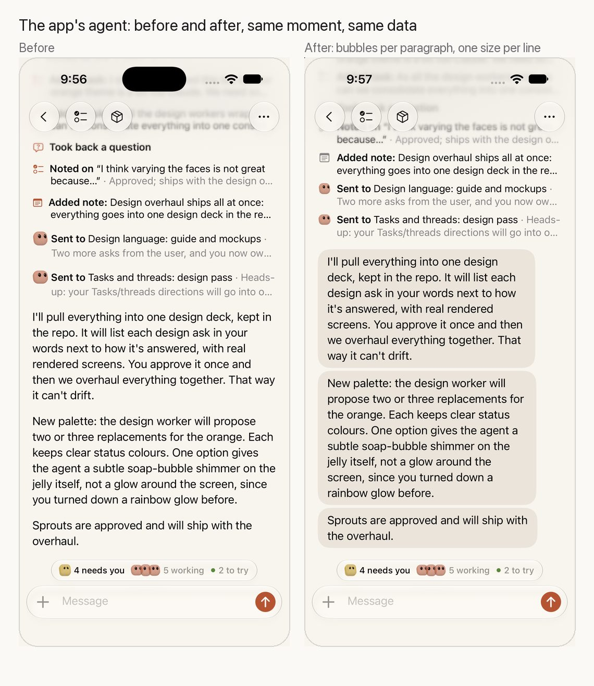

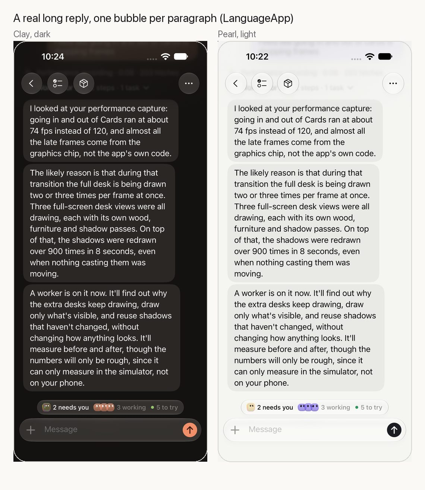

The app's agent replies like texting: each paragraph is its own received
bubble on the left, in Body. Your messages stay tinted glass on the right.
Lines (workers, Worked for…, changes, the live line) sit between them on the
glyph slot, in Line. Pictures and the build and question cards stay where
they are.

**How T3 delivers the text (measured 2026-10-31, T3 0.1.0, protocol 2).** A
reply reaches the phone as `message.updated` events, each carrying the whole
message: there are no deltas on the client stream. T3 receives
`content.delta` from its providers internally. A probe on both app agents'
threads logged 11 replies over 17 minutes. Each arrived as exactly one
`message.updated` with `streaming=false` and its full text (up to 1,448
characters over several paragraphs). In both projections, every recent
assistant message has `createdAt == updatedAt`. So for the Claude app agents,
the phone gets each reply whole and can cut it into paragraphs the moment it
arrives, without waiting for the turn to end. If a provider ever streams
(the same message updated with growing text and `streaming=true`), the same
cut works: every paragraph except the last is final once the next one
starts, and the last shows when the message completes.

**How it cuts.** It uses the Markdown parse (`Markdown.paragraphs`), not
blank lines in the raw text. Each top-level block is one bubble:

- a paragraph is a bubble;
- a whole list is one bubble, even with blank lines between its items (a
  loose list is still one list in the parse);
- a code block is one bubble, blank lines inside the fence included;
- a table stays its own row, as today (wide tables scroll sideways in the
  bubble's column);
- a heading, and a paragraph ending in a colon ("Still running:"), join the
  block after them;
- pictures still cut a message where they sit.

### Where bubbles apply

**Built (stage 2, `overhaul-chat`)**: `Markdown.paragraphs` cuts each
answer (tested: lists, code, headings and colon lines stay whole);
`ConversationText.bubbles` keeps the last paragraph back while a message
streams; the conversation lands new bubbles one at a time on the send
spring, each with `Theme.openHaptic`, the next once the last settles (one
haptic and no rise under Reduce Motion). The spacing table is
`ThreadViewController.halfGap`, applied to every row through
`TimelineCell.gap`.

**The app's agent conversation only.** Worker threads keep
today's plain full-width text. A worker's messages are working notes: long
Markdown with code, paths and tables that read better across the full width,
and chopping them into bubbles would turn a log into a wall of grey. The app
agent is the one you text with. Its replies are already a few lines
(agent-tight-replies), and that is where texting fits.

## Worked for…

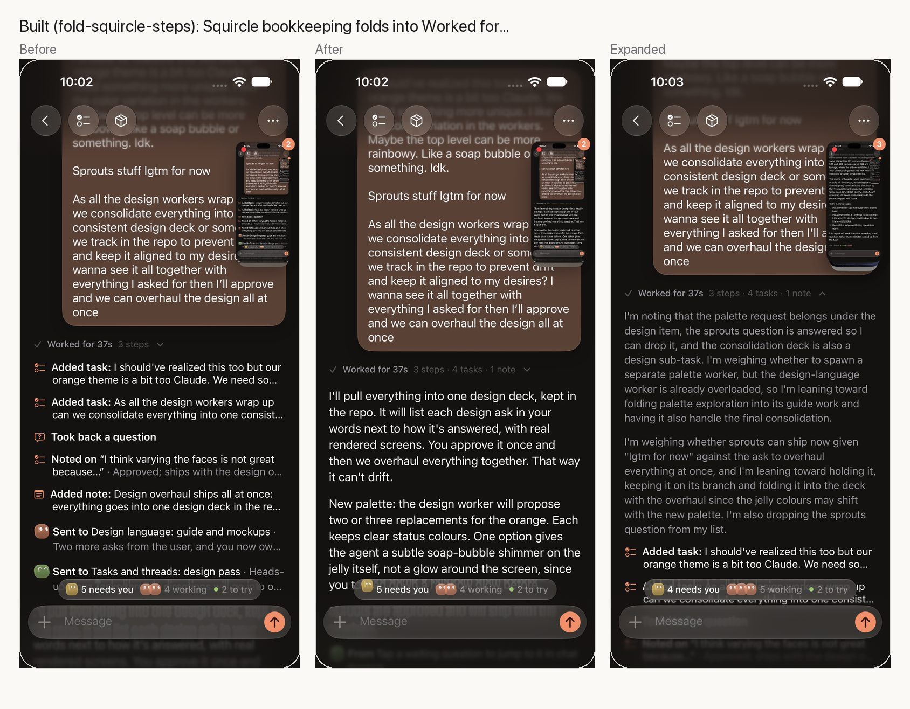

Built on main (`fold-squircle-steps`): finished turns show only results at
the top level. Squircle's own lines (tasks, notes, workers, builds,
simulators) fold into the turn's "Worked for…" line with the steps, and its
detail counts them ("3 steps · 4 tasks · 1 note"). Under this guide the
line is Line size with its check glyph in the slot, like every other line.

## The question card

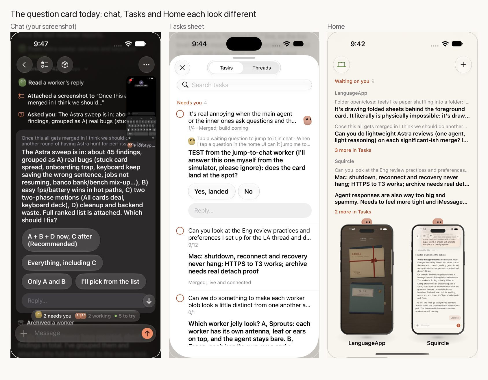

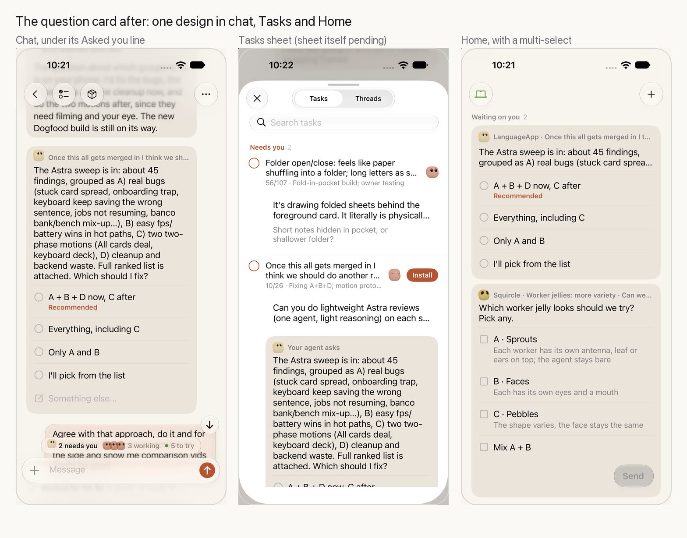

Built (stage 2): `WaitingItemView` is the card, fill included, used by the
chat's `QuestionCell`, Tasks, Home's deck and, without its fill, the
thread's `RequestCard` on glass.

One card, the same in the chat (under its "Asked you" line), in the Tasks
sheet (under its task) and on Home (`WaitingItemView`, shared):

- **It is a received bubble**: the agent is asking you something, so it uses
  the agent's bubble fill, the 18-point radius, 20 from the left edge and 56
  free on the right.
- **Who asks**, on one Caption line led by their jelly in the glyph slot:
  "LanguageApp · Once this all gets merged…" on Home and in Tasks, "Your
  agent asks" or the worker's name in the chat.
- **The question** in Body, regular weight, in full in the chat and on a
  task's page, and three lines in Tasks' Needs you (the compact card, with
  its write-in row) and on Home (tap it to open it where it was asked).
- **The answers** are a list, not a cloud of capsules. Each answer is a row:
  its mark in the glyph slot and its label in Body, wrapping as long as it
  needs to. A second line holds the option's description in Line.
  "(Recommended)" becomes a Caption tag in the accent. Hairlines separate
  the rows, and each row is at least 44 points tall.
- **Pick one**: tapping a row answers.
- **Pick several**: square marks fill in the accent, and Send (the one
  prominent glass button) sends them.
- **Something else…** is the last row: the pencil in the slot and a field in
  Body. No grey pill, and no separate Reply field.
- **What it is about** (`task ask --file`, 2026-10-31): the pictures and
  clips sit in a compact row of thumbnails under the question (120 tall in
  the chat and Tasks, scrolling sideways; on Home a 52-point strip that only
  clips, so the deck keeps its swipe), a clip with a play mark; documents are
  file lines under them (not on Home). Tapping one opens the full-screen
  viewer with the question's others a swipe away, flick to dismiss, clips
  muted.
- **Approvals** are the same card: the command in Mono under the question,
  then rows (Allow, Allow for this session, Decline).
- The thread's own request card over the field (`RequestCard`) uses the same
  layout.

## Home and Waiting on you

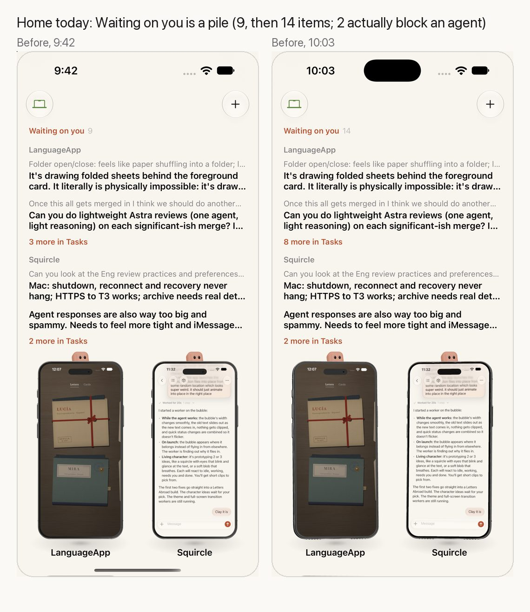

### The rule

**Waiting on you shows only what blocks an agent until you act**: open
questions in the tracker (`squircle task ask`) and threads' own questions
and approvals. Ready-to-try items, finished work, notes and task summaries
never show there. They live in the Tasks sheet (Ready to try, the needs-you
section).

Built (stage 3, `overhaul-home`): the service lists only open questions and
thread requests (`Tasks::asking`), and the client has no `.task` item. Before,
it also showed "needs-you tasks" with no question. A task set to needs
you with only a note ("Merged; live and connected", "Starts once the
question-card fix merges", or none at all) is listed as if it were a
question. They come from the service (`src/server/waiting_routes.rs:203-219`,
`kind: "task"`) and are drawn by the client (`Waiting.swift:40`,
`.task(NeedsYou)`; `WaitingItemView.swift` `case .task`). On 2026-10-31 at
10:03 they were 12 of the 14 items on Home; one of the other two was a
worker's test question. The fix drops that branch in the service and the
`.task` item in the client. In the Tasks sheet, such a task shows as a plain
row with its note, never as a question card.

### B · Deck

The heading is a Caption line ("Waiting on you 1 of 7", secondary, not
accent). Each question is the [question card](#the-question-card) with its
app's name, one at a time; swipe sideways for the next, under your finger
with native paging. Home keeps a fixed height however many wait, and the
devices stay in the same place. Answering it there is the same as answering
it anywhere. Tapping the question opens the chat at the spot (built:
tap-to-jump).

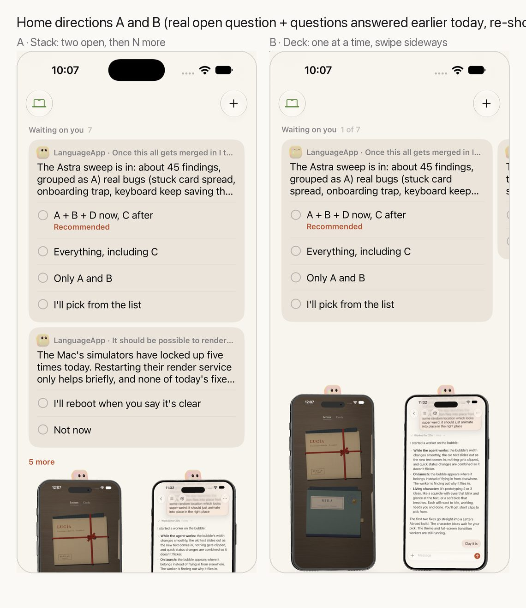

B is on the right ("Up next B seems good, don't want it getting crazy tall
and messy"). Not picked: **A · Stack** (two cards, then "N more") and **C ·
Next up** (one card, the rest as one line each).

## Pearl and the soap-film agent

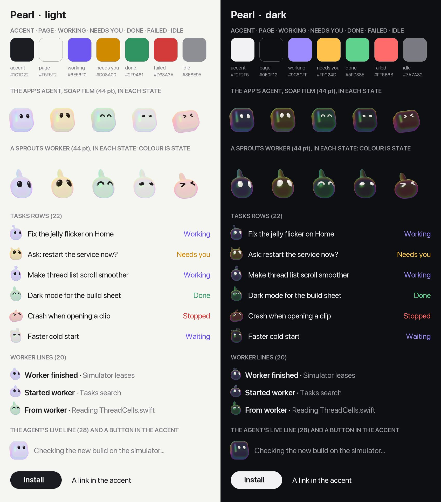

**Pearl** replaces Clay's terracotta: ink controls (near-black, near-white
in dark), a violet "working", amber, green and red. The UI is monochrome; the
only colour is state and the agent's film.

| Role | Light | Dark |
| --- | --- | --- |
| `accent` (ink) | `#1C1D22` | `#F2F2F5` |
| `onAccent` | `#FFFFFF` | `#0E0F12` |
| `paper` | `#F5F5F2` | `#0E0F12` |
| `working` | `#6E56F0` | `#9C8CFF` |
| `warning` (needs you) | `#D08A00` | `#FFC24D` |
| `success` (done) | `#2F9461` | `#5FD38E` |
| `failure` | `#D33A3A` | `#FF6B6B` |
| `idle` | `#8E8E95` | `#7A7A82` |
| `receivedFill` | `#E9E9E6` | `#1E1F24` |
| `userGlass` | `working` at 14% | `working` at 26% |

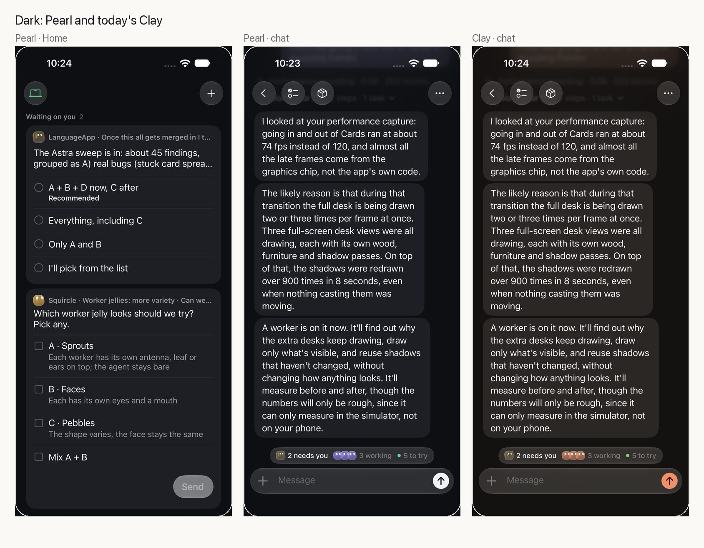

Not picked: **Lagoon** (deep teal, marigold, leaf, coral) and **Indigo**
(indigo, amber, teal-green, rose).

### The app's agent: a soap film

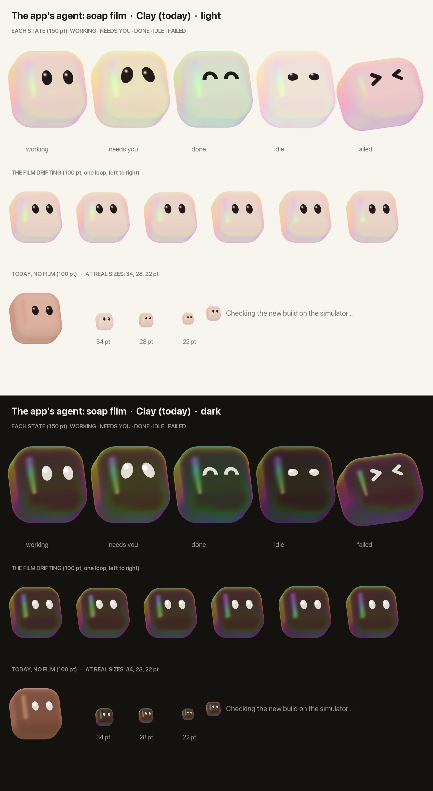

Only the app's agent has the film; workers stay their state colours (Sprouts).
It is a thin-film interference layer on the jelly's own body, in the real
Metal shader (`JellyShader.swift`):

- The body is nearly clear: the state tint drops to about half.
- The film's colours come from its thickness and the angle you see it at,
  like a real bubble. It is strongest at the rim and in the highlight, and
  faint in the middle.
- The bands drift slowly, once per mood loop. The film is thinner toward the
  top, like a bubble draining.
- Its state still reads from its faint tint and its face.
- Nothing glows outside the body, and nothing on the page is tinted: this is
  not the rainbow glow the user rejected (2026-10-05, "harsh, too
  Apple-like") or the coloured gradient glow ("AI slop").

The app icon and the Live Activity's jellies are drawn by the same shader
with the film (`Resources/JellyIcon`, `SQUIRCLE_JELLY_GLYPHS`).

## Worker jellies: Sprouts

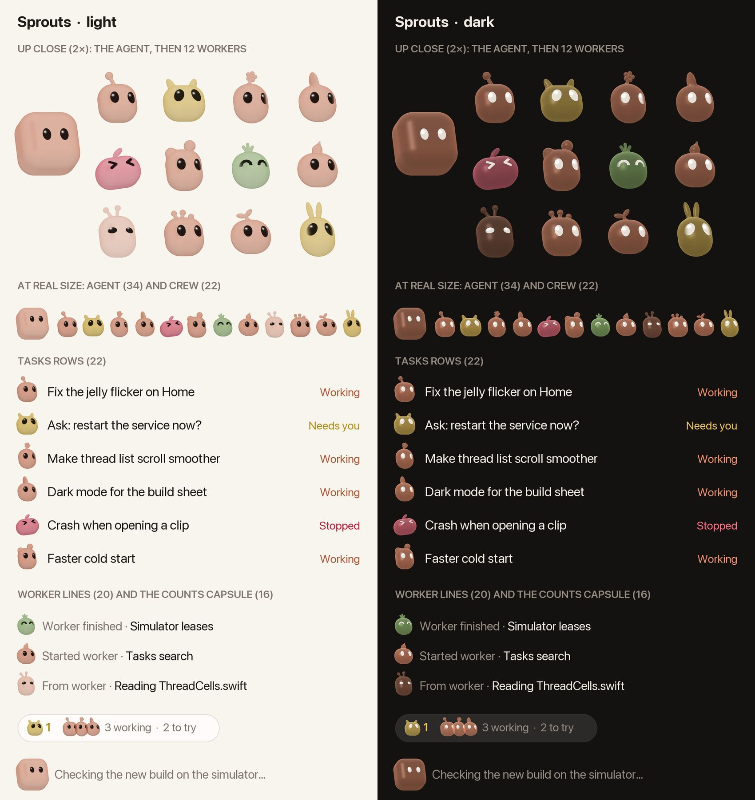

Approved by the user ("Sprouts stuff lgtm for now"), built in stage 1:

- **Who**: every worker has a sprout on top (20 kinds: antennae, leaves,
  ears and more), plus its lean, sprout size and build. The app's agent
  stays the bare cube, and with the film it is clearly not a worker.
- **Looks are dealt in order**: each newly seen worker gets the next look,
  and twenty in a row all have different sprouts. The look is kept on the
  phone, so a worker stays the same jelly everywhere.
- **The face shows status**, the same on every jelly: working, needs you,
  done, idle, failed (`> <`). Colour is state.
- The sprout grows into the room its row keeps above the body (the
  tallest, a stalk, reaches half the body's height), never past the row.
- **Laid out by the body** (user, 2026-10-31: "don't allow the antenna
  things to offset them"): every worker's body bottom sits on one baseline
  whatever its build (squat, square, tall), the sprout only grows up into
  the room above, and the body square is centred on the cap-height centre of
  the text beside it, never on the text's frame (`JellyBody`,
  `UILabel.centred(on:)`).

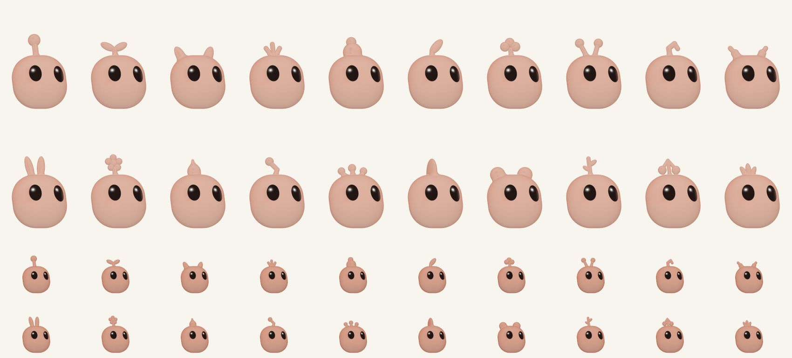

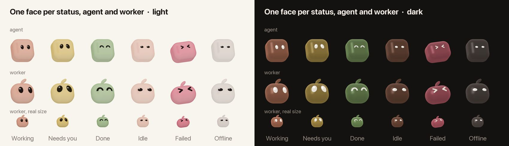

## Tasks and threads

**A · Outline** ("I think the task list A seems best, others too
cluttered"). From the Tasks and threads design pass
([tasks-and-threads.md](tasks-and-threads.md); renders from its DEBUG
prototype on real LanguageApp and Squircle data). The user asked: "We need
to see each task clearly up front with live status. When I drill into each I
want to see the active threads and what they're doing with a small preview,
then be able to jump into any one. If there's only one thread just show it
directly inside the task UI. Shouldn't need a separate thread UI … threads
are clearly visible and part of the task list."

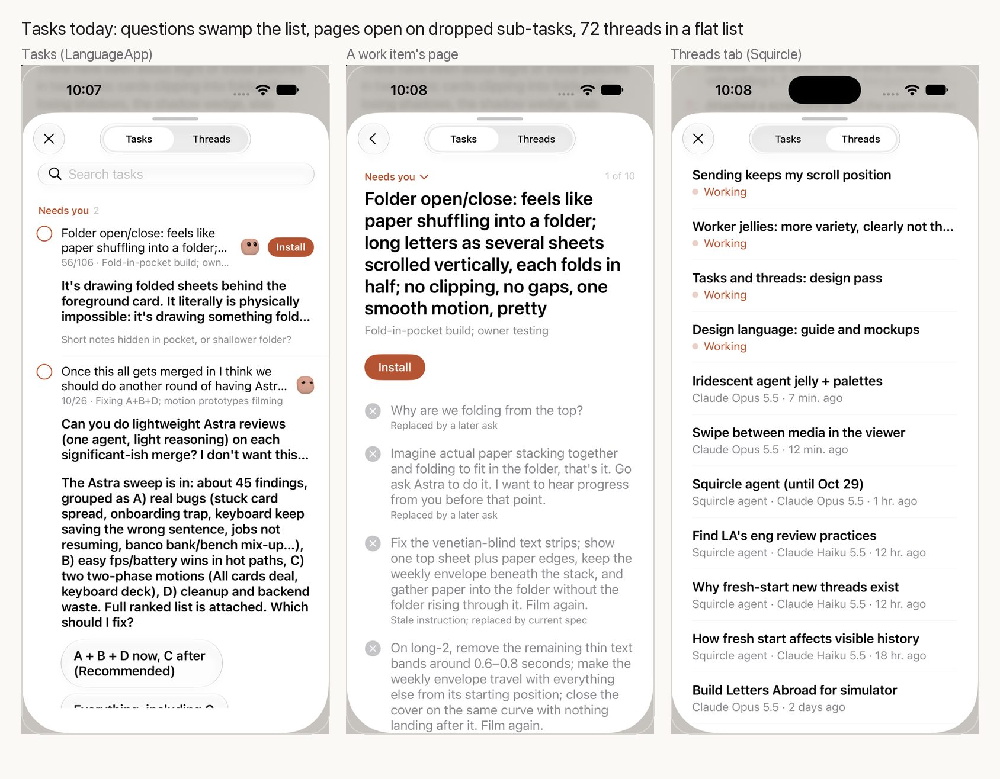

- **App, then work items, then sub-tasks, then threads.** A thread sits
  under the task it was spawned for.
- **No Threads tab.** Tasks becomes a flat push from the agent (edge swipe
  back) instead of a sheet, so a thread with its own field and keyboard
  never fights a sheet's drag.
- **Live and earlier threads.** Live threads show, sorted needs you, then
  working, then stopped, then finished. Archived threads fold into one
  "Earlier threads N" line, never chips.
- **What each thread is doing**, in one line: its question, its live step
  (the same sentence as its live line), the first line of its last reply,
  or "Stopped with an error". To build: the service adds `step` and `said`
  to each linked thread in `GET /v1/tasks`.
- **A work item with one live thread is that thread**: a short header over
  its conversation.
- **Jumping into a thread stays in the hierarchy**: back returns to the
  task, not the agent.
- **Threads on no task**: working ones show at the foot; idle ones fold
  into "Not on a task N". History stays a folded line at the foot.
- **Questions sit under their task** as the
  [question card](#the-question-card), compact in the overview. Needs you
  holds only work items with something to answer there (2026-10-31: needs
  you is derived from open questions and approvals, never set; see
  [tasks](../task-tracking.md#needs-you-is-derived-never-set-2026-10-31-user-decision)).
- **In progress next** (2026-10-31, user: "working tasks with live threads
  should sort to top"): after Needs you, the work items whose linked thread
  or build is running right now, their threads nested under them; in
  progress is derived from that, never set (see
  [tasks](../task-tracking.md#in-progress-is-derived-never-set-2026-10-31-user-decision)).
  Then Ready to try, Queued, Done, History.
- **Newest first in every group** (2026-11-01, user: "Can we sort recent
  tasks to top not bottom it's confusing"): rows, sub-tasks and the pages'
  swipe order go by each task's latest activity, most recent on top (see
  [tasks](../task-tracking.md#newest-first-2026-11-01-user-decision)).
- **Row swipe actions** (2026-10-31, user: "lol what is this illegible",
  a white Top pill with white text): swipe left for Drop and Done, each its
  glyph in Body over its label in Caption, in `onAccent` on `failure` and
  `success`, so both read in light and dark. No leading swipe; the
  long-press menu sets a status (Move to Top went with newest first,
  2026-11-01).

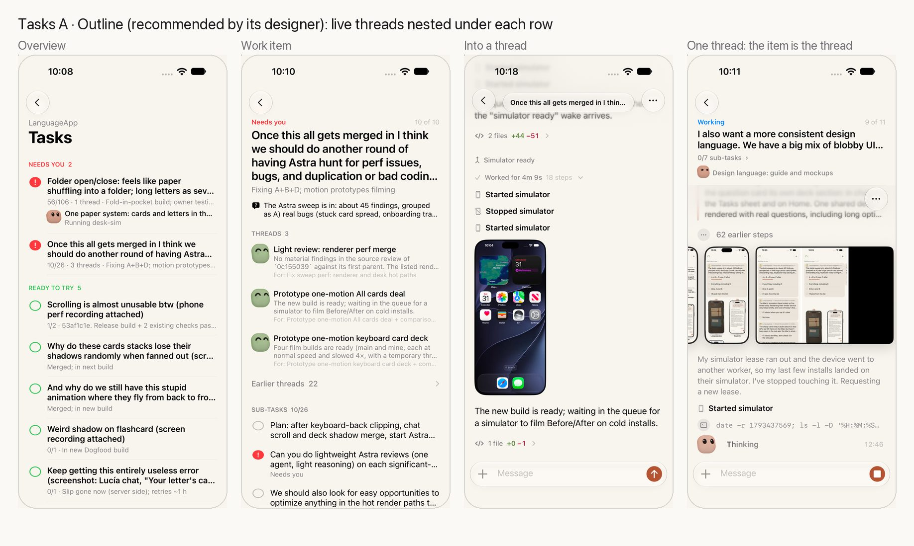

- **The overview**: each row carries its live threads nested underneath: a
  Sprout, the title, what it is doing, a row thumbnail.
- **A work item's page** lists threads first, then the open sub-tasks, with
  closed ones folded.

**Built to this deck** (the prototype predates it and uses neutral system
colours and its own sizes):

- **Type**: a row's title is Body 17 (not 16 semibold); a row's second line
  and thread lines are Line 15, with the thread's title in Line strong;
  section labels are Caption 13 in secondary (not 12 in state colours). A
  page's heading is the agent-written title in Title 22, with the user's
  words quoted beneath it in Body 17 secondary (2026-10-31, user-requested;
  a task with no title yet shows its ask as the heading and no quote; see
  [titles](../task-tracking.md#titles-2026-10-31-user-decision)).
- **Status**: [status symbols](#glyphs-and-jellies) in the 20-point slot,
  replacing the filled red, green and blue discs. Threads show their Sprout
  in the same slot (not 16 to 24-point sprouts).
- **Nesting**: as in [Glyphs](#glyphs-and-jellies). Thread lines hang at x =
  48 under the ask, with row thumbnails at 24 × 52 and page thumbnails at 56
  × 120.
- **Colour**: Pearl's `working`, `warning`, `success` and `failure` roles,
  on paper. The Tasks screen is no longer a white sheet.
- **Folded lines**: "Earlier threads", "History" and "Not on a task" use
  the folded-line row.

Not picked: **B · Tiles** (each thread a portrait tile; most threads have no
picture) and **C · Checklist** (one line per item, hiding how many threads
it has).

## Media and sending

- **Sending keeps your place** (built on main): sending from above the end
  leaves you where you are, your bubble lands below, and the jump button
  shows in the accent until you go down.
- **Sending is one motion** (built on `send-anim`, filmed frame by frame
  2026-10-31 in the simulator): your bubble is placed every frame on its
  own row plus what is left of one spring from where you typed, so the
  conversation following its end (its scroll spring retargeting when the
  live line or a reply arrives), a long message's field folding to one line
  and rows taking new room never move it off its row; it lands exactly
  there, with no second scroll. DEBUG `SQUIRCLE_SEND_FILM=1` (with
  `SQUIRCLE_APP`) re-films every case with a per-frame trace, sending nothing.
- **Swipe between media** (built on main): in the viewer,
  pictures and clips of the conversation page sideways under your finger,
  natively, with one spring and no crossfade.
- Inline media drops its card frame: pictures sit on the page at the
  bubbles' 18-point radius, with 8 points between them.
- **Reserved frames** (user: "When I'm scrolling and medias loading in it
  pops and changes scroll position"): a picture's frame is decided when its
  row first shows and never changes after, so nothing in the conversation
  moves when bytes arrive, scrolling up through history or at the end. The
  size comes from the Mac with the message (`POST
  /v1/t3/threads/{thread}/files` reads each linked picture's and clip's
  header) and is kept on the phone, so a conversation reopens with every
  frame known. A new picture waits until the Mac answers, then arrives at
  its size; one the Mac couldn't measure takes a 16:10 frame (a phone
  screen's in a gallery) that its picture fills.
- **Documents** (user: "Inline file attachments need proper design"): one
  family with the bubbles and pictures: a received fill at 18, at most 300
  wide. A PDF shows its first page across the top (160 tall, the page's top
  showing), then its name in Line strong and "PDF · 27 pages · 6.4 MB" in
  Line, secondary. A text, Markdown, JSON, CSV or log file leads with a
  40 × 48 tile naming its type ("MD", "JSON") in mono, at the small radius.
  The height is set by the kind alone, so the row never grows as the file
  arrives. Inside a question card the fill is the page's.
- **Build card and Builds rows** (user: "Tiny icon on left here is super
  ugly"): the built app's own icon as iOS shows it, a 36-point tile with
  iOS's corner, read from the build (or, for a build without a product yet,
  the app's newest build). An app without one gets Home's blurred
  placeholder, never a glyph. State is the words, not a badge: ready is
  Install; building shimmers its status word; failed gives the reason in
  the failure colour.

  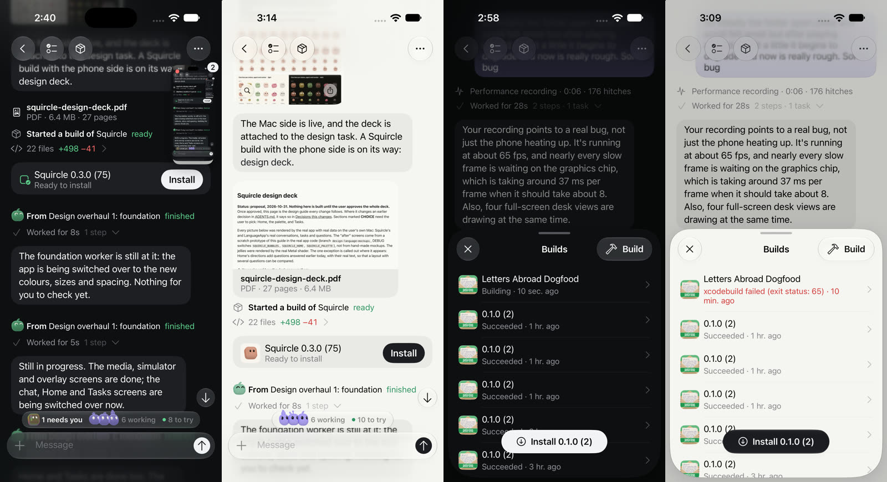

## In code

`Theme` (`app/Squircle/Sources/UI/Theme.swift`) is the only place these
values are written; the app and the overlay share it. Nothing else names a
font size, colour or radius.

| Deck | `Theme` |
| --- | --- |
| Title, Body, Body strong, Line, Line strong, Caption, Mono | `Theme.Text.title`, `.body`, `.bodyStrong`, `.line`, `.lineStrong`, `.caption`, `.mono` (`.monoStrong` for a leading figure in a mono line) |
| A symbol in a line's size and weight | `Theme.symbol(font)` |
| 4, 8, 12, 16, 20, 24 | `Theme.Space.tight`, `.row`, `.rowPad`, `.group`, `.margin`, `.section` |
| Glyph slot, its gap, text at 48, one nesting level | `Theme.Space.glyph`, `.glyphGap`, `.text`, `.indent` |
| A built app's icon | `Theme.Space.appIcon` |
| Bubble and card padding, a bubble's free side, 44 | `Theme.Space.bubble`, `.card`, `.bubbleFree`, `.tap` |
| Jellies at 16, 11, 28, 26 (the room each needs past its row: `JellyBody.room`) | `Theme.Glyph.line`, `.caption`, `.live`, `.home` |
| Radii 8, 18, capsule | `Theme.Radius.small`, `.large`, `cornerStyle = .capsule` |
| Colour roles | `Theme.accent`, `.onAccent`, `.paper`, `.working`, `.warning`, `.success`, `.failure`, `.idle`, `.receivedFill`, `.userGlass`, `.codeFill`, `.pressedFill` |

The Live Activity runs in its own extension and repeats Pearl's values
(`Widgets/SquircleWidgets.swift`).

## Decisions this changes

Each of these supersedes an entry in [AGENTS.md](../../AGENTS.md):

1. **Design A (2026-10-13)**: "conversations read like plain chat … your
   messages keep tinted glass bubbles". The app agent's replies become
   received bubbles, one per paragraph, with a haptic. Worker threads stay
   plain chat.
2. **Clay (2026-10-14)**: terracotta on cream is replaced by Pearl.
3. **Jelly crew (2026-10-15)**: "the app's agent is the plain full jelly".
   It gets the soap film. In its live line it is 28 points, not 34–40.
   Workers become Sprouts (approved).
4. **Waiting on you (2026-10-26)**: "everything waiting on the user shows …
   everything across apps in a plain list". Only blocking questions and
   approvals show, one at a time (B · Deck).
5. **Answers as glass buttons** (the shared question card): answers become
   rows inside the card. Glass is kept for Send.
6. **Status words at 13 points inside 15-point lines**: one size per line.
7. **Step wells and rails**: removed; steps use the glyph slot.
8. **Tasks (2026-10-14, 2026-10-24)**: the Tasks sheet with its Tasks |
   Threads switch becomes a pushed Tasks screen with threads nested under
   their tasks (A · Outline). A work item with one live thread shows that
   thread.

## Audit: what was wrong

The state before this overhaul, kept as the reasons for the rules. Captured 2026-10-31 from the running app (`main` at d3a55c1/4c11d89) with
real data.

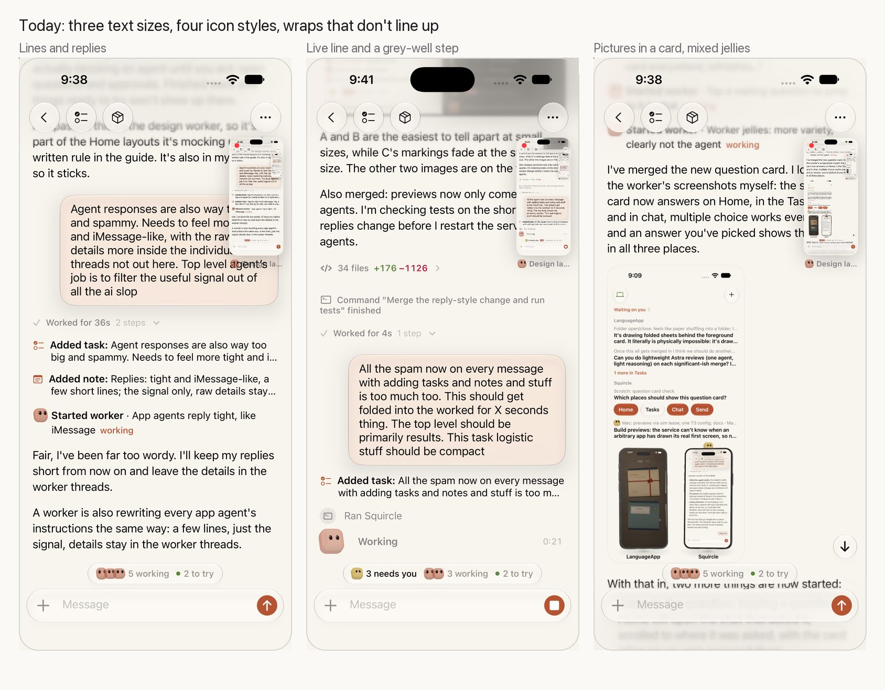

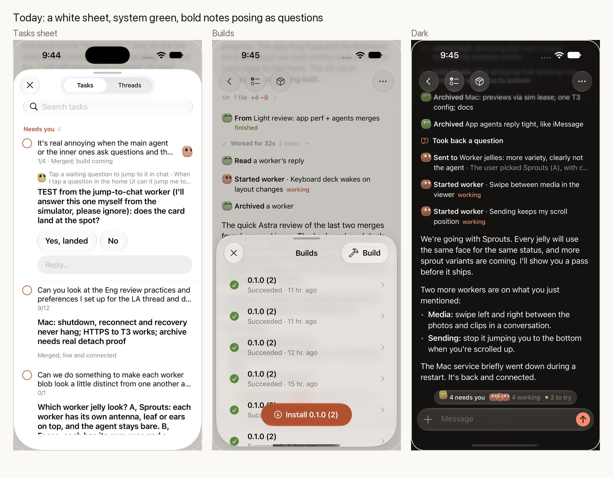

**Type: 18 size and weight pairs** (`Theme.font` calls, plus direct
`UIFont`):

| Size | Weights | Where (file:line, `Sources/UI/` unless noted) |
| --- | --- | --- |
| 28 | bold | ThreadViewController.swift:380 ("What's next?") |
| 24 | bold, semibold | ThreadCells.swift:119 (thread header), BuildDetailViewController.swift:18, TasksViewController.swift:1132 (task page ask) |
| 17 | regular, medium, semibold | ConversationText.swift:18,22 (your words, answers), WaitingItemView.swift:117 (question, **semibold**), Theme.swift:71 (buttons), BuildDetailViewController.swift:196–217, ThreadDetail.swift:31, ThreadsViewController.swift:17 |
| 16 | regular | TasksViewController.swift:934 (Tasks row ask), RequestCard.swift:160, WaitingItemView.swift:147 (reply fields) |
| 15 | regular, medium, semibold | ConversationText.swift:20,70,101,131,193 (notes, worker lines), ThreadCells.swift:306,326 (steps), :885 (build title), :1146 (live line, semibold), Theme.swift:42 (app names), TasksViewController.swift:1058,1133,1442 |
| 13 | regular, medium, semibold | ConversationText.swift:24 (update lines), :72 (agent label), :165 (status words, **13 inside 15-point lines**), ThreadCells.swift:840 (changes), :973–974 (Worked for…), :850,1162 (mono digits), WaitingItemView.swift:115,118,405–423, TasksViewController.swift:844–845,935,959,1274,1384,1448,1491,1592 |
| 12.5 | regular mono | ThreadDetail.swift:72, RequestCard.swift:17,96, WaitingItemView.swift:221 |
| 12 | semibold, mono | RequestCard.swift:135, ThreadCells.swift:272 (step +/−), DiffViewer.swift:84,266, BuildDetailViewController.swift:266 |
| 11 | bold, semibold, mono | SimulatorViews.swift:279,629, BuildDetailViewController.swift:382 |
| 10.5 | mono | DiffViewer.swift:209 |

**Spacing in the conversation**: the left edge of the text varies by row.

| Row | Text starts at | Vertical | Source |
| --- | --- | --- | --- |
| Your bubble | right edge 20 (bubble), text 35 | 14 top, 8 bottom, 10 inside | ThreadCells.swift:186–207, 238, 251 |
| Answer | 20 | 10 top, 8 bottom | ThreadCells.swift:191, 251 |
| Agent's message | 34 (rule at 20) | 14 top | ThreadCells.swift:191, 208 |
| Worker and Squircle lines | 20 plus the attachment: 46–58, wraps at 47 | 6 top, 4 paragraph | ConversationText.swift:168–187 (`lead = 27` against symbols of varying width) |
| Step | 56 (24-point well at 20, 12 gap) | 8 / 8 | ThreadCells.swift:285–295 |
| Worked for… | 20 + 6, icon 11 points | 8 + 2 / 8 + 2 | ThreadCells.swift:994–1001 |
| Changes | 20, icon 11 points | 4 / 8, fixed 34 tall | ThreadCells.swift:859–863 |
| Build card | card at 14, content at 28 | 6 / 10 | ThreadCells.swift:931–938 |
| Live line | jelly 34 at 20, text at 72 | 4 / 6 | ThreadCells.swift:1081–1104 |
| Question card | card at 14, text at 30 | 6 / 10, padding 14 / 16 | ThreadCells.swift (main) 970–990 |
| Gallery | 20, or 56 under a step | 6 / 14 | ThreadCells.swift:400–435 |

**Glyphs: five styles in one conversation**: SF Symbol text attachments at
13 medium (update lines); the same at 15 with fixed-width spaces (worker and
Squircle lines); 11-point semibold symbols in grey 24-point wells on a rail
(steps, ThreadCells.swift:262–268); 20-point jelly stills inline
(ConversationText.swift:171); a live 34-point jelly (the live line).
Elsewhere: 11-point bold symbols (changes, Worked for…), a 20-point medium
symbol in the build card, filled system-green check circles (Builds), and an
18-point jelly in the question card.

**Corner radii: 20 values**: 1, 2, 2.5, 3, 3.5, 4, 4.5, 8, 9, 12, 13, 14, 15,
16, 18, 20, 21, 22, 24, 26 and 30 (the bubble is 21, cards 18 and 22, fields
20 and 24, the update curtain 30).

**Surfaces**: the Tasks sheet is white, not paper. Question and build cards
use `tertiarySystemFill` (a cool grey on warm paper). The Builds list uses
system green. Pictures in the chat sit inside a framed card.

**Waiting on you**: see [the rule](#the-rule): 12 of 14 items were notes,
not questions.
