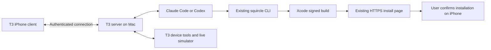

# Direct coding agents and live simulator plan

Research date: **2026-10-05**. The stock-client trial below led to the user's
accepted [fresh native client migration](t3-native-migration.md); follow that for
new work. Runtime implementation is pending.
This supersedes the earlier requirement that phone coding conversations go through
Hermes. The current Hermes client remains the installed implementation until a
replacement passes the checks below. No software or network configuration was
installed or changed during this research.

## Recommendation

Try **stock T3 Code as the complete agent client/server**, retaining Squircle's
agent-neutral build/install/diagnostic CLI. Start with T3's own iPhone client;
avoid implementing another native chat transport before assessing the existing UI.
Hermes can remain independently available but has no role in the proposed path.

The goal is picking an agent, watching its work and simulator, trying the app,
then installing the finished build. General-assistant identity and scheduling
are no longer requirements for this experience.

## Evidence and limits

| Requirement | Reuse and evidence | Remaining check |
| --- | --- | --- |
| Pick coding agent | T3 documents Claude/Codex provider configuration and existing CLI logins. [Released setup](https://github.com/pingdotgg/t3code/blob/v0.0.45/docs/user/install.md) | Exercise selection on iPhone; use a new thread for each provider initially. Do not assume cross-provider conversation transfer. |
| Live activity | T3 exposes tool details and provider adapters. [Thread inspection](https://github.com/pingdotgg/t3code/blob/v0.0.45/docs/user/thread-sidebar.md), [provider boundaries](https://github.com/pingdotgg/t3code/blob/v0.0.45/docs/internals/providers.md) | Test commands, long-running output, edits, approvals, questions, stop, reconnect and subagent visibility separately for both agents. Hidden model reasoning is not promised. |
| Live simulator and remote input | Stable v0.0.45 documents Device preview, mobile viewing/control and remote streaming. [Device guide](https://github.com/pingdotgg/t3code/blob/v0.0.45/docs/user/devices.md) | Test real phone/cellular video, tapping, scrolling, drag, keyboard, rotation and pinch. Measure latency and sustained bandwidth. |
| Preview alongside chat | Web/desktop document floating previews. Stable mobile source uses a separate modal route. [Released mobile source](https://github.com/pingdotgg/t3code/blob/v0.0.45/apps/mobile/src/features/devices/DevicePreviewRouteScreen.tsx) | Simultaneous chat and preview on iPhone, automatic idle blur and reliable agent-ownership indicators are not established. |
| Agent tests same visible app | T3 reuses expo-device-hub for streaming and agent-device for automation. [Device internals](https://github.com/pingdotgg/t3code/blob/main/docs/internals/devices.md) | Pin one simulator UDID per active task; prove agent and viewer use it. Check compatibility with this Mac's Xcode version. |
| Finished phone build | Keep Squircle's signed archive/export and installation-link flow. [Existing workflow](remote-ios.md) | Verify a fresh end-to-end T3 task produces a link that opens on iPhone and a separately identifiable launch acknowledgement. |

As researched, stable is **v0.0.45**; newer **0.0.46 nightlies** exist. The
October 4 full-screen mobile controls change is newer than that stable release.
Start on stable; only use a pinned nightly and matching TestFlight client for a
specific missing capability. Main-branch installation docs explicitly say store
clients cannot connect to nightly servers. [Stable release](https://github.com/pingdotgg/t3code/releases/tag/v0.0.45),
[mobile controls change](https://github.com/pingdotgg/t3code/pull/15551),
[beta installation](https://github.com/pingdotgg/t3code/blob/main/docs/user/install.md).

## Execution sequence

1. **Prove stock T3 before replacing the client.** Run a disposable T3 environment
   against a test checkout, connect its iPhone app using the existing private
   network, and record server/client/provider versions. Configure Codex's binary
   as `/Users/anshu/.local/bin/codex`. Verify ChatGPT and Claude Max logins in the
   actual server context and check inherited API-key overrides. Keep existing
   services and routes intact; use a separate endpoint for the trial.
2. **Run one complete task per provider.** Make a visible UI change, build and
   launch in one explicit simulator, and have the agent test it while the phone
   watches. Trigger an approval and a question, steer or stop the task, disconnect
   and reconnect the phone, and inspect failures. Accept only activity that appears
   before task completion; a final summary is insufficient.
3. **Test human interaction.** Pause agent work before taking over the simulator,
   then return control explicitly. Do not infer an exclusive input lock from the
   existence of a viewer. Check gestures on the actual phone. One active task per
   simulator initially; allocate distinct simulators if concurrency is later needed.
4. **Complete phone delivery.** Give both providers concise project instructions
   for existing `squircle` help/build/wait/install-link commands. On success, the
   agent posts the HTTPS installation page in chat. The user confirms installation
   and opens the app; distinguish a successful build, an offered link, and actual
   launch observation. Use current project signing; don't introduce TestFlight
   distribution or a new build service unless the existing path fails.
5. **Decide whether any UI work remains.** If stock T3 meets the experience, use it
   and maintain only the iOS tooling. If the iPhone layout is the sole gap, scope
   one upstream/mobile UI change: a compact preview with expansion, an idle frame
   treatment, and explicit human takeover. Derive state from known device/tool
   activity; a static screen does not prove inactivity. This requires implementation
   and real-device testing, not a new agent backend.

Proposed acceptance targets: all exposed commands/edits/requests are inspectable;
active simulator work is continuously watchable over cellular; touch feels usable
(aim for under 250 ms input-to-visible response and at least 20 fps during motion,
measured rather than assumed); reconnect restores the same task/device; either
provider can finish with a signed build installable on this phone.

## Fallbacks

- **Tapflow** if T3's device path fails the measured stream/control checks. It is
  self-hosted, documents H.264 streaming and touch/swipe/pinch, and offers API/MCP
  access. It adds a relay/agent/dashboard and would need its session linked to T3;
  same-pane integration is not established. [Tapflow](https://github.com/jo-duchan/tapflow).
- **Paseo** if T3's agent integration is the actual blocker. Its daemon and SDK
  already supply provider sessions and streaming. Adopting it would still leave
  simulator UI composition to solve. [Paseo SDK](https://paseo.sh/docs/sdk).
- **serve-sim** is an existing reusable simulator streamer, not something to
  recreate. Prefer T3's managed device path. Its internal documentation explains
  why raw helper endpoints stay on loopback behind an authenticated allowlist.
  [serve-sim](https://github.com/EvanBacon/serve-sim),
  [T3 proxy boundary](https://github.com/pingdotgg/t3code/blob/main/docs/internals/devices.md).

## Live trial: simulator input, 2026-10-05

Installed T3 desktop **0.0.45**, managed expo-device-hub **0.12.0**, Xcode
**27.1 (27A9269)**, Cards-Verify simulator on iOS **27.0**, UDID
`C800634B-1469-491D-9477-9BF9A883EEF7`.

- User reports live images and a working Home button on the native iPhone client,
  but no response to screen touches. The same failure was reproduced in T3's Mac
  preview in both flat and 3D modes; helper event logs received the tap coordinates.
- Restarting the simulator did not restore touch. The user also reports that a
  T3 restart did not help, while Apple's own simulator window responds to clicks.
- A read-only guest check returned
  `com.apple.coredevice.dtuhidd.active 1`. Upstream identifies this state as
  Device Hub disconnecting legacy input, which is the installed helper's
  non-foldable touch path. Its [explicit repair](https://github.com/EvanBacon/serve-sim/blob/main/packages/serve-sim/src/device-hub-input.ts)
  clears that notification state and restarts backboardd; it closes running
  simulator apps.
- With explicit user approval, the repair cleared the notification flag to `0`
  and restarted backboardd. The user subsequently confirmed that input works.
  Phone gesture coverage and prevention of another Device Hub takeover remain
  unverified; the first immediate automated Mac click after repair did not show
  an app transition, so the successful recovery is user-reported.

These observations establish a repairable input conflict, not a passing
remote-control milestone. The user reports the T3 preview lags behind Apple's
simulator. Cellular performance, gesture coverage, and complete phone build
delivery through T3 remain unverified.
