# Squircle as explicit state machines

Design proposal, 2026-10-15. Source baseline: `7e813c2302f094ede5fd83d62a8a45280410f0ed` on `fsm-architecture`. **Documentation only; none of the proposed machines below was implemented or run for this pass.** Step 0 (contracts, C00, M17 tasks), step 1 (Rust command identity, M16 outbox, M26 upkeep), step 2 (M14 agent lifecycle, M15 worker bootstrap and archive) step 3 (M18–M20 simulator admission, sessions and pool) and the first phone slice of step 4 (M01, M03, M04) have since been implemented; see the records under §8. File/line references are at that commit, relative to the repository root. Later implementation must refresh them.

Read first: [architecture](architecture.md), [first review](code-review-2026-10.md), [second review](code-review-2026-10-b.md). Their status sections matter: most behavioral findings have fixes in source already. “Retires” below means completing the ownership boundary and preserving its regression coverage, not asserting that every original bug still exists. This pass traces source, not phone, APNs, simulator, handover or performance behavior.

## 1. Decision and scope

Use small **extended state machines**: finite control states with typed IDs, immutable snapshots and per-state payloads. Each has a synchronous, pure `reduce(state, event) -> (state, effects)` function. Effects are values; a thin runtime executes them and returns addressed result events. Native scrolling and spring integration remain continuous numerical state, not enumerated animation frames. There is no global application FSM and no cross-product enum of every subsystem.

Keep the good work already present: `ConversationID`, `Transcript`, `Route`, `Mounted`, `ConnectionPhase`, `Lifecycle`, `Stage`, `Observed`, `JobPhase`, `DeviceLease`, `CaptureSession.State`, `Ticker`, the jobs index, the task commit boundary and process-group ownership. The main change is to put **all decisions** for each owner behind its reducer, rather than keep an enum beside async functions that also mutate its fields.

T3 remains the authority for execution, projects, threads, approvals and device sessions. Squircle owns intents, receipts, artifacts and delivery obligations. SQLite enrichment stays read-only, with no new transcript index, model runner or agent backend. The plugin emits commands/context; it does not become an execution scheduler. Product choices in AGENTS.md remain unchanged.

### Machine catalogue and composition

| ID | Owner / machine | Key and authority |
| --- | --- | --- |
| C00 | Durable commit gate | One per durable aggregate; committed revision and owed persistence |
| M01 | T3 connection and subscriptions | One per client; connection epoch, subscription readiness, RPC outcomes |
| M02 | Thread replica and transcript | Thread ID; sequenced replica, enrichment revisions and matching renders |
| M03 | Message delivery | Conversation + message ID; immutable destination/content and delivery intent |
| M04 | Addressed command | Command ID; approval, answer, interrupt, preference or task-edit intent |
| M05 | Resource refresh | Resource key; leases, freshness, one fetch and explicit failure |
| M06 | Media transfer and file retention | Attachment/content ID; upload/download receipt and file leases |
| M07 | Phone navigation | One scene; route, gesture and continuously presented geometry |
| M08 | Overlay scene ownership | Host process; one attached scene lease |
| M09 | Overlay panel | Scene lease; route, resizing regime, mounts and capture flight |
| M10 | Capture producer | Capture ID; screen/performance producer and destination |
| M11 | Jelly scheduling | Renderer/scene; hero cadence and at most four small loops |
| M12 | Simulator presentation and feed demand | Host + session/target; dock route, visibility and consumers |
| M13 | Device channel | Target + generation; H.264 video/input lifetime and gesture queue |
| M14 | App-agent lifecycle | Project; creation, restart and fresh replacement journal |
| M15 | Worker lifecycle | Worker thread; bootstrap and stop/remove/archive journal |
| M16 | Delivery outbox | Destination + event ID; worker/build/simulator wakes and alert obligations |
| M17 | Task lifecycle | Task; explicit status, linked observations, placement and revision |
| M18 | Simulator admission | Pool; FIFO waiters, grants and reservations |
| M19 | Simulator session | Session; recorder, filing, device-close and release obligations |
| M20 | Simulator pool policy | Device; provenance and freshly justified shutdown/deletion |
| M21 | Build job | Job; recipe/artifact phase and execution lease |
| M22 | Preview/catalog publication | App/build; validated real capture, immutable artifact and catalog revision |
| M23 | Install attempt and evidence | Ticket/attempt; transfer evidence, phone watch and launch report |
| M24 | Push/Live Activity | App desired state; per-device activity delivery |
| M25 | Phone registration and presence | Device/scene; token generation, presence lease and activity reports |
| M26 | Idle upkeep | Agent + context reading; eligibility, compact/fresh intent and outcome |
| M27 | Service lifecycle and handover | Data-directory lock generation; admission, drain and adoption |
| M28 | Helper process | Operation; process-group, output and reap ownership |

These are 28 domain machine **families**, plus a shared commit gate. Several explicitly orthogonal child regions have their own tables below; they are not extra independent authorities. Use separate enum types for their events, even when the owning runtime hosts several reducers.

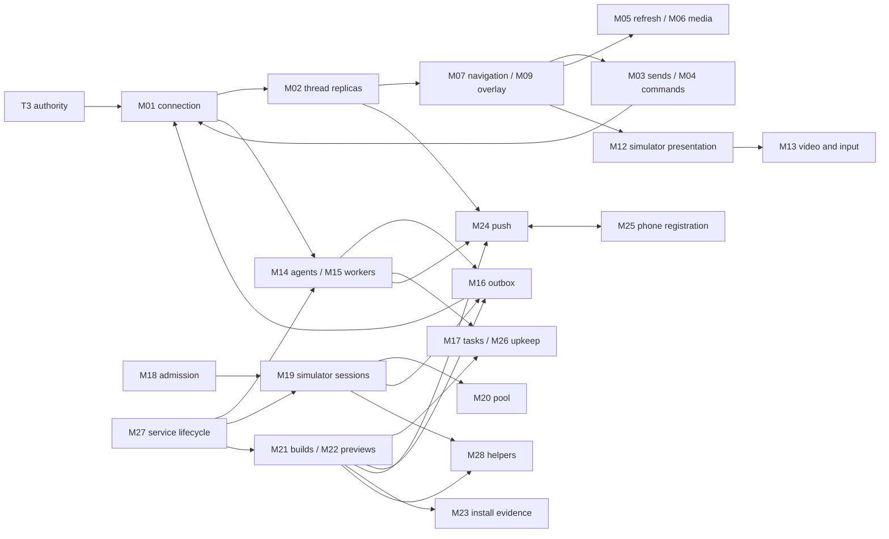

An arrow is an immutable event or an effect request, never permission to mutate another owner's state. Every durable owner uses C00. Runtime resource handles live in one nonserializable table keyed by typed lease IDs; reducers carry the IDs and ownership phase, not `Task`, socket, `Child`, UIKit view or recorder objects.

## 2. Current architecture map

Inputs here are the current semantic input classes, including lifecycle, completion and clock events. Low-level wire variants are decoded at adapters; the proposed event enums below define their total normalized contract. This is not a claim that stock T3's entire evolving wire schema has been formally enumerated.

| Owner and source of state today | Implicit/current transitions and inputs | Side effects and remaining concentration of logic |
| --- | --- | --- |
| **M01 phone:** `app/Squircle/Sources/SquircleModel.swift:76`, `:283`, `:587`, `:648`, `:721`, `:949`; socket/maps in `app/Squircle/Sources/T3Gateway.swift:218`, `:260`, `:341`, `:388`. **Rust:** `src/t3.rs:132`, `:208`, `:302`; shell `Link`/epoch in `src/agents.rs:699`, `:967`, `:1017`. | Configure → connecting → ready; refusal, network change, foreground/background expiry, probe/ping/pong, subscribe Chunk/Exit, thread selection, manual reconnect and close. Rust adds call/snapshot deadlines and healthy-session backoff. “Ready socket” and “current replica” are different facts. | Opens/closes paired HTTP/WS sessions, subscriptions, continuations and timers. Phone retry delay, `connector`, `nap`, `retryNow` and instability counters surround the enum. Rust overwrites command identity in `src/t3.rs:276` and discards subscription Exit cause at `:397`. |
| **M02:** `app/Squircle/Sources/T3ThreadState.swift:4`, `:40`; `app/Squircle/Sources/SquircleModel.swift:897`, `:1080`, `:1133`, `:1485`, `:2139`; rows in `app/Squircle/Sources/UI/ThreadTimeline.swift:111`. | Cache load → cached → live snapshot/replay; message delta, session/activity/checkpoint/meta/runtime-mode/revert events; synchronized marker; details/media result; open/leave; memory pressure; render and disk-write completion. | Derives rows, requests, changes and optimistic overlays; reads/writes bounded caches. Transcript now pairs its own state/rows, but separate current state, rendered state, detail watermark and multiple fetch/write tasks still need sequencing. Unknown thread event advances the cursor before the default no-op (`T3ThreadState.swift:49`, `:90`). |
| **M03:** `app/Squircle/Sources/SquircleModel.swift:36`, `:1303`, `:1332`, `:1375`, `:1459`. | Submit captures destination/settings; prepare uploads → create/ensure thread → adopt draft → start turn → accepted → echoed. Model validation, upload/create/dispatch results, socket replacement/refusal and observed message settle it. | Clears/restores field, sends images and context, moves maps on draft adoption. `deliver` is a suspended imperative procedure with mutable local `owner`/`operation`; missing connection can exit through the same rejection path as a true refusal (`:1180`, `:1449`). Sends are memory-only; relaunch recovery is unspecified. |
| **M04:** `app/Squircle/Sources/SquircleModel.swift:222`, `:233`, `:1025`, `:1698`, `:1704`, `:1933`. | Choose model/mode; answer/decline; interrupt; optimistic task edit → reply revision → refreshed receipt. Inputs include observed resolution, newer edit, HTTP/RPC success/failure and navigation. | Dispatches commands, masks requests and task rows. Responses use a different error path from sends: any thrown answer error removes `responding`; task edits similarly roll back on any error, including lost acknowledgements. No common unknown-outcome model. |
| **M05:** `app/Squircle/Sources/SquircleModel.swift:99`, `:699`, `:1471`, `:1795`, `:1806`, `:1830`. | Consumer acquire/release; metadata tick, provider expiry/retry, foreground/manual fresh request, activity count, simulator event debounce, History cursor, HTTP 200/304/error. | Coalesces most metadata, but lease acquisition fetches separately at `:1812`; agents/sims/tasks/media failures become nil (`:1853`). Previous values survive without their own stale/error state. Catalog/builds/agents/sims still poll every four seconds. |
| **M06:** `app/Squircle/Sources/SquircleModel.swift:1233`, `:1246`, `:1588`; `app/Squircle/Sources/AgentStep.swift:235`, `:301`; `src/media.rs:90`, `:111`. | Attach/remove; upload start/result/retry; file cache hit/miss; metered-network decision, download/poster completion, player use, launch directory scan, age/budget/memory pressure. | Recording transfers have phases; images ride inside turn commands. Disk clips coalesce and stream to file. Errors still often flatten to nil/false; file “in use” is a 15-minute recency heuristic, not actual reader ownership. Service artifact publication has several filesystem steps. |
| **M07:** `app/Squircle/Sources/UI/StudioViewController.swift:7`, `:33`, `:93`, `:545`, `:644`, `:746`, `:867`. | Grid/app/thread route; app/thread taps, back gesture begin/move/end/cancel, push target lookup/catalog arrival, draft adoption, frame/rest, safe-area/keyboard changes, task/build sheet open/dismiss. | One route + springs + offscreen mount reconciler already exists. `syncing`, drag owner, mounts and pending lookup live beside it. `onRest` invokes `rested`; routing cannot depend on that callback occurring exactly once. |
| **M08:** `app/Squircle/Overlay/OverlayHost.swift:24`, `:45`, `:65`, `:89`. | Unconfigured → detached → attached(scene); configured start, activation/replacement, deactivate/background/foreground, scene disconnect. | Owns window/controller/refresh and tears scene down. Shared-configuration load failure returns silently at `:12`; scene selection is first foreground scene. Needs explicit unsupported/unpaired/failure distinctions, without fallback credentials. |
| **M09:** `app/Squircle/Overlay/SquircleOverlay.swift:6`, `:95`, `:124`, `:175`, `:390`, `:588`, `:781`, `:829`, `:963`. | Bubble(resume)/panel; size drag regimes, full/docked, push/back, keyboard/rotation, capture flight, newly finished turn/notice expiry, spring frame/rest, close/teardown. | Mounts, key-window ownership, geometry, attachment holds and snapshots. Layout is partly changed from `rested`; flight lands both from `onRest` and threshold inside `applyFlight` (`:915`). Capture failure opens the panel without an error (`:820`, `:883`). |
| **M10:** `app/Squircle/Overlay/CaptureSession.swift:39`, `:73`, `:87`, `:119`; `app/Squircle/Overlay/ScreenRecorder.swift:20`; `app/Squircle/Overlay/PerfRecorder.swift:12`. | Idle → recording → stopping → idle; start kind, writer creation, frame/sampler input, stop, 60-second limit, no-poster/no-output, cancellation/scene teardown, asynchronous finalization. | Producer ownership is already strong. `Bool`/optional result combines busy, unsupported, failed writer, no frames and cancellation; destination is inferred by overlay at landing rather than carried in capture state. |
| **M11:** `app/Squircle/Overlay/GlassJelly.swift:133`, `:304`, `:336`; `app/Squircle/Sources/UI/Jelly.swift:266`, `:344`, `:475`, `:578`. | Detached/running/sleeping; visibility, phase/mood, touch/pull, frame, next blink alarm, background, Reduce Motion, Low Power, sprite completion, draw success/failure. | Overlay owns display link/alarm; crew director selects four cached loops; hero draws live. Link, active, view-playing and visibility facts span several owners. This is scheduling debt, not evidence of excess measured GPU cost. |
| **M12:** `app/Squircle/Sources/UI/SimulatorViews.swift:7`, `:119`, `:257`, `:349`, `:434`, `:549`, `:854`. | Uses appear/disappear; collapse/fan/expand; corner drag/backdrop; frame/rest, visible-cell/window/host activity changes, live→recording/unavailable, first picture, touch begin/end. | Single `FrameProjection` already drives geometry/input/feed. Removal still uses a UIKit completion (`:366`); unseen first-picture prewarming is an explicit exception at `:581`. Shared feeds and playback have separate lifecycle decisions. |
| **M13:** `app/Squircle/Sources/T3DeviceStream.swift:19`, `:204`, `:357`, `:374`, `:405`, `:465`. | Start/stop → video response → ticket/input config → interactive; AVCC bytes/config/keyframe/JPEG seed, touch/Home input, EOF/decoder/input/ping failure, startup deadline and retry. | Owns paired H.264/input, decoder, ordered gestures and newest presentation. Good partial-resource lifetime, but retry catches all failures as “Reconnecting” (`:430`); gesture failure closes channel inside its callback (`:398`). Protocol fault versus retryable disconnect is not explicit. |
| **M14:** `src/agents.rs:29`, `:41`, `:1455`, `:1571`, `:1654`. | Ensure/create reserve; shell arrival; restart/fresh request; idle/current observation, handoff read, stop/rename/create/rebind/handoff replies, retry and hook instruction refresh. | Per-project locks and durable lifecycle exist. A fresh operation still has multi-step local variables, rename before replacement journal and default runtime-mode recovery (`:1690`). Registry changes are commonly made before save (`:1820`). |
| **M15:** `src/agents.rs:149`, `:167`, `:1979`, `:2054`, `:2172`, `:2241`. | Spawn → bootstrapping → active; shell/message proof, repeated spawn; archive/discard, stopped receipt, Git inspection/remove, T3 archive, partial failure; cleanup/dry-run. | Persists bootstrap and stops before removal. Archive phases before `FilesRemoved` are not journaled. `StopReceipt(())` has no identity/epoch (`:884`); no atomic fence protects it across later Git awaits. Bootstrap read errors collapse to false (`:2059`). |
| **M16:** `src/agents.rs:202`, `:253`, `:277`, `:294`, `:1157`, `:1238`, `:1322`, `:1344`. | Worker turn/request changes, build started/finished, sim-ready notice, coalescing clock, dispatch/query receipt, retry, agent replacement/deletion. Queued → outcome-unknown → removed/notified. | Stable message IDs and serialized flush are valuable. Flush scheduling/failures are separate maps/flags; registry mutations precede saves. Missing recipient calls `delivered` (`:1254`), conflating obsolete with delivered. |
| **M17:** `src/tasks.rs:74`, `:204`, `:279`, `:388`, `:461`, `:580`; signal adapter `src/server.rs:2370`. | CLI add/update/link/unlink/media; explicit status hold, current worker turn/build signals, missing/stale observations, tick/age into History, new work reactivation, save success/failure. | Save-before-publish and revision fence now hold. Status/history/observation policy remains distributed among `set`, `hold`, `follow`, `touch`, `tick`; wall clock and persistence run inside these paths. Phone edits are M04, not a second task authority. |
| **M18:** `src/sims.rs:249`, `:259`, `:270`, `:291`, `:637`, `:781`, `:817`, `:837`. | Start/admit/repeat; capacity full queues; release promotes FIFO; queued wake receipt; claim; leave; gone thread or completed woken turn relinquishes grant; service drain/restore. | Durable queue already exists. Grant `woken` means queued to outbox, not observed wake turn. Promotion ignores save errors (`:852`); session start polls a previous holder 120 times without a final refusal at `:697`. |
| **M19:** `src/sims.rs:68`, `:82`, `:110`, `:316`, `:342`, `:580`, `:746`, `:921`, `:974`, `:1010`, `:1142`, `:1177`. | Reserve/open/boot/record → recording; explicit stop, 8-second confirmed idle, recorder exit, 30-minute cap, request drop, service stop/handover; stop/compact/file/close/release results and recovery PID check. | Phases coexist with recorder map, dirty flag, stop-policy map and `release_pending`. Close is abandoned after 20 attempts. Release logs failure but clears its obligation (`:1129`); fallback pool sweep must rediscover it. Compression failure silently uses raw video (`:983`). |
| **M20:** `src/simpool.rs:77`, `:100`, `:151`, `:338`, `:432`, `:461`, `:644`. | Device inventory, T3 device sessions, read-only activity/provenance, active leases, idle/delete clocks, release/cleanup/dry-run, command results. | `plan` is already pure. Gathering loses freshness: `working` is `worker_state == "working"`, excluding needs-you; log read errors continue with old facts; plan/application use separate snapshots and ignored saves. Protect user-owned devices explicitly. |
| **M21:** `src/model.rs:68`, `:87`, `:186`; `src/store.rs:266`, `:401`, `:454`, `:469`; execution `src/server.rs:519`, `:599`. | Request/import, duplicate request ID, admission, build lane, process progress/success/failure/cancel, preview, restart, result-save failure. | Typed jobs/index are good. Handler task clones a job and commits at stages; repository records/leases and single-lane semaphore encode additional states. `finish` updates record even without a matching live lease (`store.rs:474`–`:478`); API should forbid stale terminal publication. |
| **M22:** `src/model.rs:143`; `src/server.rs:685`, `:710`, `:936`; `src/apps.rs:117`, `:229`, `:323`, `:349`; `src/preview.rs:31`. | Capture request/replace/cancel; simulator helper steps; staged PNG validation; immutable publication/catalog sync; missing bytes/repair; import/register/update app recipe. | Preview survives build success independently. Current source preserves prior image. Cross-file publication and catalog update need one operation receipt; missing artifact must not make app identity disappear. Only real captures are eligible. |
| **M23:** `src/model.rs:410`, `:424`; `src/server.rs:1382`, `:1470`, `:1529`; `app/Squircle/Sources/SquircleModel.swift:131`, `:2046`; `app/Squircle/Sources/UI/UpdateCurtain.swift:78`. | Issue/expire ticket, manifest request, IPA open/bytes/EOF/abort, diagnostic launch; phone Install/link/open/status/error/cancel/foreground and watch deadlines. | Install enum now exists (newer than review B's original inventory). A failed status poll is swallowed and deadline says “installation didn’t finish,” although actual outcome is unknown. Curtain autonomously sleeps then calls suspend. Transfer is not install/launch proof. |
| **M24:** `src/push.rs:351`, `:364`, `:570`, `:686`, `:879`, `:1074`, `:1114`, `:1228`. | Shell/build news, recipient presence/token, APNs accepted/rejected/unregistered/transient, pause/throttle/start-wait/backoff clocks, current-step completion, restart. | Desired state and generation-checked flights exist. Alert retry tasks are memory-only. `settle` treats permanent Rejected like Sent, even for End (`:1242`–`:1249`). Saving tokens logs failure only (`:754`). |
| **M25:** `app/Squircle/App/PushCenter.swift:21`, `:42`, `:58`, `:97`, `:120`, `:165`. | Permission result/APNs registration, device/start/activity token updates, local activity/end, scene active/visible conversation, renewal clock, service reply, notification tap. | Registration is typed and presence ordered. Activity reports only log failure; watcher tasks and `watched` set have no explicit shutdown owner. Server expiry means uncertain presence, currently presented as background (`src/push.rs:440`). |
| **M26:** `src/upkeep.rs:11`, `:61`; `src/agents.rs:1739`, `:1756`, `:1793`. | Five-minute tick/manual compact, Ready/current-idle agent, worker phases, context-size read, local hour and idle thresholds, duplicate reading, compact/fresh dispatch result. | Pure threshold decision already exists. `upkept` is memory-only and inserted before dispatch; failure suppresses this reading until restart/new reading. Readiness can change during query; compact does not revalidate immediately before dispatch. Missing reading means silent no action. |
| **M27:** `src/server.rs:338`, `:374`, `:410`; `src/serving.rs:37`; `src/service.rs:30`, `:46`, `:102`. | Lock acquire, config/ledger load, listener ready, SIGTERM handover/SIGINT stop, persistence drain, handler/body/connection completion, child exit/health, restart/stop CLI cancellation. | Shutdown sequences jobs, sims, requests and detached background loops. Handover adopts recorders by identity; CLI waits indefinitely for PID exit or successor health. No durable successor generation/ack; a time limit elsewhere is not proof that obligations were transferred. |
| **M28:** `src/xcode.rs:394`, `:424`, `:460`, `:485`; symbol runner `src/perf.rs:234`; query `src/t3steps.rs:36`. | Spawn, stdout/stderr chunks/EOF, leader exit, timeout/cancel/drop, output cap/I/O failure, kill/reap results. | Owned unreaped leader prevents group-ID reuse; preserve it. Implementations and some newer sim helpers still differ. Files/output and resource cleanup must settle before publishing success. No live helper is a mere PID value. |
| **Plugin/CLI adapters:** `plugin/squircle/hooks/hooks.json:3`, `:6`, `:9`; `plugin/squircle/agents/app-agent.md:11`, `:16`, `:18`, `:22`, `:26`. | Prompt/compact hook requests context; tool hook requests guard decision; agent issues spawn/task/notes/reset/sim commands; worker/sim-ready messages become ordinary T3 inputs. | State lives in T3 and the service owners above, not plugin hooks. Hook deadlines (20/10 seconds) can truncate a request; they must not make acceptance known or create another workflow authority. Prompt prose is not enforcement. Guard/history/notes internals are outside this FSM audit's deep trace; preserve their existing contracts and read-only history rule. |

### Ten concrete walls of logic to dismantle first

These are source-traced behaviors/debt at the baseline, not ten newly reproduced bug reports.

1. **Commit uncertainty is inconsistently represented.** Tasks stage then save (`src/tasks.rs:461`); agents mutate then save (`src/agents.rs:1820`, `:1344`); simulator progress saves may be ignored (`src/sims.rs:933`); push saves only log (`src/push.rs:754`). C00 gives all four an explicit contract.
2. **Command identity and unknown outcomes differ by caller.** Phone sends preserve command IDs, Rust `dispatch` always replaces them (`src/t3.rs:277`), answers roll back on any thrown error (`app/Squircle/Sources/SquircleModel.swift:1713`). A timeout must not mean rejected or authorize a new command.
3. **Reset/archive safety is a long procedure, not a fenced operation.** `src/agents.rs:1654` and `:2172` mix observation, stop, Git work, persistence and rebinding. Current idle/StopReceipt checks help, but an external new T3 turn can race them. Unknown runtime mode defaults to full access at `:1690`; reject that uncertainty instead.
4. **Upkeep's timer and dedupe map substitute for a journal.** `src/agents.rs:1775` consumes a reading before compact/fresh dispatch; `:1805` sends a new random message after asynchronous readiness, without revalidating that idle evidence. Make policy, intent and result separate.
5. **Simulator admission, finalization and cleanup share indirect obligations.** `src/sims.rs:697` exits a finite wait without a final holder check; `:852` ignores grant save failure; `:1135` clears release debt even when shutdown failed. Queue grants, capacity and release need explicit receipts.
6. **Simulator cleanup collapses execution into a display boolean.** `src/simpool.rs:644` maps only “working” to protected activity; `:163` depends on it. Needs-you, unknown and stale observations require separate protected states, and cleanup must revalidate at execution.
7. **APNs rejection is promoted to acknowledgement.** `src/push.rs:1242`–`:1249` advances Start/Update/End on `Rejected` as well as `Sent`; `:894` launches non-durable alert retries. Permanent failure must remain failure, including the owed End token.
8. **Phone freshness is spread over fetch loops and nil results.** `app/Squircle/Sources/SquircleModel.swift:1806`, `:1830`, `:1853` combine separate eager refresh, coalescing and silent partial failures. Each resource needs its own version/error/lease state.
9. **Overlay transitions still mutate ownership in rendering callbacks.** `app/Squircle/Overlay/SquircleOverlay.swift:781`, `:915`, `:923` change layout, flight and attachment holds from rest/geometry paths; capture errors silently open (`:883`). Reducer events should own those changes; rendering should only project them.
10. **Handover success is inferred from process disappearance and generic health.** `src/service.rs:54`, `:71`, `:102`, `src/server.rs:420`, `src/serving.rs:77` have multiple wait/drain boundaries without a shared handover receipt. Require explicit ownership release/adoption and report unresolved obligations.

## 3. Reducer contract and total transition semantics

### Common types and rules

Use distinct `ProjectID`, `ThreadID`, `ConversationID`, `MessageID`, `CommandID`, `OperationID`, `AttemptID`, `SessionID`, `DeviceID`, `Revision`, `Epoch`, `LeaseID` and `EffectID`. Constructors validate external strings. `Observed<T> = unavailable(reason) | stale(epoch, revision, last) | current(epoch, revision, value)`. A current `None` is authoritative absence; stale `None` is not.

Every event is an envelope `{owner, incarnation, eventID, causeID, payload}`. Every result includes the effect ID, attempt and source revision it answers. Time and randomness are explicit inputs (`ClockSample`, preallocated IDs, jitter seed); reducers never read the clock or allocate UUIDs. `Failure` distinguishes `refusedBeforeEffect`, `outcomeUnknown`, `transientRead`, `invalidProtocol`, `permission`, `storage`, `resourceLost`, `unsupported`, `cancelledBeforeEffect`. Error strings are diagnostics, not predicates.

In the tables, `X(data)` names an enum case with required data; `same` means a deliberate self-transition. `emit` sends another machine an event; `run` requests I/O; `arm`/`disarm` manage a generation-tagged clock. `commit(next, after)` uses C00: **after-effects cannot run before the commit acknowledgement**. `Result` always has success, classified failure and cancellation alternatives; a cancelled I/O completion enters that operation's failure/cancellation row, not an untyped nil. Event names joined as `DragBegin/Move/End/Cancel` abbreviate four distinct enum cases. Diagrams summarize control flow; tables plus the ordered common rules specify all transitions. This notation is a type specification, not compilable implementation code.

Each owner also stores its latest immutable `Inputs` snapshots (configuration, demand, clock sample and other owners' observations) as part of its reducer state. Guards read these values, never another runtime's mutable state. Observed recording can therefore forbid panel opening without sharing a `CaptureSession` object. Per-state associated data below lists the machine-owned facts; generic observation/configuration fields are not repeated in each case. Orthogonal regions are used only when their combinations are valid; otherwise use a sum type or a validated private constructor. Derived status, capability and layout values are selectors, never stored authorities.

The tables are **total through these ordered rules**, shared by every table below:

| Priority / event class | Explicit decision and effects |
| --- | --- |
| Wrong owner/incarnation; superseded attempt/result/timer | No domain transition, disposition `stale`; dispose any resource returned by that stale effect through its original runtime owner. Log identity/reason. Never attach it to the current operation. |
| Duplicate `eventID` or already-acknowledged receipt | No transition, disposition `duplicate`; return the previous command receipt where retained. No repeat side effect. Same content with a different operation ID is **not** assumed duplicate. |
| Structurally invalid input, unsupported protocol version or impossible payload | Boundary returns typed rejection; retain last good data marked stale/unsupported where relevant. Unknown execution is never decoded as idle, done or full-access. |
| Valid pair matching a specific table row | Apply that row; guards in a row are mutually exclusive. |
| Remaining user/CLI command, including Cancel where unsupported | No transition; return `notApplicable(state, command)` or `conflict(currentRevision)`. UI may omit the unavailable control, but the API still returns the decision. |
| Remaining current effect completion or internal event | No domain transition; `protocolFault(stateTag, eventTag)` diagnostic, DEBUG assertion, fail/close the responsible effect owner and expose its unresolved operation. Never silently drop a current result. |
| Remaining broadcast observation/clock with no relevance to this machine | No transition, `irrelevant` disposition counted, with no I/O. Each section identifies its intended irrelevant cases. |

Thus “all other pairs” is a specified refusal/fault/irrelevance policy, not `default: break`. Each reducer's event enum is exactly its listed vocabulary plus `Restore`, `OwnerClose`, and these common boundary events. `Restore` follows section 5, never calls the normal Start path blindly; `OwnerClose` follows that section's cancellation row. An unlisted **new event enum case must fail compilation** until assigned an explicit disposition. Implementation uses exhaustive switches, not a catch-all switch arm hiding future cases.

Cancellation is about local intent/resources. Before an external mutation is sent, it can cancel cleanly. After send, cancellation cannot prove remote nonexecution: retain a receipt/unknown obligation and reconcile. An explicit T3 interrupt is a new M04 operation, never an implied consequence of abandoning a phone waiter.

### C00 — Durable commit gate (shared, not a new database)

`State<R> = clean(committed: R, revision) | saving(previous: R, candidate: R, transaction, after: [Effect]) | blocked(previous: R, candidate: R, transaction, failure, after)`.

`Event = Propose(expectedRevision, candidate, after) | Saved(transaction) | SaveFailed(transaction, failure) | Retry | CancelProposal | OwnerClose`. Candidate data is hidden from normal reads until committed. Irreversible external results awaiting persistence are shown separately as **unpersisted outcome**, never rolled back into a false earlier fact.

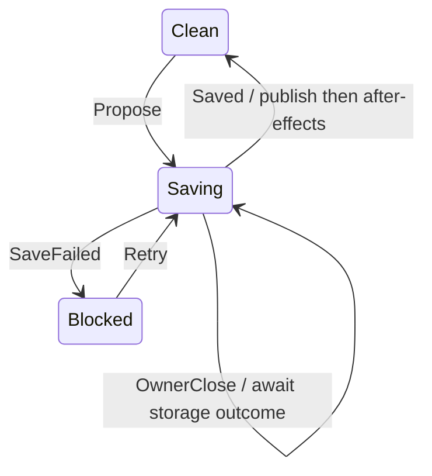

| State | Event/guard | Next; effects |
| --- | --- | --- |
| clean | Propose with matching revision | saving; atomic private write of versioned candidate |
| clean | Propose with old revision | same; conflict receipt |
| saving | Saved matching transaction | clean(candidate, revision+1); publish and release after-effects once |
| saving | SaveFailed | blocked; expose storage failure, block dependent mutations |
| saving/blocked | Propose | same; busy receipt; caller retains intent |
| blocked | Retry | saving with same transaction; retry storage only |
| clean | CancelProposal | same; notApplicable |
| saving/blocked | CancelProposal before write known complete | same; cannot claim cancellation of uncertain disk write; resolve then propose compensating change |
| any | OwnerClose | retain candidate obligation; stop new proposals; finish in-flight atomic write or record unresolved shutdown |

No-transition cases: repeated Saved is duplicate; stale storage completion cannot publish another revision. Disk-write failure is never acknowledgement. The transaction wrapper belongs inside the existing aggregate file (`agents.json`, `sims.json`, etc.); do not introduce a database or global transaction coordinator.

### M01 — Connection and subscription lifetime

`State = stopped(reason) | suspended(resumeConfig) | refused(config, failure) | connecting(attempt, requiredSubscriptions, partialLease) | synchronizing(attempt, transportLease, subscriptions) | ready(session, subscriptions) | retrying(config, failure, retryAt, attemptCount) | closing(lease, destination)`.
Subscription child: `absent | requesting(id, cursor) | catchingUp(id, cursor) | current(id, watermark) | ended(reason)`. `ready` requires each required child current, not merely a written subscribe request. Thread subscriptions may fail independently; mandatory shell/device subscription loss invalidates readiness. Service requires shell; phone requires shell and devices. Local thread scope is an optional addressed child.

`Event = Start(config) | SocketOpened | Subscribe | SubscriptionWritten | Snapshot | ReplayEvent | Synchronized | SubscriptionExit | ReadFailed | WriteFailed | PingDue | Pong | LivenessExpired | NetworkChanged | Foreground | Background | BackgroundExpired | RetryDue | Reconnect | Unsubscribe | Request | Reply | RequestCancelled | RequestDeadline | Closed | Stop`.

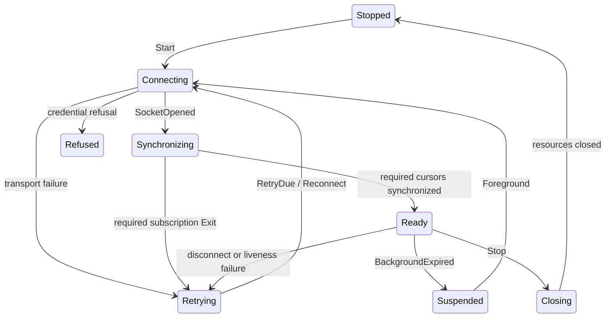

| State | Event/guard | Next; effects |
| --- | --- | --- |
| stopped/suspended/refused | Start with valid/new config; Foreground from suspended; explicit Reconnect from refused | connecting(new attempt); open authenticated socket |
| connecting | SocketOpened | synchronizing; subscribe required scopes, arm startup liveness |
| synchronizing/ready | SubscriptionWritten | child requesting→catchingUp; no readiness claim |
| synchronizing/ready | Snapshot/ReplayEvent | update addressed child cursor; emit M02/typed shell observation |
| synchronizing/ready | Synchronized (or verified initial snapshot contract) | child current; ready iff all required current |
| connecting/synchronizing/ready | read/write/required Exit/liveness failure | closing toward retrying; mark replicas stale, fail RPCs as unknown when sent, release socket/children |
| ready | optional thread Exit | child ended; expose thread stale, request resubscribe with preserved cursor |
| any live attempt | authentication refusal | closing toward refused; pairing error, no automatic credential fallback |
| ready | PingDue/Pong | same; send probe / record exact acknowledged frontier; never treat absence of image/text as failure |
| connecting/synchronizing/ready/retrying | Background | same while valid OS background lease; arm expiry |
| live/retrying | BackgroundExpired | suspended after closing resources; pause retries |
| retrying | RetryDue/Reconnect/usable NetworkChanged | connecting(new attempt); cancel old retry timer |
| ready | Reconnect/Foreground | same; probe and emit refresh request; reopen only on failed probe |
| ready | Request | same; allocate RPC waiter scoped to session; enqueue bounded request |
| ready | Reply | same; settle exact waiter with typed accepted/refused result |
| any | RequestCancelled/RequestDeadline | same; remove waiter/interrupt subscription as appropriate; **sent mutation outcomeUnknown**, not refusal |
| any live child | Unsubscribe | child ended; interrupt and release lease |
| closing | Closed matching resource lease | recorded destination (stopped/suspended/refused/retrying); arm retry only for retrying |
| any | Stop/OwnerClose | closing→stopped; cancel timers, complete waiters, join resources |

Child table: absent+Subscribe→requesting; requesting+Written→catchingUp; requesting/catchingUp+Snapshot→current only under verified complete-snapshot semantics; catchingUp+ReplayEvent stays; catchingUp+Synchronized→current; current+Event stays/current watermark; any live+Exit→ended with reason; any live+Unsubscribe→ended(cancelled); ended+Subscribe creates a new ID. No transition for repeated Start in a live state (return existing attempt), duplicate Pong, or background notification while already suspended. Unknown wire frame is a protocol disposition, not a silent parser default.

Preserve the phone's slow-uplink-aware heartbeat accounting. Rust's current 45-second request deadline may remain a caller budget, but is never evidence the command failed. Verify T3 replay completion and command receipt retention before strengthening guarantees (Q1/Q2).

### M02 — Thread replica, enrichment and transcript

`State = absent | loadingCache(thread, readID) | cached(snapshot) | syncing(previous?, epoch, cursor) | current(snapshot, epoch) | invalidated(previous?, reason) | unavailable(previous?, failure)`. Snapshot contains `{threadID, epoch, sequence, localRevision, decodedThread, detailRevision, mediaRevision}`. `Render = absent | building(snapshotKey, previousRender?) | ready(Transcript<snapshotKey>) | failed(snapshotKey, reason)`. Render and cache are derived children, not independently editable thread facts.

`Event = ObserveThread | CacheLoaded | CacheFailed | SubscriptionStarted | Snapshot | Delta | Synchronized | Reverted | Disconnected | Details | Media | Rendered | RenderFailed | CacheWritten | CacheWriteFailed | MemoryPressure | Release`.

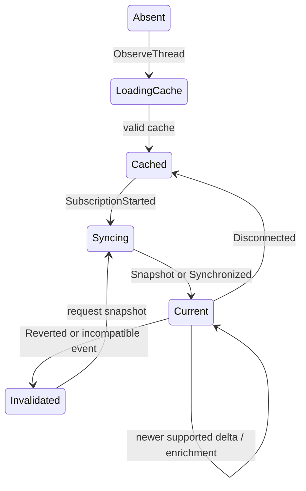

| State | Event/guard | Next; effects |
| --- | --- | --- |
| absent | ObserveThread | loadingCache; read addressed file and request M01 subscription |
| loadingCache | CacheLoaded valid, no newer live state | cached; render snapshot and resume cursor |
| loadingCache | missing/corrupt CacheFailed | syncing without cache; diagnose corrupt/version error, request snapshot |
| absent/loadingCache/cached/invalidated/unavailable | SubscriptionStarted | syncing(previous, epoch, cursor); subscribe; keep cache-read identity only while no newer live snapshot exists |
| syncing without live snapshot | CacheLoaded valid matching read | same with cached previous display snapshot; never mark current or replace a newer replay snapshot |
| syncing/current | Snapshot valid for epoch | current(new snapshot); render/cache; apply matching pending-operation receipts |
| syncing | Delta with known replay semantics | stay syncing with advanced replica; render may show catching-up content |
| current | newer supported Delta | current(reduced snapshot); schedule one render and coalesced cache write |
| any replica | older/duplicate Delta | same; duplicate disposition, no repeated text append |
| syncing | Synchronized at verified cursor | current; publish freshness and reconcile operations |
| current/syncing | Reverted, incompatible required event or invalid ordering | invalidated; mark stale and request fresh snapshot; never invent missing data |
| current/cached/syncing | Details/Media for matching thread/base revision | same control state, new localRevision; render/cache; only successful details advance watermark |
| render building | Rendered exact key | render ready; publish that transcript; schedule latest dirty snapshot if one arrived |
| render building | RenderFailed | failed(key, reason); keep previous labelled render, expose failure |
| any replica | Disconnected | cached/stale; retain data without live authority |
| any replica | CacheWritten/CacheWriteFailed | same; record cache status; failure does not invalidate server fact |
| any | MemoryPressure/Release | cancel optional render/fetch, evict unleased derived data; keep durable send references |

No transition for old enrichment/render results (dispose per common rule), metadata unrelated to this thread, or a cache load arriving after live state. A global sequence need not be contiguous for one thread: **do not add `seq == previous+1` unless T3's scope guarantees it**. Unknown event classification must distinguish documented irrelevant variants from required unsupported variants.

### M03 — Message delivery

`State = editing(Draft) | preparing(Intent, transfers) | creating(Intent, CreateReceiptQuery) | readyToSend(ResolvedIntent) | dispatching(ResolvedIntent, effectID) | unknown(UnknownStage, evidence, resumeTrigger) | accepted(ResolvedIntent, receipt) | rejected(Intent, refusal) | cancelled(unsentIntent)`. `UnknownStage = creation(Intent, CreateReceiptQuery) | turn(ResolvedIntent)` prevents an uncertain thread creation from requiring a nonexistent resolved thread. `Intent` freezes conversation, settings, complete content digest, message/create/turn command IDs, attachment identities and context revision. A resolved intent has a nonoptional thread ID and exact wire command. Never reconstruct a retry from today's model/CLI instructions.

`Event = Submit | TransfersReady | TransferFailed | ThreadCreated | CreateRefused | CreateUnknown | SendStarted | Accepted | Refused | TransportLost | MessageObserved | Reconnected | ReceiptFound | ReceiptAbsent | LookupFailed | Cancel | Close`.

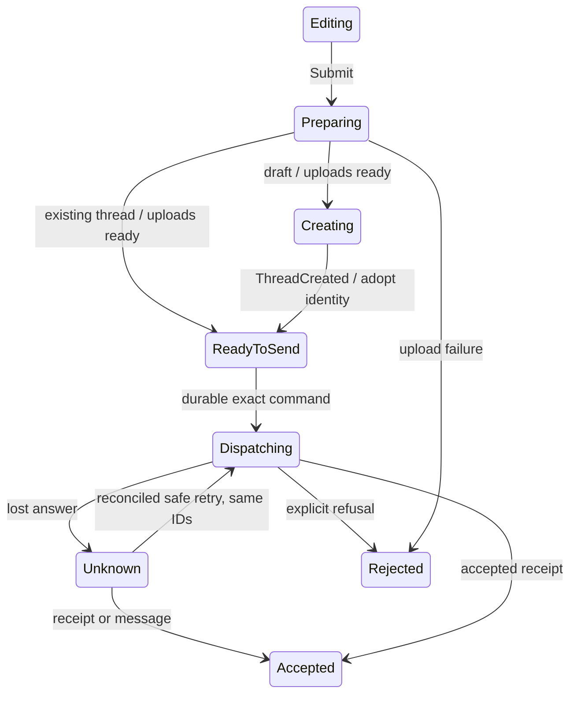

| State | Event/guard | Next; effects |
| --- | --- | --- |
| editing/rejected/cancelled | Submit valid | commit preparing with new operation IDs; transfer captured attachments |
| preparing | TransfersReady | existing thread→readyToSend; draft→creating; commit and ensure/create with fixed identity |
| preparing | TransferFailed | rejected(local preparation failure); restore same conversation content, retain successful transfer receipts |
| creating | ThreadCreated | commit resolved owner; emit draft→thread alias to M02/M07/M09/M06 atomically in local store; readyToSend |
| creating | CreateRefused/CreateUnknown | rejected / unknown(create stage); retain fixed create identity and draft alias obligation |
| readyToSend | SendStarted (C00 durable acknowledgement) | dispatching; run exact recorded command |
| dispatching | Accepted | commit accepted; keep echo until observed |
| dispatching/unknown | Refused with explicit nonacceptance proof | rejected; restore content to resolved owner |
| dispatching/creating | TransportLost | unknown at exact stage; retain content/IDs; request reconciliation on next current session |
| unknown | Reconnected | same; query receipt/authoritative thread, not allocate a new message |
| unknown creation | ReceiptFound proving creation | readyToSend; commit alias/resolved intent, then dispatch turn through normal commit path |
| dispatching/unknown turn | ReceiptFound/MessageObserved | accepted; record authoritative evidence even if observation beats RPC acknowledgement |
| unknown | ReceiptAbsent with verified dedupe/replay contract | dispatching/creating with same IDs and bytes; run recorded command |
| unknown | LookupFailed or inconclusive absence | same; expose waiting/unknown, no send based on elapsed time |
| accepted | MessageObserved | editing successor conversation; remove pending echo/intent after receipt commit |
| preparing/readyToSend | Cancel before send | cancelled; cancel owned transfers, restore unsent content |
| creating/dispatching/unknown/accepted | Cancel/Close after possible send | retain unknown/accepted receipt obligation; detach waiter, no remote undo; explicit Interrupt belongs to M04 |
| any | OwnerClose | persist unfinished intent; cancel local effects; restore via section 5 |

No transition for a second Submit while delivery exists (busy), navigation (destination stays fixed), or unrelated thread messages. Explicit refusal permits a later **new** submission; ambiguous acceptance permits only reconciliation of the **same** operation. Retrying a failed upload does not change message identity. Proposed on-disk pending intents extend current memory-only behavior; storage policy is in section 5.

### M04 — Addressed commands and optimistic overlays

`State = idle(observedRevision) | pending(Intent, expectedRevision) | dispatching(Intent, effectID) | unknown(Intent, evidence) | acknowledged(Intent, receiptRevision) | rejected(Intent, failure) | resolved(receipt)`. `Intent.kind = answer(thread, request, Answer) | approval(thread, request, Decision) | interrupt(thread, turn) | chooseMode(thread, Mode) | chooseModel(thread, Selection) | editTask(task, Patch) | ensureProject(catalogApp, root)`; each kind defines its own reconciliation evidence. No optional decision/answers combination and no absent approval defaulting to decline.

`Event = Propose | Sent | Ack | Refused | Lost | Observed | Reconcile | LookupFailed | Supersede | Cancel`.

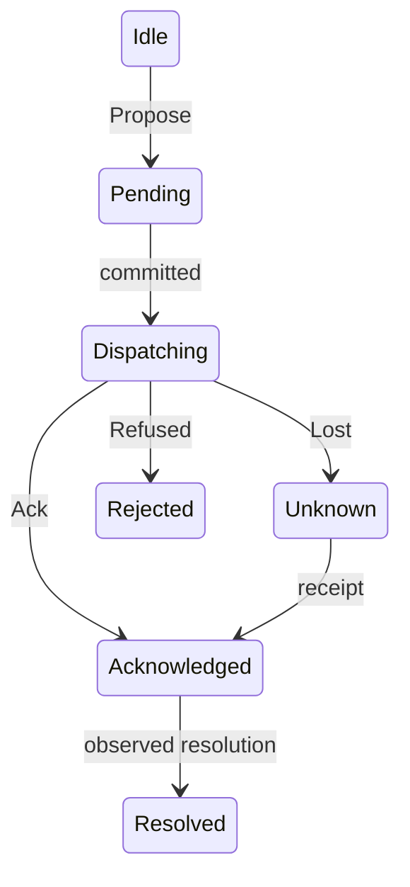

| State | Event/guard | Next; effects |
| --- | --- | --- |
| idle/resolved/rejected | Propose with valid target/base | pending; commit intent; derive optimistic overlay |
| pending | Sent after commit | dispatching; send addressed operation |
| dispatching/unknown | Ack | acknowledged(receipt); await matching observation |
| dispatching | Lost | unknown; show pending uncertainty, query authoritative outcome |
| dispatching/unknown | Refused | rejected; remove only this operation's overlay; expose reason |
| dispatching/acknowledged/unknown | Observed matching request resolution/value/revision | resolved; drop overlay even if observation beats RPC acknowledgement |
| unknown | Reconcile with proven absent receipt + idempotent contract | dispatching same intent/ID |
| unknown | LookupFailed/inconclusive | same; retain uncertainty |
| pending | Supersede by newer preference/task patch | replace unsent intent; explicit superseded receipt |
| dispatching/unknown/acknowledged | Supersede | keep old operation, queue newer desired value; serialize conflicting mutations |
| pending | Cancel | idle; cancel unsent effect |
| dispatching/unknown/acknowledged | Cancel/OwnerClose | retain reconciliation debt; stop local observer, never undo remote effect |

No transition for responding twice to the same request, wrong-conversation commands, or unrelated observed revisions. UI request disappearance is not acknowledgement; a completed T3 request event is. Task HTTP lost replies need a server operation receipt or conditional revision contract before automatic retry; absent that, query and expose unresolved outcome. Project import remains catalog-authoritative and calls stock T3 to create projects.

### M05 — Leased resource refresh

`State<T> = unneeded(previous?) | absent(leases) | fetching(leases, requestID, baseVersion, previous?, refreshAgain) | ready(leases, value, version, fetchedAt, dueAt) | failed(leases, previous?, failure, retryAt) | unsupported(leases, previous?, reason)`; `refreshAgain = no | requested` is independent coalesced demand, not a second fetch. Resource keys include providers, catalog, jobs, agents, sims, task page, thread media and step details.

`Event = Acquire | Release | Invalidate | Refresh | Due | Fetched | NotModified | FetchFailed | ProtocolUnsupported | Cancel | OwnerClose`.

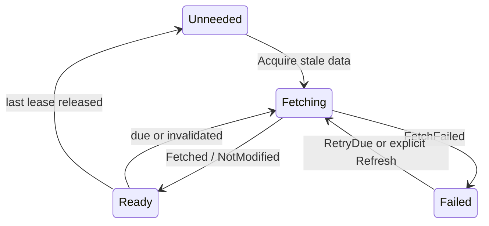

| State | Event/guard | Next; effects |
| --- | --- | --- |
| unneeded/absent | Acquire | ready if valid cached version, otherwise fetching; one conditional read |
| ready | Acquire/Release with remaining leases | same with lease set; no fetch merely because another consumer appears |
| fetching/failed/unsupported | Acquire/Release with remaining leases | same control state with updated lease set; preserve in-flight request/error, no duplicate fetch |
| ready/failed | Due/Invalidate/Refresh with demand | fetching; cancel old retry timer, read exact key/version |
| fetching | Refresh/Invalidate | same with refreshAgain=requested; no concurrent same-key read |
| fetching | Fetched valid | ready(new version); publish once; if refreshAgain, issue one subsequent pass |
| fetching | NotModified with prior value | ready(prior); renew freshness, do not replace collection |
| fetching | NotModified without prior value | failed(protocol); request unconditional read explicitly |
| fetching | FetchFailed | failed(previous labelled stale); expose resource-specific error, arm classified retry |
| fetching | ProtocolUnsupported | unsupported; actionable compatibility error, no retry loop |
| any demanded | last Release/Cancel/OwnerClose | unneeded(previous); cancel read/timer; discard late completion by request ID |

No transition for ticks before due, unknown lease release (duplicate diagnostic), or unrelated metadata. An active operation may own a resource lease without a visible screen. Polling is a documented transport fallback where the service has no event feed, with explicit due times and resource failure states; it does not invent business state. Keep ETag/304 and existing cadence initially; change cadence only with measured evidence.

### M06 — Media transfer and retention

`Transfer = local(Source) | queued(Source, direction, op) | transferring(Source, op, stagingLease) | verifying(Source, op, stagedFile) | available(Receipt) | failed(Source, failure) | unknown(Source, op, reconciliation) | cancelling(op)`. An image inside a T3 command is `inline(Source, messageID)` and its acceptance belongs to M03; it is not a pretend independent upload receipt. File retention child: `missing | resident(Artifact, readerLeases, lastUsed) | evicting(Artifact, deleteID) | unavailable(reason)`.

`Event = Need | Start | BytesProgress | Completed | Validated | Refused | Lost | ValidationFailed | Retry | Cancel | CleanupFinished | AcquireReader | ReleaseReader | EvictDue | Deleted | DeleteFailed | ScanResult`.

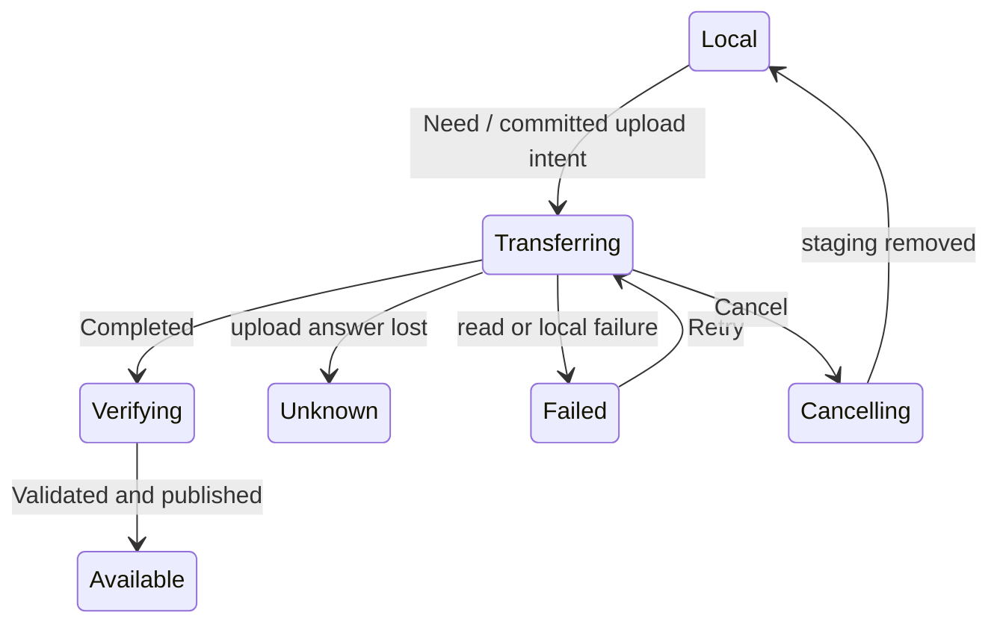

| State | Event/guard | Next; effects |
| --- | --- | --- |
| local/failed | Need/Retry | queued; commit upload intent where needed, request Start |
| queued | Start | transferring; create private staging, stream bytes; coalesce same artifact |
| transferring | BytesProgress | same; bounded counters, no whole-movie Data |
| transferring | Completed | verifying; validate identity/size/content and atomically publish |
| verifying | Validated | available(receipt); notify M03/consumer and transfer file ownership |
| transferring/verifying | Refused/ValidationFailed/local failure | failed; remove staging, retain user-owned source |
| transferring upload | Lost | unknown; query receipt/content identity; do not create duplicate remote artifacts blindly |
| transferring download | Lost | failed; discard incomplete file, safe retry read |
| unknown | Retry with confirmed remote receipt/absence | available / transferring same operation; unsupported receipt lookup stays unknown |
| queued/transferring/verifying | Cancel/OwnerClose | cancelling; close resources/delete staging; preserve uncertain upload receipt and user source |
| cancelling | CleanupFinished | local if definitely unsent/read-only; unknown if remote upload may have completed; cleanup failure retains cancelling with explicit debt |
| resident | AcquireReader/ReleaseReader | same with lease set; pin while any reader holds it |
| resident, no readers, not user-owned | EvictDue | evicting; delete exact immutable file |
| evicting | Deleted/DeleteFailed | missing / resident with visible cleanup debt |
| any cache | ScanResult | rebuild validated index; report/quarantine invalid metadata, never delete user source |

No transition for eviction of leased/user-owned files, progress for an old transfer, duplicate acquire ID, or a retry of an already available artifact (return receipt). Poster unavailability is separate from movie download failure. Upload idempotency is a proposed service contract; until supported, unknown uploads require reconciliation rather than an assertion of exactly-once publication.

### M07 — Phone route and presentation

Retain `Route = grid | app(AppID) | thread(AppID, ThreadDestination)`. Add `Interaction = resting | dragging(GestureID, level, originRoute, geometry, velocity)` and `Presentation {appSlot, threadSlot, springValues}`. A slot is `empty | mounted(key, lease)`; no separate controller/key optionals. Pending target is `none | resolving(target, lookupID) | waiting(target, failure)`. Sheets are a separate `Sheet = none | tasks(app, tab) | builds(app, selectedBuild?) | importApp`, not Boolean overlays.

`Event = OpenApp | OpenThread | Back | GestureBegan | GestureMoved | GestureEnded | GestureCancelled | Frame | GeometryChanged | OpenTarget | TargetResolved | TargetFailed | RetryTarget | CatalogueChanged | AdoptConversation | OpenSheet | DismissSheet | MountFailed | SceneClosed`.

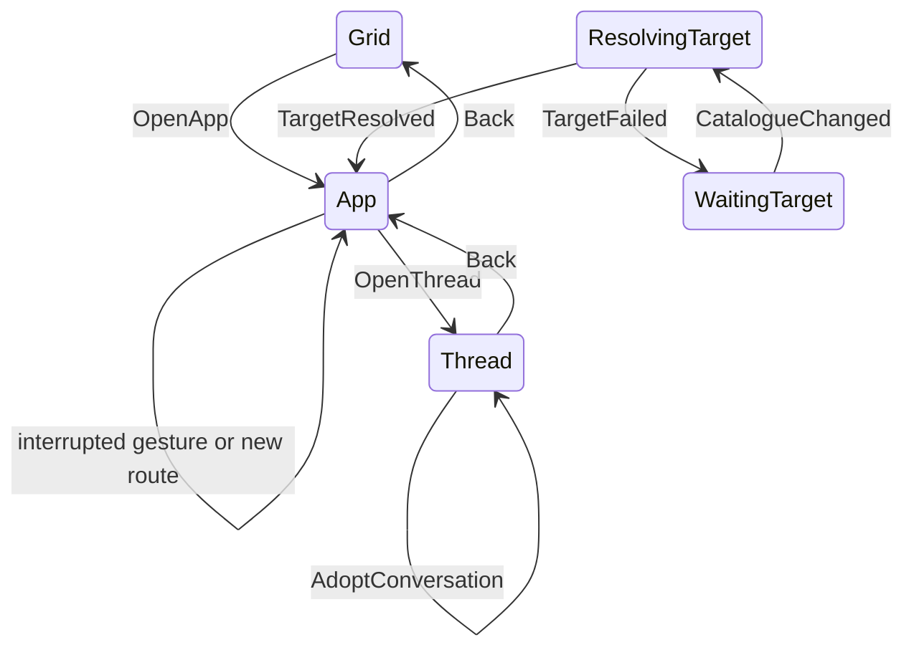

| State | Event/guard | Next; effects |
| --- | --- | --- |
| any route | OpenApp known app | app; retarget from present values, acquire destination content lease immediately |
| app/thread | OpenThread valid destination in app | thread; retarget; request offscreen mount reconciliation |
| thread/app/grid | Back | app/grid/grid respectively; grid Back returns notApplicable |
| route with back destination | GestureBegan | dragging(captured origin); destination owns incoming interaction immediately |
| dragging same ID | GestureMoved | same interaction with new numerical values; project frames/input |
| dragging | GestureEnded | resting with committed/cancelled route from threshold/velocity input; spring from current values |
| dragging | GestureCancelled | resting(originRoute); spring from current values, no stale completion toggles |
| any | Frame/GeometryChanged | update presentation; reconcile mounts **only when their outgoing slot is offscreen**; derive all visibility/feed/input |
| any | OpenTarget | resolving(new lookupID); lease catalog/build lookup |
| resolving | TargetResolved | route to resolved app/thread/build sheet; release lookup |
| resolving | TargetFailed transient/not-found | waiting / explicit not-found result only after fresh authoritative catalog |
| waiting | CatalogueChanged/RetryTarget | resolving; new lookup generation |
| any | AdoptConversation matching mounted draft | replace logical identity without stealing a different route; no animation restart |
| any | OpenSheet/DismissSheet | sheet enum changes; sheet capability/visibility follows state |
| any | MountFailed | retain route with explicit unavailable destination; do not silently navigate elsewhere |
| any | SceneClosed/OwnerClose | release content/mount/lookup leases, cancel gestures; no model execution cancellation |

No transition for OpenThread from grid, unknown app, wrong gesture ID or duplicate route request (return current route). Old target resolution cannot navigate. `Frame` is a pure projection/numerical step; UI runtime applies a diff. `SQUIRCLE_STRESS` audits that actual hierarchy matches this projection, not just the reducer's intent.

### M08 — Overlay scene lease

`State = disabled(reason) | unconfigured | detached(modelLease) | attaching(modelLease, sceneID, attachID) | attached(modelLease, SceneLease) | detaching(modelLease, Acquisition, nextScene?) | failed(modelLease?, failure)`. `Acquisition = pending(attachID) | owned(SceneLease)` distinguishes cancellation while attachment is still being created. `SceneLease` is an ID with runtime-owned window/controller/refresh resources. Distinguish absent pairing from failed Keychain access; never borrow unrelated credentials.

`Event = Configure | ConfigurationFailed | SceneActive | Attached | AttachFailed | Deactivated | Background | Foreground | SceneDisconnected | Detached | Stop`.

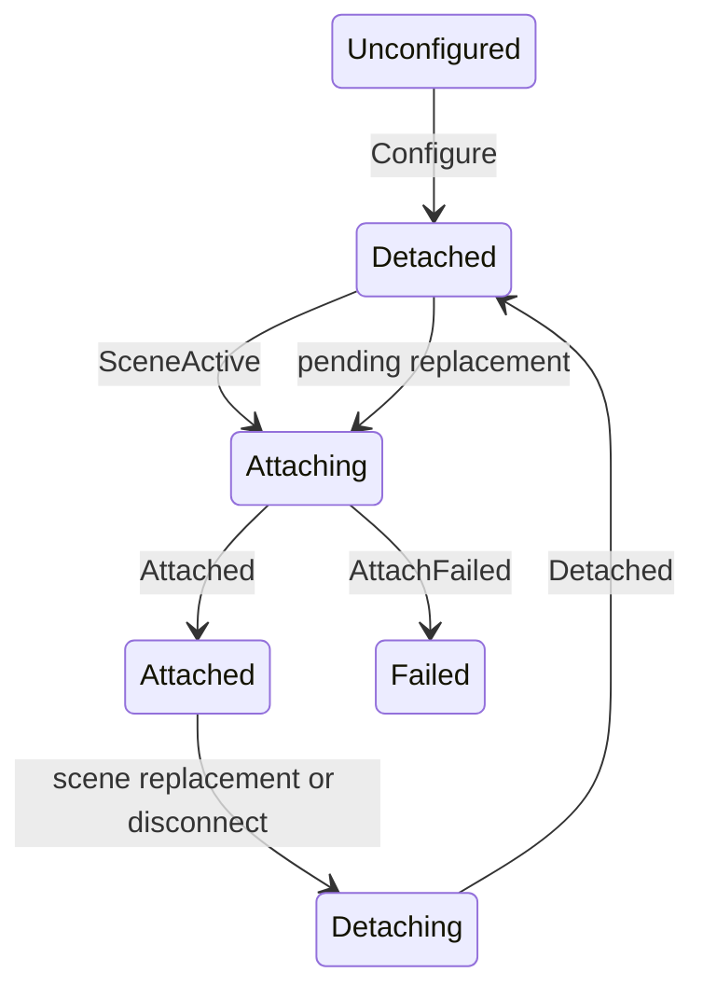

| State | Event/guard | Next; effects |
| --- | --- | --- |
| unconfigured/failed | Configure valid | detached(model lease); create shared model runtime |
| unconfigured | ConfigurationFailed absent/unsupported/error | disabled / failed with diagnostic; no window |
| detached | SceneActive eligible | attaching; create scene resources |
| attaching | Attached | attached; emit foreground to M01 and acquire resource leases |
| attaching | AttachFailed | failed; dispose partial resources, retain configuration |
| attached | SceneActive same | same; resume refresh lease idempotently |
| attached/attaching | SceneActive other | detaching with pending scene; close old M09/M10/M12 before attaching new |
| attached | Deactivated/Background/Foreground owning scene | same scene; emit explicit lifecycle events to children |
| attached/attaching | SceneDisconnected | detaching; cancel capture and dispose scene resources |
| detaching pending | Attached/AttachFailed | dispose late acquired scene / settle failed acquisition; emit Detached only once all partial resources close |
| detaching | Detached | detached, then attach pending scene if still eligible |
| any | Stop/OwnerClose | detach owned scene then close model, disabled(stopped) |

No transition for notifications from a nonleased scene, repeated Configure while configured, or activation with no eligible scene. Attach failure is visible in diagnostics, not silent success. Multi-scene selection policy remains “one foreground scene”; ordering must be deterministic (last activation, with stable tie-break), not collection order.

### M09 — Overlay panel, capture flight and notice

`State = closed | live(Route, Layout, Interaction, Mounts, Flight, Notice)`; `Route = bubble(ResumePanel) | panel(Panel)`, `Panel.mode = docked(size) | full`, with the existing agent/worker destination. `Layout = stretched(restSize, outgoingSnapshot?) | revealed(DragLayout) | liveMorph(from, to)`; `Interaction = free | resizing(gesture, origin) | moving(gesture, origin) | backing(gesture, originRoute)`.

`Flight = none | flying(attachmentID, conversationID, flightID, source, progress, holdLease)`. `Notice = none | showing(completionID, outcome, expiresAt)`. Geometry and a weak controller are not capture destination identity. Views/snapshot pictures remain runtime leases, not state values.

`Event = Open | Close | ToggleFull | OpenThread | Back | ResizeBegin/Move/End/Cancel | MoveBegin/Move/End/Cancel | BackBegin/Move/End/Cancel | Frame | GeometryChanged | CaptureReady | FlightSettled | CompletionObserved | NoticeExpired | RenderResourceFailed | TearDown`.

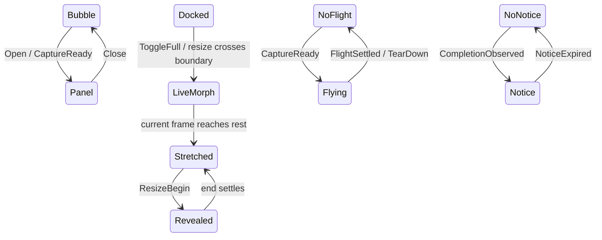

| Region/state | Event/guard | Next; effects |
| --- | --- | --- |
| live/bubble | Open, valid app and no active recording | panel(resume); derive key-window/content ownership |
| live/panel | Close | bubble(resume panel); end keyboard focus, retain remembered destination |
| live/panel | ToggleFull | other mode + liveMorph; retarget existing spring |
| live | OpenThread/Back | update destination; replace mount only offscreen; reject when recording owns closed route |
| free | Resize/Move/Back Begin | corresponding interaction with origin; hold spring |
| matching interaction | Move | update numerical state/layout regime from gesture; derive route target and touch owner |
| matching interaction | End/Cancel | free; commit target / restore origin and spring from current geometry |
| any live | Frame/GeometryChanged | project all geometry; at verified rest choose stretched and emit snapshot release; rest callback only sends Frame |
| flight none/flying | CaptureReady addressed destination | flying new ID; release previous hold/picture, hold exactly new attachment, open panel |
| flying | FlightSettled matching ID and current geometric guard | none; release hold/picture |
| notice any | CompletionObserved new authoritative completion | showing; arm one expiry (existing six-second policy) |
| notice showing | NoticeExpired matching completion | none; render |
| live | RenderResourceFailed | retain intent, mark visual resource unavailable; show capture/render reason where actionable |
| any | TearDown/OwnerClose | closed; cancel capture, notices, flights, gestures and all mounts/leases |

No transition for old flight settlement/notice expiry, Close already bubble, ToggleFull while bubble, unrelated completion, or opening during recording (return recording conflict). A missing capture is a typed M10 failure; opening the panel remains possible as a separate action. No `onRest` may directly clear holds, change layout or remove current content. Notice expiry and flight rest are separate clocks/conditions; neither means an agent finished.

### M10 — Capture producer

`State = idle | starting(Intent, producerAttempt) | recording(Intent, producerLease, startedAt, limitAt) | stopping(Intent, producerLease, finishID) | ready(Intent, Artifact) | failed(Intent, Failure) | cancelling(Intent, Acquisition)`. `Acquisition = pending(producerAttempt) | owned(producerLease)` distinguishes cancellation during creation. Intent carries capture kind, scene lease and originating `ConversationID`. Screenshot uses starting→ready without a long-lived recorder. Output type keeps `screen(file, poster)` distinct from `performance(file, frameIntervals)`.

`Event = Start | ProducerStarted | ProducerFailed | Sample | Stop | LimitReached | Finished | FinishFailed | Cancel | ProducerCancelled | ConsumeArtifact | SceneLost`.

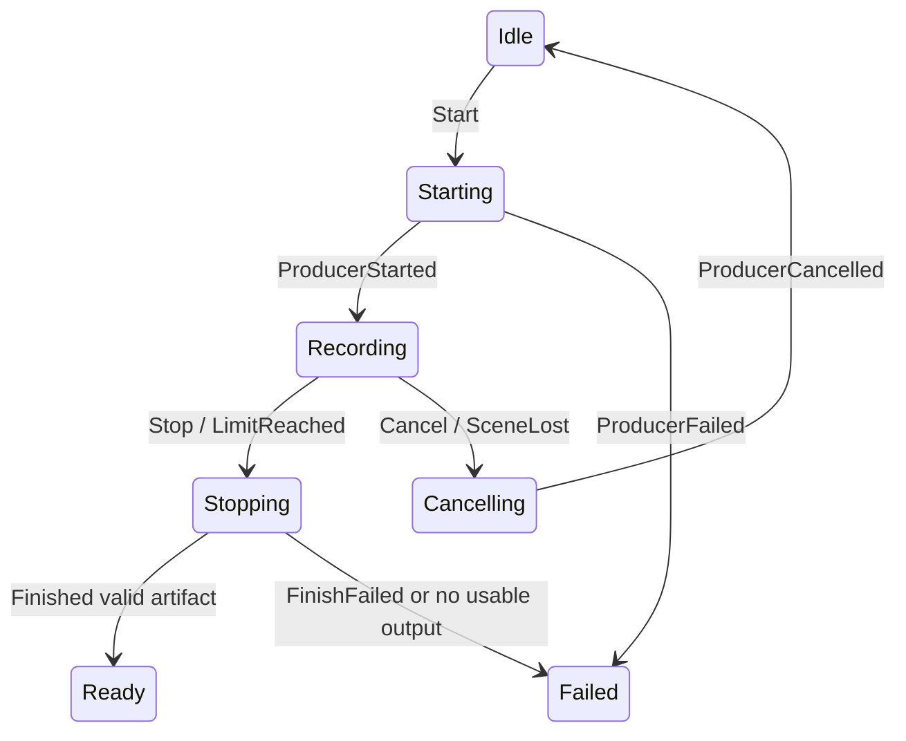

| State | Event/guard | Next; effects |
| --- | --- | --- |
| idle/failed | Start valid scene/destination | starting; allocate producer |
| starting | ProducerStarted | recording; arm existing 60-second policy limit |
| starting screenshot | Finished | ready; emit CaptureReady to M09 |
| starting | ProducerFailed | failed with distinct unsupported/writer failure; release partial producer |
| recording | Sample | same; producer adapter records bounded sample; cadence per frame, inactive gaps excluded |
| recording | Stop/LimitReached | stopping; disarm limit, stop producer before asking for poster/output |
| stopping | Finished valid | ready; transfer file receipt and destination to M09/M06 |
| stopping | Finished no frames/no poster or FinishFailed | failed(reason); producer already stopped, dispose unusable artifact explicitly |
| starting/recording | Cancel/SceneLost/OwnerClose | cancelling; stop producer and delete only owned temporary files |
| stopping | Cancel/SceneLost/OwnerClose | cancelling; await/consume late finish, delete artifact, never land it |
| cancelling | ProducerCancelled/Finished/FinishFailed | idle; settle cleanup receipt |
| cancelling pending | ProducerStarted | cancelling owned; stop/dispose late producer, wait for cleanup receipt |
| ready | ConsumeArtifact | idle; file now owned by addressed attachment store |

No transition for Start while active (busy), repeated Stop while stopping (return same finish operation), or Sample outside recording. Error, cancellation and no output are distinct; no nil result standing for all three.

### M11 — Jelly scheduling

Use the existing pure `JellyLook`/`JellyPose` for shape and tone. Scheduling is `State = detached | still(presentation, reason) | scheduled(presentation, wakeID, due) | running(presentation, cadence, linkLease) | unavailable(reason)`. Crew director state is `Selection(visibleCandidates, granted: Set<LoopLeaseID>)`, constructed with at most four grants; hero live-render lease is separate and unique per visible conversation hero. Springs, time and last successfully presented picture are separate numerical facts.

`Event = Attach | Detach | Visibility | MoodChanged | Touch | Frame | MotionPolicy | Background | Foreground | Alarm | SpritesReady | RenderFailed | FramePresented`.

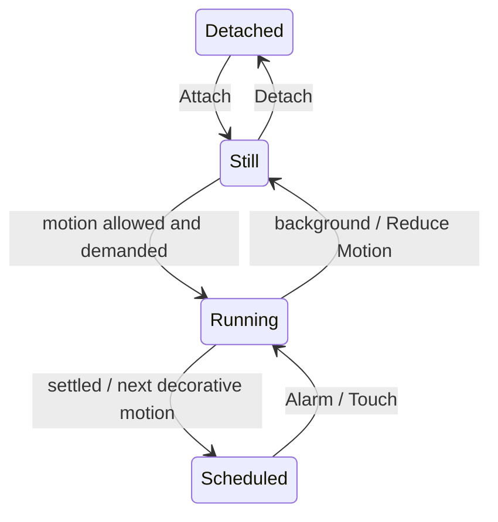

| State | Event/guard | Next; effects |
| --- | --- | --- |
| detached | Attach | still; obtain cached still / request sprite resource through M05 |
| still/scheduled/running | Visibility/MoodChanged/MotionPolicy/Foreground/Touch | derive cadence; running if allowed demand, scheduled for future blink, otherwise still; reconcile one link/alarm |
| running | Frame | numerical step + draw effect; director deterministically grants highest-priority visible candidates, capped at four |
| running | FramePresented | same with presented revision; only actual presentation advances draw evidence |
| running | settled Frame | scheduled(due) or still(no alarm); pause link |
| scheduled | Alarm current | running; advance elapsed decorative time without integrating background spring gap |
| any attached | Background/reduced motion | still; revoke loop grants, stop decorative ticks and cancel alarm |
| any attached | SpritesReady matching look | same; install matching immutable clip |
| any attached | RenderFailed | unavailable or still(last valid image, error); record failure, never endless success-like animation |
| any | Detach/OwnerClose | detached; release link/alarm/grants/sprite lease |

No transition for Alarm after detach, frame from revoked lease or old sprite key. No agent FSM here: mood is a projection of typed agent state. Tests cover scheduling ownership/budget and stale completion only; appearance, spring constants and individual frames are visually checked.

### M12 — Simulator deck, playback and feed demand

`State = hidden | visible(Uses, Route, Presentation, Interaction)`, `Route = collapsed | fanned | expanded(SessionID)`, `Presentation = deck | presenting(incomingSlot, outgoingSnapshot?, expansion)`; replace a physical content slot only while it is offscreen. An interrupted change may retain an inert outgoing snapshot while mounting a new incoming slot offscreen; route identity owns input from the first frame, never the outgoing snapshot. `Interaction = free | dragging(gesture, origin, velocity)`. Per-cell `Playback = stopped | live(FeedLease) | recorded(PlayerLease) | unavailable(reason)`. `Uses` has `live(target, session) | filing(session) | recording(media) | unavailable(reason)`; never live=false plus nil recording.

`Event = UsesChanged | HostVisibility | CellVisibility | Tap | Expand | Collapse | DragBegin/Move/End/Cancel | Frame | PictureReady | ContentChanged | FeedFailed | PlayerFailed | RetryPlayback | Close`.

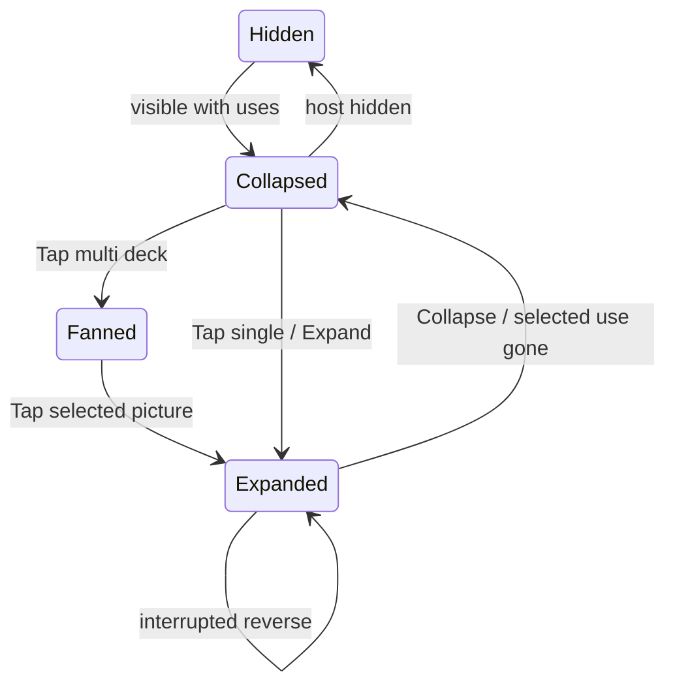

| State | Event/guard | Next; effects |
| --- | --- | --- |
| hidden | visible HostVisibility with uses | visible(collapsed); derive feed demand |
| visible | UsesChanged/ContentChanged | update immutable uses; missing expanded target collapses and emits end-touch before feed release |
| collapsed | Tap with multiple uses | fanned; retarget fan spring |
| collapsed/fanned | Tap single/Expand known ID | expanded(ID); input owner changes immediately; geometry follows spring |
| expanded | Expand different ID | retarget immediately; snapshot outgoing content as inert, mount new incoming content offscreen, move it with current spring values; destination owns touches immediately (explicit unavailable if its channel is not ready) |
| expanded/fanned | Collapse | collapsed; end outstanding input before releasing channel lease |
| visible/free | DragBegin | dragging; retain input-owner distinction (PiP move versus device touch) |
| dragging | Move/End/Cancel | update geometry / free with chosen corner / restore origin corner |
| visible | Frame/CellVisibility/PictureReady | derive **one** FrameProjection and required feed set; reconcile playback leases |
| live/recorded playback | FeedFailed/PlayerFailed | unavailable(reason); expose retry through resource/channel machine |
| unavailable playback | RetryPlayback with demand | stopped then acquire current source; retry never changes selected session |
| visible | hidden HostVisibility/Close/OwnerClose | hidden; end touch, stop players, release feed leases |

No transition for Expand unknown ID, stale touch end to a replacement channel, or old content results. First-picture prewarming must be an explicit `PreviewDemand(untilFirstFrame)` lease, released on first frame or failure; retain current behavior initially and budget it separately from visible feeds. No completion callback removes the current picture. Child playback table: stopped+live demand→live; stopped+recording ready→recorded; live/recorded+no demand→stopped; source change releases old lease then acquires new; failure→unavailable; retry→stopped then acquire. UI runtime verifies actual windows/occlusion match demand.

### M13 — Video/input channel, decoder and gestures

`State = stopped | openingVideo(attempt, partialLease, deadline) | openingInput(attempt, videoLease, ticketRequest, deadline) | interactive(attempt, ChannelLease) | retrying(failure, due) | refused(failure) | closing(lease, next)`. Interactive requires both authenticated H.264 response and input config; a JPEG seed never enables input.

Decoder child `waiting | awaitingKeyframe(Configuration) | decoding(Configuration) | failed(reason)`; gesture child `idle | dragging(GestureID, channelID, lastPoint, queue) | closed`. All wire tags and parser errors become typed events; no MJPEG or priming fallback.

`Event = Demand | VideoOpened | InputConfigured | TicketFailed | Bytes | Config | Keyframe | Seed | DecodeFailed | EOF | InputFailed | PingFailed | StartupExpired | RetryDue | TouchBegin/Move/End/Cancel | Home | DemandEnded | Closed`.

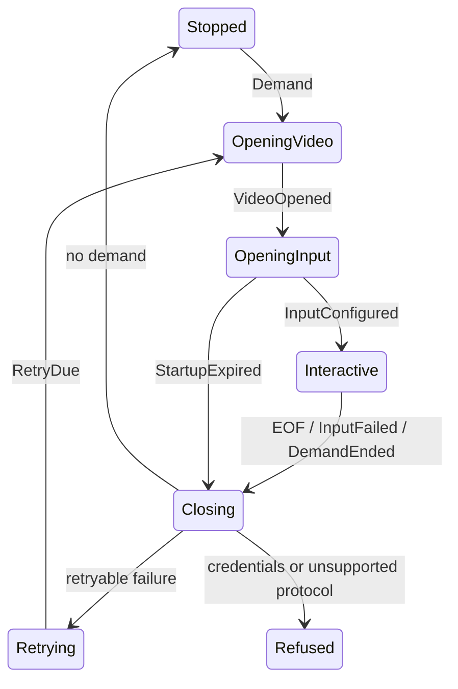

| State | Event/guard | Next; effects |
| --- | --- | --- |
| stopped/retrying | Demand/RetryDue with consumers | openingVideo; allocate attempt, open authenticated AVCC, arm startup deadline |
| openingVideo | VideoOpened valid response | openingInput; fetch ticket and connect input |
| openingInput | InputConfigured valid target/config | interactive; disarm startup deadline; publish input capability |
| startup/interactive | Bytes/Config/Keyframe/Seed | feed decoder child; preserve reference frames, publish only newest decoded picture |
| startup | StartupExpired | closing toward retrying; close actual partial resources, record handshake failure |
| any live | TicketFailed/EOF/InputFailed/PingFailed/DecodeFailed | closing; transient transport→retrying, credential/protocol failure→refused with reason |
| interactive | TouchBegin idle | child dragging(channel); queue begin |
| interactive | TouchMove/End/Cancel same gesture/channel | update/idle; ordered send; cancel maps to an end for existing touch |
| interactive | Home | same; ordered input command |
| any live/retrying | DemandEnded/OwnerClose | closing toward stopped; cancel retry, end/drop gesture on **old** channel, close video and input |
| closing | Closed | requested next state; no resource reuse across generations |

Decoder table: waiting+Config→awaitingKeyframe; awaitingKeyframe+non-key frame→same with explicit drop-until-reference; awaitingKeyframe+Keyframe→decoding; decoding+valid frame→decoding; any+new Config→awaitingKeyframe with new decoder; any+malformed framing/config/decode error→failed and channel failure; Seed→one still presentation without changing input readiness. Gesture table: idle+Begin→dragging; dragging+Move→dragging; dragging+End/Cancel→idle; any+channel close→closed and queue cancelled; Move/End while idle, Begin while dragging, all input while closed→notApplicable. Idle video silence is explicitly **no transition**. Never reboot the agent's simulator to cure an ambiguous stale image.

### M14 — App-agent creation, restart and fresh replacement

`State = absent | reserving(CreateIntent) | creating(CreateIntent, delivery) | ready(AgentRef, Instructions) | resetQueued(AgentRef, ResetIntent) | resetting(RestartOperation) | replacing(FreshOperation) | blocked(Operation, Failure)`. `Instructions = current(revision) | refreshOwed(expectedRevision)`.
`RestartOperation.phase = validating | stopUnknown | awaitingStopped | refreshingInstructions`.
`FreshOperation.phase = gatheringHandoff | validatingStop | stopUnknown | awaitingStopped | renaming | creatingNew | rebinding | deliveringHandoff` with fixed old/new IDs, selected runtime mode and exact commands. Phase payloads contain only the receipts required for the next step. Do not rename/stop before persisting that phase's intent.

`Event = Ensure | Reserved | Created | ResetRequested | Observation | HandoffReady | EffectAccepted | EffectUnknown | EffectRefused | Receipt | Retry | RetryDue | Cancel | InstructionsRead | Close`.

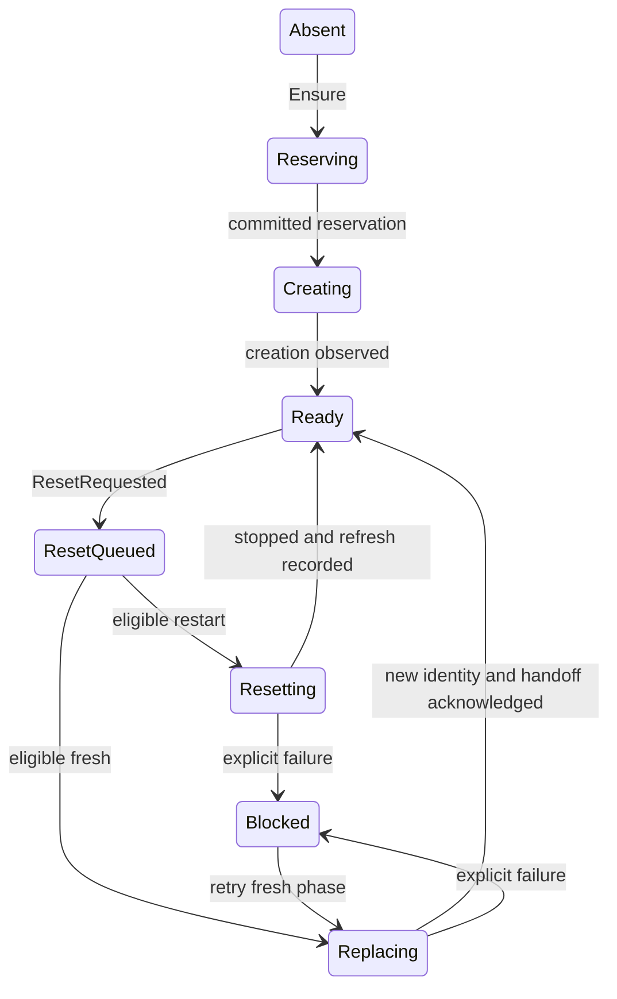

| State | Event/guard | Next; effects |
| --- | --- | --- |
| absent | Ensure | reserving(fixed IDs, valid chosen mode); commit before T3 create |
| reserving | Reserved | creating; dispatch exact creation command |
| creating | Created/Receipt proving creation | ready; publish registry identity |
| creating | EffectUnknown/EffectRefused | remain reconciling / blocked with reservation; never create another identity |
| ready | Ensure | same; return agent, independent optional message uses M16/M03 |
| ready/resetQueued | ResetRequested | commit resetQueued; replacing prior queued request requires explicit superseded receipt |
| resetQueued | Observation stale/unknown/busy/waiting | same; reason deferred; no stop |
| resetQueued | current idle eligible | resetting(validating) / replacing(gatheringHandoff); acquire per-project operation ownership |
| fresh gathering | HandoffReady | persist text/source revisions; validatingStop; request current execution observation |
| validating stop | Observation eligible with usable fence | commit stop intent; dispatch conditional stop if supported (Q1) |
| stop intent sent | EffectAccepted | awaitingStopped; query current execution; command acceptance alone is not stopped proof |
| validating stop | new work/uncertainty | resetQueued; release eligibility proof, retain user intent |
| stopUnknown/awaitingStopped | Receipt/Observation stopped for expected identity | restart→refreshingInstructions; fresh→renaming; commit before next effect |
| fresh renaming/creatingNew/rebinding/deliveringHandoff | EffectAccepted or authoritative receipt | next named phase; **rebind agent, workers and only undispatched wakes in one agents-registry commit**; deliver handoff via M16 |
| reset/fresh any phase | EffectUnknown | same phase with unknown evidence; query receipt, do not repeat a fresh ID |
| reset/fresh any phase | EffectRefused | blocked(phase, error); retain prior/partial facts; retry only classified repairable step |
| blocked | RetryDue/manual Retry | exact retained phase; revalidate eligibility before any new destructive effect |
| resetQueued/gathering/validating | Cancel before stop sent | ready; commit cancelled receipt |
| after stop or creation sent | Cancel/Close/OwnerClose | retain durable partial operation; stop optional work, require reconciliation; no invented rollback |
| ready with refresh owed | InstructionsRead matching revision | ready refreshed; commit receipt of hook delivery |

No transition for Ensure making a second agent, reset while creating, unknown mode defaulting to full access, or old-thread completion updating new identity. **Q1 remains a distributed race:** a fresh local observation alone cannot prevent another T3 client starting a turn immediately before stop. Without a server-supported fence, do not advertise that guarantee; automatic destructive maintenance must defer or use a genuinely stopped/no-live-session boundary supported by T3. No timer makes that safe.

### M15 — Worker bootstrap and archive

`State = absent | reserved(BootstrapIntent) | bootstrapping(Intent, delivery) | active(WorkerRef) | archiving(ArchiveOperation) | archived(ArchiveReceipt) | blocked(Operation, Failure)`.
Archive phases `checkingExecution | stopRequested | awaitingStop | inspecting(StopProof) | removing(RemovalPlan, StopProof) | filesRemoved(RemovalReceipt) | archivingT3(RemovalReceipt)`. Proof includes thread/session, epoch/revision and inspected branch/worktree/tip; only the executor can validate and consume it. It is not a durable eternal permission token.

`Event = Spawn | Committed | DispatchAccepted | DispatchUnknown | DispatchRefused | Observation | RetrySpawn | Archive(discard) | GitInspected | FilesRemoved | ArchiveAccepted | StepFailed | Retry | Cancel | Close`.

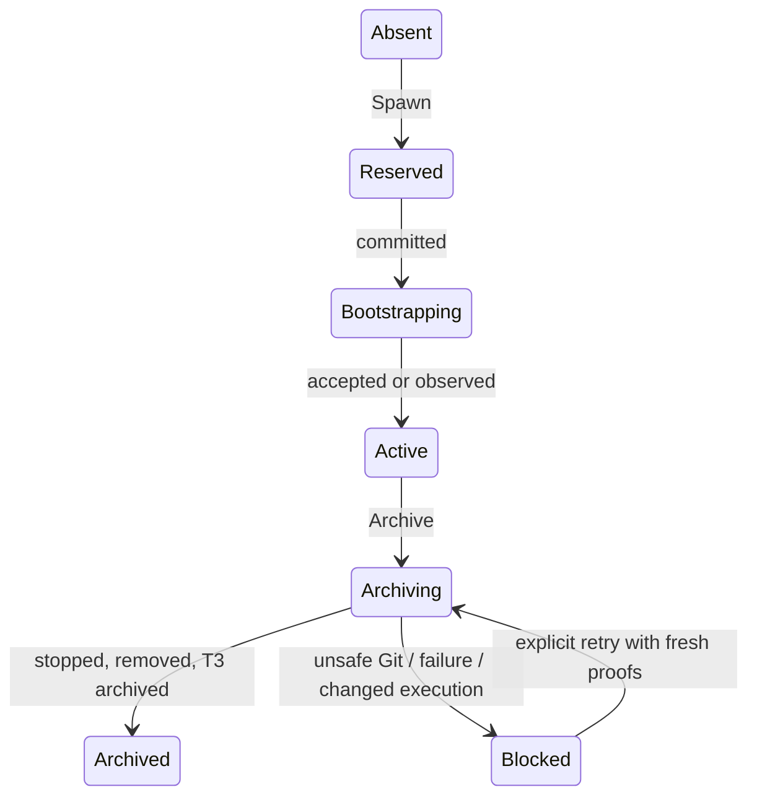

| State | Event/guard | Next; effects |
| --- | --- | --- |
| absent | Spawn valid request | commit reserved full bootstrap and IDs before T3 hears it |
| reserved | Committed | bootstrapping; dispatch exact command |
| reserved/bootstrapping | same RetrySpawn | same operation; reconcile, resend only under verified dedupe |
| bootstrapping | DispatchAccepted/Observation proving thread/message | active; commit registration and enable observation |
| bootstrapping | DispatchUnknown/Refused | retain unknown reservation / blocked; expose outcome |
| active/reserved | Archive | archiving checkingExecution; current observation required; no Git deletion for never-created reservation |
| checkingExecution | busy/waiting, no discard | active; explicit refusal |
| checkingExecution | live with discard, or idle live session | stopRequested→awaitingStop; durable stop intent through M04/M01 |
| checkingExecution/awaitingStop | current stopped/absent | inspecting(fresh proof); inspect exact Git identities |
| inspecting | GitInspected merged/clean or explicit discard | removing; revalidate execution and tip immediately at boundary; Q1 applies |
| inspecting | GitInspected unsafe or changed proof | blocked; keep files, explain conflict |
| removing | FilesRemoved | commit filesRemoved then archivingT3; dispatch archive |
| archivingT3 | ArchiveAccepted/authoritative archived observation | archived; durable terminal receipt |
| any effect phase | DispatchUnknown/StepFailed | blocked with exact progress and unknown receipts; no loss of removal debt |
| blocked | Retry | resume exact phase after new current observation; never reuse old StopProof |
| before removal | Cancel/Close | preserve active/stopped worker as actually observed; cancelled archive receipt |
| after removal begins | Cancel/OwnerClose | retain partial journal for recovery; report cannot restore removed files |

No transition for archive of an app agent, conflicting spawn on the reserved branch, unknown execution authorizing deletion, or cleanup based on a display “done.” Retain ancestry/merge-resolution/tip checks from A01. Restore a bootstrap as awaiting reconciliation/repeated spawn initially, preserving current no-automatic-resend behavior until Q2 is resolved.

### M16 — Durable outbox

`State = queued(Envelope) | dispatching(Envelope, effectID) | unknown(Envelope, evidence) | waiting(Envelope, failure, retryAt) | delivered(Receipt) | obsolete(Reason) | failed(Envelope, Failure)`. Envelope has recipient, stable logical event ID, command/message IDs, payload/version, and policy `t3Wake | apnsAlert`; never reuse the same reducer outcome to claim APNs presentation and T3 acceptance are equivalent. The delivery adapter defines accepted/reconcile semantics.

`Event = Enqueue | Due | Accepted | Lost | Refused | TransientFailure | ReceiptFound | ReceiptAbsent | LookupFailed | RecipientGone | RecipientReplaced | Retry | Cancel | Close`.

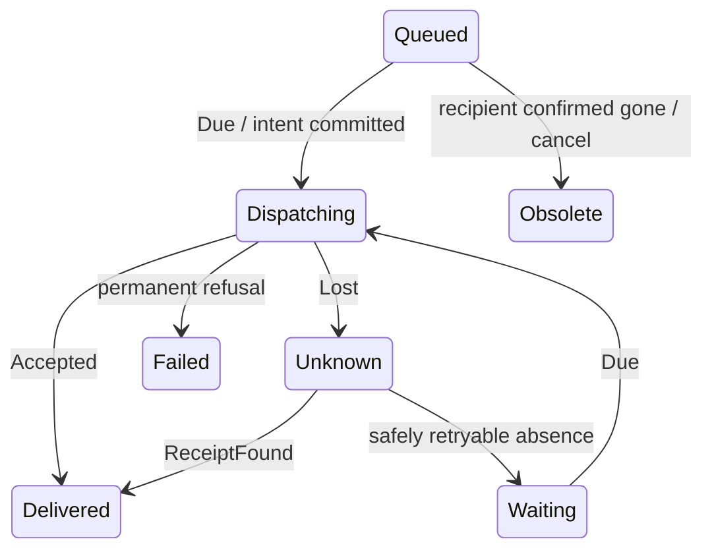

| State | Event/guard | Next; effects |
| --- | --- | --- |
| no entry | Enqueue | commit queued; optional bounded coalescing with recorded member event IDs |
| queued/waiting | Due and eligible recipient | commit dispatching/unknown-before-send; send exact identity |
| dispatching/unknown | Accepted/ReceiptFound | commit delivered and advance worker/build notification markers **in same registry commit** |
| dispatching | Lost | unknown; query receipt on current connection |
| dispatching | TransientFailure known before send | waiting; arm explicit backoff |
| unknown | ReceiptAbsent with safe adapter retry | waiting; reuse exact identity; APNs duplicate-delivery limitations remain Q3 |
| unknown | LookupFailed/inconclusive | same; record reason, no inference of absence |
| dispatching/unknown | Refused permanent | failed; retain payload reference and terminal reason, no success marker |
| queued/waiting | RecipientGone confirmed current | obsolete; commit reason, not delivered |
| queued | RecipientReplaced | retarget in M14 atomic registry commit |
| dispatching/unknown | RecipientReplaced | reconcile old recipient first; do not retarget an ambiguous sent message |
| queued/waiting | Cancel | obsolete(cancelled before dispatch) |
| dispatching/unknown | Cancel/OwnerClose | retain unknown obligation; close local waiter only |
| failed | explicit retry after configuration repair | queued with original identity; retain failure history |

No transition for duplicate logical event, unchanged worker phase/request, early Due or stale delivery reply. Failed alerts may expire under an explicit delivery policy; keep `expired(reason)` as an obsolete receipt, never delivered. Queue acceptance by M16 is distinct from wake delivery and from a new worker turn actually starting (M18).

### M17 — Tasks

`State = absent | open(OpenStatus, Record, Placement, Policy) | closed(ClosedStatus, Record, Placement, closedAt)`.
`OpenStatus = queued | inProgress | needsYou | readyToTry`; `ClosedStatus = done | dropped`; `Placement = active | history(agedAt)`; `Policy = following(Observation) | held(baselineObservation)`. A held policy holds its containing open status, with no duplicate status field. A closed task retains its observation baseline but has no ordinary following policy. `Record` owns immutable ID, user ask, ordered links, attachments, history and revision. No task is manufactured from worker activity without a user ask.

`Event = Add | Edit(expectedRevision, patch) | Link | Unlink | Attach | ExplicitStatus | Signals(sourceRevision, observation) | AgeDue(now) | CommitFailed | RetryCommit | CancelEdit`.

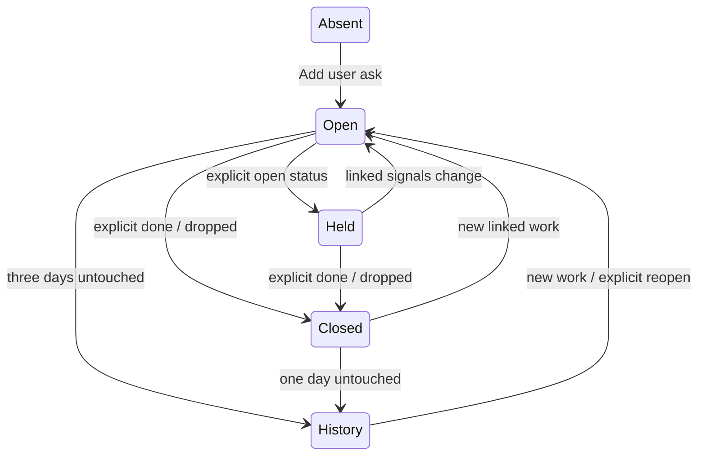

`Held` and `History` in the diagram are projections of policy/placement, not competing authorities for status.

| State | Event/guard | Next; effects |
| --- | --- | --- |
| absent | Add valid ask and IDs | commit open queued/active; return revision |
| open/closed | Edit/Link/Unlink/Attach matching expected revision | commit patched record and touch/placement using existing policy; validate linked ownership and media |
| open/closed | ExplicitStatus open | commit open held at current observed baseline, active |
| open/closed | ExplicitStatus done/dropped | commit closed with current baseline and timestamp, active |
| open following | Signals newer and complete enough | derive status with existing precedence needsYou → active worker/build → successful linked build → retain; commit observation and any status history |
| open held | Signals equals baseline | same; explicit status holds |
| open held | Signals meaningful linked change | open following with new baseline; derive status using same precedence |
| closed | Signals old completion or missing linked object | retain closed; update trustworthy observation without reopening |
| closed/history | Signals genuinely new turn/build work | open following inProgress/active; commit reopening history |
| open/closed active | AgeDue after respective three/one-day untouched threshold | same status, history placement; commit, never delete |
| any record | Signals stale/unavailable, older revision or missing keys | retain previous known entries; mark observation uncertainty; do not infer completion or release a hold |
| any proposed mutation | CommitFailed/RetryCommit | C00 blocked/retry; no visible success before durable write |
| any | CancelEdit/OwnerClose | cancel only an undispatched edit; retain committed task and unresolved commit |

No transition for unchanged signals/early age tick, no automatic transition to done, and no deletion from History. A missing worker is not a completed worker. Capture source revisions before async gathering, then reject results older than a newer explicit edit. Keep the current cheap revision fence and save-before-publish behavior.

### M18 — Simulator admission and grant queue

One aggregate owns `State = accepting(Capacity, OrderedWaiters, Reservations) | draining(same) | blocked(same, Failure)`; capacity is configured (currently three), not duplicated in sessions and pool policy. Waiter child `queued(WaiterID, ThreadID, order) | granted(GrantID, reservedSlot, wake: WakeState, claimEvidence)`. `WakeState = owed(OutboxID) | queued(OutboxID) | delivered(Receipt) | turnObserved(TurnID)`; queue acceptance is not delivery. Claimed grants become `Reservation(sessionID, deviceID, owner)` atomically with session creation in the **same sims aggregate**. Each reserved device is unique; active capacity is distinct device reservations plus unclaimed grants, never an approximate count of booted simulators.

`Event = Start(thread, requestID) | CapacityAvailable | WaiterObservation | WakeQueued | WakeDelivered | WakeTurnObserved | Claim | ReservationReleased | Leave | Drain | Resume | StorageFailed | RetryCommit`.

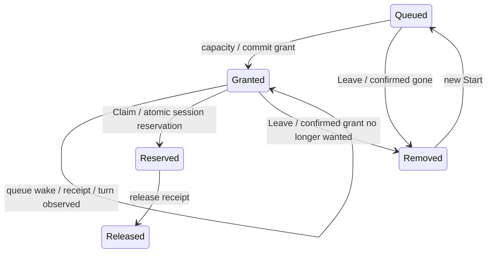

| State / child | Event/guard | Next; effects |
| --- | --- | --- |
| accepting | Start with existing live session/reservation/request | same; return existing receipt, never create duplicate |
| accepting | Start with grant or free slot and no earlier eligible waiter | commit reservation + M19 reserved session; acknowledge and emit BeginSession |
| accepting | Start without eligible capacity | commit queued waiter; return queued receipt |
| accepting / queued | CapacityAvailable | commit oldest eligible grant; enqueue M16 wake only after save |
| granted | WakeQueued / WakeDelivered / WakeTurnObserved matching grant | commit progressively stronger evidence; do not fabricate a new turn from delivery |
| accepting / granted | Claim valid matching thread/grant, device unreserved | atomic grant→reservation + session; begin M19 |
| granted/queued | WaiterObservation current gone, explicit Leave, or policy-confirmed completed wake turn without claim | commit removal; promote next eligible waiter |
| granted/queued | WaiterObservation stale/unknown or old turn completion | same; retain place/grant, surface uncertainty |
| reserved | ReservationReleased with M19 receipt of fulfilled safety obligations | commit removal and promote; never free a slot on mere Stop intent |
| accepting | Drain | draining; reject new admissions, retain durable waiters/grants/reservations |
| draining | Resume by current service incarnation | accepting; reconcile actual sessions before promotion |
| any | StorageFailed/RetryCommit | C00 blocked/retry; do not acknowledge a grant or issue its wake before commit |
| queued/granted | Leave/OwnerClose | explicit Leave removes user's request; OwnerClose preserves journal for next service |
| reserved | Leave | send M19 Stop; keep reservation until release receipt |

No transition for early/duplicate capacity event, claim by another thread, absent grant receipt, or unavailable device. If a previous holder is stopping, return `waitingForRelease(reservation)` and listen for its receipt; exhausting a poll count never authorizes reuse. Grant expiry should be based on explicit lifecycle evidence; a new time-based expiry would be a product policy requiring a visible reason, not an implementation shortcut.

### M19 — Simulator session, recorder and cleanup obligations

`State = reserved(Intent) | opening(Intent, OpenStep) | recording(Lease, RecorderIdentity, StopPolicy) | finalizing(Finalization) | finished(MediaReceipt, CleanupReceipt) | failed(Failure, CleanupReceipt)`.
`OpenStep = deviceOpening(commandID) | booting(deviceLease) | startingRecorder(deviceLease, outputIntent)`.
`Finalization` is an explicit product of independent obligations created from the **actual acquired leases**:

- `Recording = stopOwed(identity) | stopping(identity) | stopped(artifactCandidate) | unusable(reason)`.
- `Filing = waitingForStop | notProduced(reason) | publishing(candidate, transformPolicy) | published(MediaReceipt) | failed(Failure, retainedPath)`.
- `DeviceClose = notAcquired | closeOwed(DeviceLease) | closing(DeviceLease, attempt) | closed(Receipt) | blocked(DeviceLease, Failure)`.
- `PoolRelease = waitingForRecorderAndDeviceClose | releaseOwed(DeviceID, ownershipProof) | releasing(...) | released(Receipt) | blocked(..., Failure)`.

Constructors enforce filing cannot start before recorder stop, and release cannot start while a recorder or device session still holds the device. If opening failed before a recorder existed, recording is unusable and filing is notProduced; notAcquired discharges the device-close requirement. This is deliberate conservative policy; if T3 close remains unknown, the slot remains occupied and visible as cleanup blocked. Never erase the obligation after twenty attempts. Manual administrative resolution needs a proof/reason receipt, not a boolean “abandoned.”

`Event = BeginSession | DeviceOpened | Booted | RecorderStarted | StepFailed | Observation | Stop(reason) | LimitDue | RecorderExited | RecorderStopped | TransformResult | MediaPublished | CloseResult | ReleaseResult | RetryDue | ResolveWithEvidence | Drain(mode) | Cancel`.

```mermaid
stateDiagram-v2
    Reserved --> Opening: BeginSession
    Opening --> Recording: device + boot + recorder ready
    Opening --> Finalizing: failure / Cancel / Stop
    Recording --> Finalizing: Stop / idle proof / limit / recorder exit
    Finalizing --> Finalizing: stop / file / close / release receipts
    Finalizing --> Finished: media published and cleanup settled
    Finalizing --> Failed: media failed and cleanup settled
```

| State / region | Event/guard | Next; effects |
| --- | --- | --- |
| reserved | BeginSession after reservation commit | opening; persist effect intent, open through T3 |
| opening | DeviceOpened / Booted / RecorderStarted matching step | commit receipt and advance one step; record exact owned process identity/output |
| opening | StepFailed/Cancel/Stop | finalizing with only acquired obligations; release partial resources, report error |
| recording | Observation current busy/waiting | retain recording; cancel idle eligibility clock |
| recording | Observation current idle | arm idle policy clock with observation revision; on revalidated due, finalize |
| recording | Observation stale/unknown | invalidate eligibility; retain session, do not count uncertain time as proven idle |
| recording | Stop/LimitDue current configured limit/RecorderExited | commit finalizing reason; stop/reap recorder, close device; limit is explicit product policy |
| finalizing stop owed | RecorderStopped/RecorderExited | commit stopped candidate or unusable; start filing; enable release only when close also settled |
| finalizing publishing | TransformResult success | publish transformed file with provenance |
| finalizing publishing | TransformResult failure | explicit `retainedOriginal(reason)` result **only if raw retention is the declared policy**; otherwise failed; expose warning and continue owed cleanup |
| finalizing publishing | MediaPublished | commit media receipt, emit turn attachment/outbox receipt once |
| finalizing close/release | CloseResult/ReleaseResult success or authoritative already absent | commit closed/released receipt; notify M18 only after release commit |
| finalizing any region | StepFailed/transient CloseResult/ReleaseResult | retain exact owed obligation; classified retry/backoff or blocked failure |
| finalizing blocked | RetryDue/ResolveWithEvidence | retry eligible effect or settle from authoritative identity/evidence; audit manual resolution |
| recording | Drain(handover) | persist adoption manifest and verified recorder identity; keep recording for successor, no stop implied |
| reserved/opening/recording | Drain(stop) | finalize; stop/reap owned producer and discharge obligations |
| finalizing | Cancel/OwnerClose | cannot cancel cleanup debt; persist progress and transfer/stop as M27 requires |
| finalizing | all regions settled | finished if published, otherwise failed; persist terminal receipt |

No transition for duplicate stop, stale idle clock, close result for another T3 device lease, or unverified recovered PID. Failed media does not erase cleanup; a failed close does not erase media. Restore verifies process start identity **and** owned output/session before adopting; command-line substring alone is not durable identity. If identity cannot be proven, protect the device, mark recovery blocked and do not signal an arbitrary process. Orphan discovery is a recovery event, not an alternate cleanup loop that mutates sessions.

### M20 — Simulator pool provenance and cleanup

`State = unobserved(Provenance) | protected(Provenance, Protection) | eligible(Provenance, Evidence) | acting(ActionIntent, Evidence) | blocked(Provenance, Failure) | absent(RemovalReceipt)`.
`Provenance = userOrUnknown | squircleCreated(CreationReceipt) | squircleBooted(BootReceipt)`; touches are observations, never sufficient ownership by themselves. `Protection` carries reservations, active T3 sessions, working/needs-you/unknown execution and any unmatched process. `Action = shutdown | delete`; deletion requires Squircle creation plus explicit age/absence policy. This per-device reducer consumes one immutable inventory/execution/lease snapshot; pure `plan` can remain the policy function inside it.

`Event = Inventory | ExecutionObservation | LeaseChanged | IdleDue | RequestCleanup(dryRun) | Revalidated | ActionSucceeded | ActionFailed | ProvenanceSaved | Cancel`.

```mermaid
stateDiagram-v2
    Unobserved --> Protected: incomplete / user owned / active evidence
    Unobserved --> Eligible: owned and freshly proven idle
    Protected --> Eligible: all protections released with current evidence
    Eligible --> Acting: cleanup requested, revalidated, intent committed
    Acting --> Protected: shutdown receipt
    Acting --> Absent: deletion receipt
    Acting --> Blocked: failure / unknown outcome
    Blocked --> Protected: fresh reconciliation
```

| State | Event/guard | Next; effects |
| --- | --- | --- |
| any non-acting | Inventory/ExecutionObservation/LeaseChanged | classify protected or eligible from coherent current snapshot; unknown protects |
| eligible | IdleDue/RequestCleanup | dryRun returns plan only; otherwise ask owner for fresh evidence and reserve cleanup exclusion |
| eligible | Revalidated all conditions still true | commit acting intent; execute shutdown/delete with device identity and exclusion lease |
| eligible | Revalidated changed/stale/active/needs-you | protected; release cleanup exclusion, no destructive effect |
| acting | ActionSucceeded | shutdown→protected(now shut down); delete→absent; commit provenance receipt, release exclusion |
| acting | ActionFailed before effect | blocked; preserve provenance and error; release exclusion safely |
| acting | ActionFailed outcome unknown | blocked; inventory reconciliation required before retry/release claim |
| acting | ExecutionObservation/LeaseChanged newly protecting device | cancel before effect if still unsent; otherwise blocked with actual outcome owed, stop further destructive steps and reconcile; cannot undo an already executed action |
| blocked | Inventory authoritative result | classify actual state; resolve or retain owed action, no assumed success |
| any | ProvenanceSaved | C00 commits only matching revision |
| eligible | Cancel | protected/cancelled request; release exclusion |
| acting | Cancel/OwnerClose | retain unknown action until receipt/reconciliation; cannot undo shutdown |

No transition permits shutdown of `userOrUnknown`, deletion of merely booted devices, or cleanup using stale “not working.” M18 admission and M20 cleanup acquire mutually exclusive device reservations in the sims owner; they cannot race through independent locks. External user/T3 activity still requires the Q1/Q4 contract: no local FSM makes an uncooperative external actor atomic.

### M21 — Build job

`State = queued(ProjectBuildIntent, AdmissionReceipt) | running(ProjectBuildIntent, ExecutionLease, Progress) | importing(ImportIntent, AdmissionReceipt, ValidationLease) | cancelling(ResourceLease, cause) | succeeded(ArtifactReceipt, PreviewLink) | failed(BuildFailure) | cancelled(CancelReceipt) | interrupted(RecoveryEvidence)`. `ResourceLease = execution(ExecutionLease) | validation(ValidationLease)`.
`ProjectBuildIntent` requires validated recipe, project/thread provenance and request ID; `ImportIntent` requires immutable artifact source. `Progress = executing(summary) | validating(ProcessReceipt, artifactCandidate)` makes process exit distinct from accepted artifact. An imported build cannot launch Xcode. Preview is M22, so failed preview cannot change a successful IPA to failed. The jobs aggregate owns admission and leases; helpers cannot publish terminal state by copying a mutable `Job`.

`Event = Admit | LaneGranted | Progress | ProcessSucceeded | ProcessFailed | ArtifactValidated | Cancel | ProcessStopped | PreviewReceipt | PersistFailed | RetryCommit | ServiceStopping | RecoveryInspected`.

```mermaid
stateDiagram-v2
    Queued --> Running: lane grant / running committed
    Queued --> Cancelled: Cancel
    Running --> Succeeded: process success + validated artifact
    Running --> Failed: failure
    Running --> Cancelling: Cancel / service stop
    Cancelling --> Cancelled: process stopped and reaped
    Running --> Interrupted: recovery without live execution owner
```

| State | Event/guard | Next; effects |
| --- | --- | --- |
| no job | Admit valid recipe/import and free admission | commit queued/import intent and idempotency receipt; then enqueue lane or validate import |
| queued | duplicate Admit same request | same; return existing job receipt; conflicting payload rejects |
| queued | LaneGranted current admission lease | commit running; start M28 process only after save |
| importing | Cancel/ServiceStopping | cancelling(validation lease); commit cancelled only after ProcessStopped carrying its file/resource cleanup receipt |
| running | Progress current execution | update bounded progress, no authority change |
| running | ProcessSucceeded | retain running with artifact validation owed; validate and fsync artifact/metadata |
| running validating/importing | ArtifactValidated | commit succeeded + release execution/admission lease atomically; enqueue build notification/task signal and optional M22 preview |
| importing | ProcessFailed (validation adapter failure result) | commit failed after validation resources settled; release admission |
| running | ProcessFailed | commit failed and release only after process ownership settled |
| queued | Cancel/ServiceStopping | commit cancelled; remove lane request |
| running | Cancel/ServiceStopping | cancelling; stop M28, preserve partial artifact evidence |
| cancelling | ProcessStopped (including natural exit racing cancel) | cancelled with actual exit receipt; no success publication after cancellation won |
| succeeded | PreviewReceipt matching preview operation | update preview link/revision; retain IPA success |
| any committing phase | PersistFailed/RetryCommit | C00 blocked; retain unpersisted terminal outcome, block admission as required |
| restored running | RecoveryInspected no valid live owner | interrupted; retain logs/artifact candidate for diagnosis, never auto-start a duplicate build |
| running/cancelling | OwnerClose | require stop/reap or explicit transferable execution manifest; default builds are not transferable |

No transition for stale execution/preview lease, terminal-to-running, mismatched import fields or a second terminal completion. Admission is a bounded resource owned by state, not separate count/map updates. Store methods accept typed lease/revision and must reject stale terminal publication before writing disk or replacing the index entry.

### M22 — Preview and catalog publication

`State = idle(LastPublished?) | capturing(PreviewIntent, CaptureLease, LastPublished?) | staging(Intent, CaptureReceipt, LastPublished?) | publishing(Intent, StagedArtifact, CatalogExpectedRevision, LastPublished?) | published(PublicationReceipt) | failed(Intent, Failure, LastPublished?) | cancelling(Intent, Lease, LastPublished?)`.
Artifact presence child: `available(path, digest, validatedMetadata) | missing(expectedDigest, error)`. App identity/recipe is independent of this child; a missing image cannot delete or hide the app. Catalog edits use addressed M04/C00-style commands with revision checks. The renderer only accepts actual simulator capture provenance; no generated artwork.

`Event = Request | CaptureSucceeded | CaptureFailed | Staged | StageFailed | PublishSucceeded | PublishConflict | PublishFailed | ArtifactMissing | Repair | CatalogEdit | Cancel | CaptureStopped`.

```mermaid
stateDiagram-v2
    Idle --> Capturing: Request
    Capturing --> Staging: capture receipt
    Staging --> Publishing: validated immutable file
    Publishing --> Published: catalog commit receipt
    Capturing --> Failed: capture failure
    Staging --> Failed: validation / storage failure
    Publishing --> Failed: conflict / storage failure
    Capturing --> Cancelling: Cancel
    Cancelling --> Idle: capture stopped
    Failed --> Capturing: explicit retry
```

| State | Event/guard | Next; effects |
| --- | --- | --- |
| idle/published/failed | Request current app/build identity | commit intent; capturing; acquire M18/M19 capture session as required, keep last published image |
| capturing | CaptureSucceeded real source/owner matches | staging; validate PNG, dimensions, provenance; stage immutable private file |
| staging | Staged fsynced artifact | publishing; commit catalog pointer with expected app/build revision and source receipt |
| publishing | PublishSucceeded | published; release staging/capture leases, emit catalog revision; delete old bytes only when no readers |
| publishing | PublishConflict | failed(conflict, last); keep staged artifact for explicit rebase/retry, never overwrite newer preview |
| capturing/staging/publishing | matching failure | failed with exact progress/last; discharge capture/file obligations; unknown commit result first reconciles digest/receipt |
| published | ArtifactMissing | retain published identity with missing child; show placeholder/error; no fabricated image |
| missing/failed | Repair | inspect retained artifact/capture provenance; reuse verified bytes or request new real capture |
| any | CatalogEdit matching revision | separate catalog transaction; invalidates or rebases pending publication only by explicit event |
| capturing | Cancel | cancelling; stop producer/session; on CaptureStopped return idle(last) |
| staging | Cancel | idle(last) after releasing owned staged file; no catalog change |
| publishing | Cancel/OwnerClose | reconcile commit first; cannot claim publication was undone; retain cleanup receipt |

No transition for old capture result, mismatched source thread/app, invalid image, or concurrent publication without revision arbitration. Capturing new preview and retaining old published preview is an intentional product, not an invalid pair. Runtime filenames/rename/fsync implement immutability; a reducer alone cannot guarantee filesystem durability.

### M23 — Installation: delivery evidence and phone attempt

Keep server evidence and phone intent as separate children; neither claims installation from download completion.

Server `State = TicketValidity × Evidence × Map<TransferID, Transfer>`, where `TicketValidity = valid(Ticket, expiresAt) | expired(Ticket)`, `Evidence = issued | manifestRequested(at) | ipaOpened(at) | transferred(byteReceipt) | launchObserved(BuildIdentity, diagnosticsReceipt)`, and `Transfer = open(expectedLength) | streaming(expectedLength, sent) | complete(length) | aborted(sent, reason)`. These regions are intentionally independent: multiple downloads can exist after stronger evidence is received, and expiry must not discard that evidence. Evidence carries earlier timestamps/receipts as needed; launch proof does not depend on a successful transfer being observed by this service.

Phone `Attempt = idle | requesting(AttemptID, BuildID) | opening(AttemptID, Ticket, URL) | watching(AttemptID, Ticket, LastEvidence, watchUntil) | observed(AttemptID, Evidence) | unresolved(AttemptID, LastEvidence, Reason) | failed(AttemptID, Failure)`. `watchUntil` bounds observation cost, never declares install failure. Curtain child `hidden | showing(BuildIdentity, PresentationProgress) | suspended(BuildIdentity)` follows explicit local actions/build evidence and scene lifecycle; remove autonomous success assumptions from a sleep.

`Event = Install | TicketIssued | TicketFailed | URLOpenResult | ManifestRequested | TransferOpened | Bytes | TransferEnded | LaunchReport | EvidenceFetched | PollFailed | PollDue | TicketExpired | WatchExpired | ResumeWatch | SuspendRequested | SuspendResult | SceneInactive | Foreground | Cancel`.

```mermaid
stateDiagram-v2
    Idle --> Requesting: Install
    Requesting --> Opening: TicketIssued
    Opening --> Watching: OS accepted URL
    Watching --> Observed: evidence received
    Watching --> Unresolved: WatchExpired
    Requesting --> Failed: ticket refused
    Opening --> Failed: URL refused
    Watching --> Idle: Cancel observation
    Unresolved --> Watching: explicit resume
```

| Region/state | Event/guard | Next; effects |
| --- | --- | --- |
| phone idle/terminal | Install valid build | requesting; obtain ticket with stable attempt ID |
| requesting | TicketIssued / TicketFailed | opening and request OS URL open / failed with reason |
| opening | URLOpenResult accepted/refused | watching with explicit deadline / failed; OS acceptance means prompt opened only |
| watching | PollDue | M05 refresh ticket evidence; one fetch per ticket |
| watching/observed | EvidenceFetched | retain strongest verified evidence; observed at transferred or launchObserved with accurate label; optionally continue bounded launch watch |
| watching | PollFailed | retain last evidence and visible stale/error; classified retry, no false terminal status |
| watching | WatchExpired | unresolved(watch ended); stop poll, offer explicit resume; do not say installation failed |
| unresolved | ResumeWatch valid ticket/evidence target | watching with a new bounded observation budget; no second OS URL open |
| any phone attempt | Cancel/OwnerClose | cancel local watching/open waiter, retain identity if effect outcome unknown; cannot cancel OS installation |
| server valid ticket | ManifestRequested/TransferOpened | advance strongest evidence/start addressed transfer; persist milestone before reporting it |
| server expired ticket | ManifestRequested/TransferOpened | no transition; explicit expired refusal, no new byte stream |
| server transfer open/streaming | Bytes | accumulate bounded per-transfer byte counter; no per-byte durable write |
| server transfer | TransferEnded exact expected length with normal EOF | complete; persist transferred evidence meaning **bytes handed to response transport**, not phone acknowledgement |
| server transfer | TransferEnded abort/error/short read | aborted receipt; retain prior strongest evidence, expose transfer error |
| server any unexpired/expired ticket | LaunchReport valid paired build identity | launchObserved; persist diagnostic proof even if download receipt was missed |
| server valid ticket | TicketExpired | expired; keep evidence/history and policy for already admitted transfers |
| curtain showing | SuspendRequested explicit permitted local action | suspend request effect; scene event drives suspended state; request failure remains visible |
| curtain showing | SuspendResult failure / SceneInactive after accepted suspend request | retain showing with explicit failure / suspended; no installation inference |
| curtain any | Foreground with current installed-build facts | hidden or showing as projection of actual build mismatch; no install claim from elapsed time |

No transition downgrades launch to transferred or transferred to requested; byte-count callbacks never mutate ticket evidence outside the reducer. Repeated Install for the same live attempt returns it; a new attempt supersedes only the local watch. Background/OS replacement cannot supply a guaranteed launch callback; `unresolved` is a legitimate result, not a hidden fallback. Whether to retain the private suspend affordance at all is a product/API question, outside this structural proposal.

### M24 — Push and Live Activity delivery

App projection `Desired = hidden(reason) | visible(StepKey, Content, urgency) | pausePending(last, deadline)`. It derives from current thread/agent/build facts and recipient presence. Per-recipient link `State = absent | starting(StartIntent, DeliveryState) | awaitingToken(StartIntent, receipt, until) | running(ActivityIdentity, acknowledgedContent, Flight) | ending(ActivityIdentity, EndIntent, DeliveryState) | blocked(Obligation, Failure)`.
`DeliveryState = queued | inFlight(AttemptID) | unknown(AttemptID) | retryAt(Failure, time)`; `Flight = idle | update(ContentRevision, DeliveryState)`. A sent APNs request is transport acceptance, not device presentation. Store acknowledged content only after APNs success; keep activity token until successful End, definitive unregistration or explicit evidenced obsolescence. Alerts use M16 with APNs-specific receipts, not detached retry tasks.

`Event = Projection | Presence | TokenReported | Due | APNsAccepted | APNsRejected | APNsUnregistered | TransportLost | TransientFailure | StartWaitExpired | PauseExpired | StepDetail | Cancel | DeviceEnded`.

```mermaid
stateDiagram-v2
    Absent --> Starting: visible projection
    Starting --> AwaitingToken: APNsAccepted
    AwaitingToken --> Running: TokenReported
    Running --> Running: updated content accepted
    Running --> Ending: hidden projection
    Ending --> Absent: accepted End / device ended / unregistered
    Starting --> Blocked: permanent rejection
    Running --> Blocked: permanent update rejection
    Ending --> Blocked: permanent End rejection
```

| State | Event/guard | Next; effects |
| --- | --- | --- |
| absent | Projection visible, recipient eligible | commit starting intent; send Start when throttle policy allows |
| starting | APNsAccepted | awaitingToken; persist accepted receipt, arm named start-wait policy |
| starting/ending queued or retryAt | Due eligible | commit inFlight; send exact Start/End intent |
| starting/awaitingToken | TokenReported matching app/device start generation | running; persist activity identity; reconcile current desired content |
| awaitingToken | StartWaitExpired | blocked(token not observed); reconcile phone reports before any new Start; Q3 |
| running idle | Projection/Presence new desired content | update flight with stable content revision; coalesce superseded unsent content only |
| running update | Due | commit inFlight; send update |
| running update | APNsAccepted matching flight | running idle with acknowledged content; reconcile newer desired revision |
| running | Projection hidden / matching PauseExpired | commit ending; send End |
| ending | APNsAccepted/DeviceEnded | commit absent receipt; remove token only after commit |
| any flight | APNsRejected permanent | blocked with owed operation and reason; do not acknowledge content or discard End obligation |
| any link | APNsUnregistered authoritative token response | commit token invalidation/absent; await new registration, no retries with old token |
| running/blocked | DeviceEnded matching activity | commit absent with device receipt; cancel unsent updates/End; do not discard unrelated/newer activity |
| running/ending | TokenReported new valid token for same activity | commit identity generation; cancel unsent stale-token request, retain in-flight outcome for reconciliation |
| starting/awaitingToken | Projection changed while start unresolved | retain start obligation and newest desired projection; after token arrives, reconcile/update/end; never send a blind replacement Start |
| any flight | TransientFailure known before acceptance | retryAt; bounded rate policy with visible status |
| any inFlight | TransportLost | unknown; reconcile when possible; APNs duplicate delivery cannot be solved by local IDs alone |
| blocked | TokenReported repaired identity or Due after classified retryable repair | resume specific owed operation; permanent failures require changed configuration/evidence |
| app desired visible | Projection briefly idle | pausePending; explicit product delay; new work cancels pause; true hidden then emits End intent |
| app desired | StepDetail only if StepKey still matches | update derived content; stale step ignored with stale disposition |
| unsent Start/update | Cancel | remove/supersede unsent intent; no remote claim |
| sent/unknown Start or End | Cancel/OwnerClose | retain durable obligation; no blind second Start or token deletion |

No transition for stale generation, identical desired content, obsolete pause timer, or a local foreground claim treated as proof another phone saw content. Missing/expired presence is `unknown`, with a declared notification policy. Proposed conservative default: allow normal alert eligibility but do not claim active foreground suppression; product confirmation is Q3. Existing throttle and short pause delays remain explicit policies, not error recovery.

### M25 — Phone push registration, presence and activity reports

`Registration = unavailable(reason) | unregistered(TokenGeneration) | registering(TokenGeneration, EffectID) | registered(TokenGeneration, Receipt) | retrying(TokenGeneration, Failure, retryAt)`.
`Presence = inactive(Sequence) | active(Sequence, VisibleConversation?, leaseUntil)`, with delivery child `settled(ackedSequence) | owed(newestSnapshot) | sending(snapshot, EffectID) | unknown(snapshot)`. Preserve ordering; newer unsent presence can supersede older unsent presence, not reorder acknowledgements. Activity watcher child `unwatched | watching(ActivityID, TaskLease) | reportOwed(ActivityID, TokenGeneration) | ended(Receipt)`. Runtime owns every watcher task; no orphan lifetime outside host close.

`Event = PermissionResult | APNsToken | StartToken | RegisterResult | RetryDue | SceneChanged | VisibleConversationChanged | RenewDue | PresenceResult | ActivityFound | ActivityToken | ActivityEnded | ActivityReportResult | NotificationTapped | Close`.

```mermaid
stateDiagram-v2
    Unregistered --> Registering: complete token generation
    Registering --> Registered: accepted matching generation
    Registering --> Retrying: failure / unknown
    Retrying --> Registering: RetryDue
    Registered --> Unregistered: changed token generation
    Registered --> Unavailable: permission revoked
    Unregistered --> Unavailable: unsupported / permission denied
```

| Region/state | Event/guard | Next; effects |
| --- | --- | --- |
| registration any | PermissionResult denied/unsupported | unavailable; report reason, cancel unnecessary acquisition work |
| registration any | APNsToken/StartToken changed | unregistered(new generation); register complete snapshot, retain previous receipt for diagnosis |
| unregistered/retrying | complete tokens / RetryDue | registering; service registration effect |
| registering | RegisterResult accepted matching generation | registered; publish receipt and send pending presence/activity reports |
| registering | RegisterResult error/unknown | retrying with original generation/idempotency key; do not mark registered |
| unavailable | PermissionResult newly allowed | unregistered current token generation; begin normal registration when complete |
| presence any | SceneChanged/VisibleConversationChanged/RenewDue | generate ordered snapshot; owed; send when registration eligible |
| presence sending | newer change | retain in-flight plus newest owed snapshot; send next only after ordered settlement |
| presence sending | PresenceResult accepted | settle matching sequence; send newer owed snapshot |
| presence sending | PresenceResult failed/unknown | owed/unknown; retry same sequence before advancing or use server monotonic sequence rejection |
| watcher unwatched | ActivityFound | watching with owned task lease; resolve duplicate local activities by explicit stable policy |
| watcher watching | ActivityToken | reportOwed generation; send idempotent service report |
| reportOwed | ActivityReportResult success/failure | watching with receipt / retain owed retry; error is visible in diagnostics |
| watcher any | ActivityEnded | end watcher; report device-ended receipt to M24 |
| any | NotificationTapped | emit addressed M07 OpenTarget; registration machine never navigates directly |
| any | Close/OwnerClose | cancel and join watcher/renewal tasks, send best-effort last presence as a tracked effect; server expiry remains explicit unknown |

No transition for repeated same token, old registration response or duplicate watcher registration. Pending token reports persist in private phone storage if restoration requires them; authorization tokens retain existing secure storage rules and never enter logs. Permissions are not re-prompted on each retry.

### M26 — Idle compaction and fresh upkeep

`State = disabled(ConfigError) | observing | checking(Candidate, ObservationFence) | eligible(Decision, ReadingKey, Fence) | submitting(Intent) | unknown(Intent) | applied(Receipt, ReadingKey) | blocked(IntentOrCandidate, Failure)`.
`Decision = compact | fresh`; `Candidate` carries configured size/age/night policy and manual/automatic origin. `ReadingKey` identifies agent incarnation, source context watermark and threshold decision, not just a counter in memory. Mark applied only after a real command receipt. Fresh delegates to M14; it is not implemented a second time here. `Checking` owns one read-only context query through M28.

`Event = Tick | ManualCompact | Configuration | ContextRead | ReadFailed | Revalidated | IntentAccepted | IntentUnknown | IntentRefused | ReceiptFound | Retry | Cancel | ExecutionChanged`.

```mermaid
stateDiagram-v2
    Observing --> Checking: policy tick / manual request
    Checking --> Eligible: reading qualifies
    Checking --> Observing: no action, explicit reason
    Eligible --> Submitting: fresh eligibility / durable intent
    Submitting --> Applied: acceptance receipt
    Submitting --> Unknown: lost acknowledgement
    Unknown --> Applied: receipt found
    Submitting --> Blocked: refused
    Blocked --> Checking: Retry
```

| State | Event/guard | Next; effects |
| --- | --- | --- |
| any idle | Configuration invalid | disabled with structured reason; never silently use a default threshold |
| observing/applied | Tick/ManualCompact with current safe candidate | checking; read context using bounded read-only adapter |
| observing/applied | Tick ineligible | same; record reason (busy, needs-you worker, missing current shell, lifecycle not ready, already applied reading) |
| checking | ContextRead qualifying, nonduplicate reading | eligible; request fresh execution/worker fence |
| checking | ContextRead absent/nonqualifying | observing with explicit unavailable/no-action reason, not success |
| checking | ReadFailed | blocked(candidate, failure); classified retry; no consumed reading key |
| eligible | Revalidated still safe | commit submitting stable intent; compact via M04/M01 or fresh via M14 |
| checking/eligible | ExecutionChanged/Revalidated no longer safe | observing; cancel eligibility, do not dispatch |
| submitting | IntentAccepted/ReceiptFound | commit applied receipt/reading; await observed compact/session outcome where T3 exposes it |
| submitting | IntentUnknown | unknown; reconcile same intent; do not consume reading as successfully applied |
| submitting | IntentRefused | blocked; persist failure; reading remains eligible for explicit classified retry |
| unknown | ReceiptFound | applied; otherwise remain unknown pending reconciliation |
| blocked | Retry with current eligibility | checking; same logical intent if already sent; new read may change candidate |
| checking/eligible | Cancel | observing; cancel query/eligibility |
| submitting/unknown | Cancel/OwnerClose | retain durable intent and uncertainty; do not enqueue a second command |

No transition for early tick, identical applied reading, stale query or a missing context read interpreted as small context. Automatic destructive fresh requires Q1's safe boundary; absent it, defer with a visible reason. Compact also requires known runtime mode and immediate eligibility validation. A timer may trigger a check, never itself authorize compaction or replacement.

### M27 — Service lifecycle and handover

Server `State = stopped | acquiring(Invocation) | restoring(LockLease, Incarnation) | serving(LockLease, Incarnation, ReadyReceipt) | draining(DrainPlan, Owners) | blockedDrain(DrainPlan, Unresolved) | released(HandoverReceipt) | failed(StartupFailure)`.
`DrainMode = stop | handover(TransferManifest)`; transferability is explicit per owner. The kernel data-directory lock remains the single service exclusion authority. Handover receipt records predecessor incarnation, committed aggregate revisions and adoptable recorder identities; successor readiness names the receipt it adopted.

CLI supervisor `State = idle | locating | requestingStop(VerifiedProcess, desiredInvocation) | awaitingRelease(ProcessIdentity, intent) | starting(ChildLease, expectedHandover) | awaitingReady(ChildLease, expectedIncarnation) | succeeded(ReadyReceipt) | failed(Failure, LastEvidence) | cancelled(LastEvidence)`.

`Event = Start | LockAcquired | RestoreSucceeded | StartupFailed | ListenerReady | StopRequested(mode) | AdmissionClosed | OwnerDrained | OwnerFailed | DrainDeadline | RetryDrain | LockReleased | PredecessorExited | ChildSpawned | ChildExited | HealthReceipt | WaitDeadline | Cancel`.

```mermaid
stateDiagram-v2
    Stopped --> Acquiring: Start
    Acquiring --> Restoring: LockAcquired
    Restoring --> Serving: restore and listener ready
    Acquiring --> Failed: lock / config failure
    Restoring --> Failed: recovery failure
    Serving --> Draining: StopRequested
    Draining --> BlockedDrain: unresolved owner / deadline
    BlockedDrain --> Draining: RetryDrain
    Draining --> Released: owners settled and manifest committed
```

| Region/state | Event/guard | Next; effects |
| --- | --- | --- |
| server stopped | Start | acquiring; validate config/invocation, acquire exclusive lock |
| acquiring | LockAcquired | restoring; assign incarnation, migrate/read aggregates, reconcile resources before admitting requests |
| acquiring/restoring | StartupFailed | failed; settle acquired resources/lock; structured error, no healthy response |
| restoring | RestoreSucceeded + ListenerReady | serving; publish identity-bearing ready receipt after required owners ready; explicitly degraded owners listed |
| serving | StopRequested | draining; close admission first; fence all new background effects; close accept/body sources; notify owners with mode |
| draining | AdmissionClosed/OwnerDrained | accumulate exact receipts; stop builds and ephemeral operations; transfer only verified simulator recorders; persist manifest |
| draining | OwnerFailed/DrainDeadline | blockedDrain with unresolved obligations; keep lock while ownership remains; never claim successful handover |
| blockedDrain | RetryDrain | draining specific outstanding owners; explicit force-stop, if later supported, is a separate authorized destructive command |
| draining | all receipts + manifest committed + handlers quiescent | release lock last; released receipt; terminate predecessor |
| CLI idle | Start | locating; verify kernel-lock owner and full process identity/invocation |
| CLI locating | valid predecessor | requestingStop; signal verified owner with requested mode; then awaitingRelease |
| CLI awaitingRelease | PredecessorExited + lock released evidence | starting; spawn requested invocation (not arbitrary process arguments) |
| CLI starting | ChildSpawned | awaitingReady; query identity-bearing readiness |
| CLI awaitingReady | HealthReceipt expected incarnation/manifest | succeeded; print structured receipt |
| CLI any active | ChildExited/StartupFailed/WaitDeadline | failed with actual evidence and unresolved status; deadline bounds waiting, does not kill a different process or declare success |
| CLI active | Cancel | cancelled; stop local wait; state whether predecessor/successor continues; do not silently undo a requested restart |
| server draining | Cancel/OwnerClose | cancellation cannot resume admissions or erase debt; finish/retain explicit drain state |

No transition from generic HTTP 200 to successful handover, from PID disappearance alone to safe adoption, or from timeout to presumed cleanup. A failed handover may need operator repair; this is preferable to releasing ownership while old mutable loops still run. Q6 chooses user-facing wait budgets and whether explicitly degraded readiness is acceptable. Do not add a watchdog that masks a stuck owner as successful shutdown.

### M28 — Owned helper process

`State = idle | spawning(ProcessIntent) | running(ProcessGroupLease, OutputState, Deadline) | stopping(ProcessGroupLease, StopCause, OutputState) | reaping(ProcessGroupLease, ExitEvidence, OutputState) | completed(ProcessReceipt, OutputArtifact) | failed(Failure, CleanupReceipt)`.
`OutputState` has independently open/EOF/error stdout and stderr channels plus bounded byte counts. Holding the leader unreaped until process-group cleanup remains part of the lease; a saved PID is never a process-group handle. Queries, symbolication, build tools and simulator helpers use the same protocol with distinct output/timeout policy. Recorder transfer is an explicit M19/M27 extension, not generic process detachment.

`Event = Run | Spawned | SpawnFailed | Stdout | Stderr | PipeEOF | PipeFailed | LeaderExited | Deadline | OutputLimit | Cancel | KillResult | Reaped | PipesClosed`.

```mermaid
stateDiagram-v2
    Idle --> Spawning: Run
    Spawning --> Running: Spawned
    Spawning --> Failed: SpawnFailed
    Running --> Stopping: cancel / deadline / output or pipe failure
    Running --> Reaping: leader exit
    Stopping --> Reaping: group stop evidence
    Reaping --> Completed: group, leader and output settled
    Reaping --> Failed: failed exit or output
```

| State | Event/guard | Next; effects |
| --- | --- | --- |
| idle | Run validated argv/environment/output policy | spawning; spawn owned group with pipe/output limits |
| spawning | Spawned | running; acquire deadline and reader leases |
| spawning | SpawnFailed | failed with no process obligation |
| running/stopping/reaping | Stdout/Stderr within bound | update counters/digest; spool/parse bounded output through runtime |
| running | LeaderExited | reaping; retain leader ownership while settling descendants/pipes; do not wait forever for inherited pipes |
| running | Deadline/OutputLimit/PipeFailed/Cancel | stopping; record exact cause, signal owned group, drain bounded output |
| spawning | Cancel/OwnerClose | record cancellation; if late Spawned arrives, dispose by stopping/reaping through original owner |
| stopping | KillResult success or known already exited | reaping; reap leader and close/join readers |
| stopping | KillResult failure/unknown | retain ownership/blocked cleanup reason; retry only with valid lease identity |
| running/stopping/reaping | PipeEOF/PipesClosed/Reaped | accumulate completion receipts; finish only when process group, leader and readers settled |
| reaping | all receipts and successful exit/valid output | completed; return receipt/output once |
| reaping | all receipts and failed exit/cancel/deadline/output error | failed with typed cause/cleanup receipt |
| running/stopping/reaping | OwnerClose | same tracked stop/reap protocol; final Drop is emergency cleanup plus diagnostic, not normal transition logic |

No transition sends a signal using a reused bare PID, treats partial output as valid JSON, or reports success before output/process ownership settles. Preserve existing `OwnedGroup` safeguards. Deadlines and byte limits are explicit resource bounds with failures, not fallback output. Code that genuinely needs unlimited recording uses M19's declared policy instead of disabling every helper limit.

## 4. Composition contracts and effect ownership

An owner receives one envelope, reduces once, checks invariants and publishes the next state before scheduling effects. Async completions only enqueue result envelopes. No reducer is re-entered from an effect completion; no lock or main-actor critical section spans I/O. On Rust, a bounded mailbox serializes each aggregate; blocking filesystem/process work runs in the existing blocking execution facility. On Swift, UI owners are `@MainActor`; I/O/storage actors return immutable results. Both use explicit cancellation ownership and join/settle children before releasing their resources.

| Boundary | Contract; who owns the invariant |
| --- | --- |
| M01 → all T3 consumers | `Observation<T>(epoch, revision, freshness)` and classified command outcomes. Every consumer loses authority on disconnect; none infers idle from absent fields. Wire adapters are the only place raw JSON/status strings exist. |
| M03 ↔ M06 → M02/M07/M09 | A send owns immutable destination and attachment references. Creation commits one draft alias, then emits `ConversationAdopted`; caches/routes consume it by identity. A late capture keeps its original conversation. Rendering is never a send destination lookup. |
| M14/M15/M16 within agents aggregate | Child reducers produce a single candidate registry transaction. Fresh rebinding and notification markers/outbox receipt settle together. No async nested mutex locking or cross-file “best effort” transaction. |
| M17 ← agents/jobs | One immutable signal batch with per-source revisions, not reads of independently changing display maps. Task owner retains last known entries when a source is unavailable. Different sources need not pretend to share a T3 sequence. |
| M18/M19/M20 within sims aggregate | One capacity/reservation authority, including cleanup exclusion. Queue grants, session reserve and device claims commit together. Session close/release receipts free reservations; pool cleanup consumes the same reservation view. M20's provenance store remains its own file, with reconciliation intents for cross-file writes. |
| M21/M22 → M16/M17/M24 | Build/preview commits emit durable `BuildOutcome(job, revision, app, thread, artifactOrFailure)` obligations. Consumers dedupe logical outcome IDs. A successful build remains successful if preview, wake or alert fails. |
| M24 ↔ M25 | Registration generations, presence sequences, activity identities and APNs receipts are distinct. Phone report loss does not create another activity automatically. Service acknowledgement and device presentation are different facts. |
| M27 → every runtime | `Drain(mode, incarnation)` rejects new admission first, then requires per-owner receipts. An owner may report `blocked(obligations)`; shutdown cannot manufacture `drained`. All clock/effect executors are fenced by current incarnation. |
| Plugin/CLI → service/T3 | Commands decode into addressed intents and return structured receipts (`accepted`, `queued`, `unknown`, `refused`, `conflict`). CLI remains agent-neutral. Plugin context/guard/history/notes remain adapters: no polling agent state machine or new autonomous workflow in the plugin. |

For cross-aggregate notification, the source commit includes an owed event. Delivery to the destination is idempotent by event ID, then the source settles its obligation. A crash between destination commit and source receipt redelivers the same ID. Do not require a global transaction coordinator. For cross-file artifacts, stage/fsync immutable bytes, commit a pointer/receipt, then garbage-collect unreferenced staging by recorded ownership; never delete the only recovery evidence on a failed metadata write.

Effects have **intent identity**, **attempt identity**, and **resource ownership**, separately. Example: retrying one wake keeps its message/command IDs but gets a new transport attempt. Every effect has a concrete completion algebra: accepted/result, rejected-before-effect, unknown-after-send, cancelled-before-effect, and cleanup result. Avoid an “execute arbitrary closure” effect that hides state decisions or rereads mutable global choices.

The following are the proposed **effect enums**, in addition to shared `Commit`, `Emit`, `ArmClock`, `CancelClock`, `CancelEffect` and `ReturnReceipt` values. Each name takes the IDs/immutable payloads shown in its machine; each I/O variant declares its result event from section 3. The pure function for each owner is exactly `reduce_Mxx(State, Event) -> Reduction<State, Effect>` using that section's rows and ordered no-transition rules. There is no async work inside those functions.

| Owner | Domain effect variants (data, not callbacks) |
| --- | --- |
| C00 | `WriteCandidate(transaction, revision, bytes)`; `ReadCommitted(transaction)` |
| M01 | `OpenSocket(config, attempt)`; `WriteSubscribe(scope, cursor, id)`; `WriteRPC(command, id)`; `WriteInterrupt(subscription)`; `SendProbe(frontier)`; `CloseTransport(lease)` |
| M02 | `ReadCache(key)`; `BuildTranscript(snapshot)`; `WriteCache(snapshot)`; `EvictDerived(key)`; subscription/enrichment demand via Emit |
| M03 | `PrepareAttachments(intent)`; `EnsureDestination(createIntent)`; `DispatchExact(resolvedIntent)`; `ReadDeliveryReceipt(identity)`; `PublishAlias(draft, thread)` |
| M04 | `DispatchAddressed(intent)`; `ReadCommandReceipt(identity, expectedRevision)` |
| M05 | `ReadResource(key, version, requestID)` |
| M06 | `OpenStaging(owner)`; `StreamUpload(source, intent)`; `StreamDownload(source, staging)`; `VerifyPublish(file, expected)`; `ReadArtifactReceipt(id)`; `RemoveOwnedFile(lease)`; `ScanCache(root)` |
| M07 | `ReconcileMounts(projectedSlots)`; `ApplyPresentation(projection)`; `ResolveTarget(target, lookupID)`; `UpdateAccessibility(route)` |
| M08 | `ReadPairing` through current configuration adapter; `CreateSceneResources(scene, attachID)`; `CloseSceneResources(acquisition)`; `CloseModel(lease)` |
| M09 | `ApplyPanelProjection(projection)`; `SnapshotOutgoing(slot)`; `ReconcilePanelMounts(slots)`; `AcquireAttachmentHold(identity)`; `ReleaseAttachmentHold(lease)`; `SetWindowRole(role)` |
| M10 | `CreateProducer(intent)`; `FeedSample(lease, sample)`; `FinishProducer(lease)`; `CancelProducer(acquisition)`; `TransferArtifact(receipt, destination)`; `RemoveOwnedCapture(file)` |
| M11 | `ReconcileDisplayLink(cadence)`; `DrawPose(pose, revision)`; `PresentSprite(key, frame)`; `GrantLoops(selection)`; `ReleaseRenderLease(lease)` |
| M12 | `ReconcilePlayback(demand)`; `ApplyDeckProjection(projection)`; `EndOwnedTouch(channel)`; `SnapshotOutgoing(slot)`; `ReconcilePictureSlots(slots)` |
| M13 | `OpenAVCC(target, attempt)`; `ObtainInputTicket(target)`; `OpenInput(ticket)`; `Decode(packet, config)`; `SendInput(channel, orderedGesture)`; `CloseChannel(partialLease)` |
| M14 | `CreateThread(intent)`; `ReadHandoff(sourceRevisions)`; `ReadExecution(thread)`; `StopThread(fence)`; `RenameThread(intent)`; `ReadOperationReceipt(id)`; handoff delivery via Emit to M16 |
| M15 | `DispatchBootstrap(intent)`; `ReadExecution(thread)`; `StopThread(fence)`; `InspectGit(identity)`; `RemoveWorktree(validatedPlan)`; `ArchiveT3Thread(intent)`; `ReadOperationReceipt(id)` |
| M16 | `DeliverEnvelope(adapter, intent)`; `ReadDeliveryReceipt(adapter, identity)` |
| M17 | No domain I/O beyond common commit/events/receipts; signal gathering is an adapter feeding immutable Signals |
| M18 | No external mutation beyond common commit/events/receipts; emit BeginSession/WakeIntent after commit, never call T3 directly |
| M19 | `OpenT3Device(intent)`; `BootOwnedDevice(reservation)`; `StartRecorder(intent)`; `StopRecorder(identity)`; `InspectRecorder(identity)`; `TransformRecording(policy)`; `PublishMedia(receipt)`; `CloseT3Device(lease)`; `ReleasePoolReservation(proof)` |
| M20 | `ReadInventory` ; `ReadOwnershipEvidence` ; `RevalidateCleanup(intent)`; `ShutdownOwnedDevice(proof)`; `DeleteCreatedDevice(proof)` |
| M21 | `AcquireBuildLane(admission)`; `StartBuildHelper(recipe, lease)`; `ValidateBuildArtifact(candidate)`; `StopBuildHelper(lease)`; `ReleaseBuildLane(lease)` |
| M22 | `RequestRealCapture(intent)`; `ValidateStagePNG(candidate)`; `PublishCatalogPointer(expectedRevision, artifact)`; `InspectPublication(identity)`; `ReleaseStaging(lease)` |
| M23 | `IssueTicket(intent)`; `OpenInstallURL(attempt)`; `ReadInstallEvidence(ticket)`; `OpenIPATransfer(ticket)`; `RequestLocalSuspend(attempt)`; HTTP byte observations are events |
| M24 | `SendAPNs(kind, identity, contentRevision)`; `ReadCurrentStep(stepKey)`; `ReconcileActivityReports(device)` |
| M25 | `RequestPermission` on explicit startup policy; `RegisterTokens(generation)`; `ReportPresence(sequence)`; `WatchActivity(identity)`; `ReportActivity(generation)`; `EndDuplicateActivity(identity)` |
| M26 | `ReadContextWatermark(thread)`; `ReadEligibility(thread, workerRevisions)`; compact/fresh dispatch and receipt queries via Emit to M04/M14 |
| M27 | `AcquireServiceLock` ; `RestoreOwners(manifest)`; `BindListener(incarnation)`; `CloseAdmission` ; `DrainOwners(mode)`; `WriteHandoverManifest` ; `ReleaseServiceLock(lease)`; `InspectProcess(identity)`; `SignalVerifiedOwner(mode)`; `SpawnSuccessor(invocation)`; `ReadReadyReceipt(incarnation)` |
| M28 | `SpawnOwnedGroup(intent)`; `ReadBoundedPipes(lease)`; `SignalOwnedGroup(lease, cause)`; `ReapLeader(lease)`; `CloseReaders(lease)` |

UIKit projection effects are synchronous and idempotent against a revision; they may report `MountFailed`/resource errors but cannot choose business state. Storage or network effect adapters classify errors without deciding retries. Cross-owner “effects” such as M18 BeginSession are Emit requests to the sole resource owner, not direct calls that bypass it.

Backpressure is explicit: reserve mailbox capacity for cancellation/result events; coalesce replaceable snapshots/progress by key; reject new commands with `busy` when bounded admission is full. Never drop mutation outcomes, close receipts or queue grants. Runtime implementations must not await a send into their own full mailbox. High-rate video bytes stay in the bounded parser/decoder adapter; only protocol boundaries, failure and presentation frontiers enter the domain machines.

## 5. Persistence, restoration and versioning

The durable truth is the committed aggregate plus outstanding intents/receipts, **not the diagnostic event log**. Keep existing private atomic-file storage; do not copy/index T3's history. Proposed envelope: `{schemaVersion, aggregateID, revision, lastWriterIncarnation, state, owedEffects}`. An owed effect records operation/payload version, stable logical IDs, target and last known stage; it never contains a `Task`, socket or unchecked process handle.

| Machines | Persisted data | Restore/recovery decision |
| --- | --- | --- |
| C00 | Committed revision; write transaction ID in candidate file; atomic temp-file/rename protocol | Re-read final file and transaction ID after uncertain save; distinguish committed versus unsaved. Only execute effects encoded as owed in a committed candidate. Uncommitted in-memory outcome may be lost in a crash, so external effect reconciliation is still required. |
| M01 | Pairing/config through existing secure stores; optional known cursors | Transport/waiters are ephemeral. Restore stopped→connecting with a new epoch; all replicas start stale. No restored socket/current flag. Pending remote mutations belong to their originating durable machines. |
| M02 | Existing bounded thread cache, version/cursor/detail provenance | Cache is stale display data only. Validate schema, load and subscribe; corrupt cache may be quarantined and refetched with explicit diagnostic. Never use cached execution for deletion/reset. Derived row caches need not persist. |
| M03/M04 | **Proposed new** bounded private pending-intent journal: exact commands or secure payload references, IDs, draft aliases, outcome/receipts | Relaunch reconciles creating/dispatching/unknown before any resend. Rejected/unsent drafts remain editable; accepted pending echoes reconcile to T3. Only commands whose remote outcome may be ambiguous need durable entries; transient UI preferences before submission need not persist. |
| M05 | Optional last values/ETags through existing caches | No fetch/lease/timer survives. Restore unneeded/previous-stale; consumers reacquire; refresh only when needed. |
| M06 | Published artifact index, pending upload identity, owned staging manifest | Rebuild cache from validated private files; restore no reader leases; interrupted download is failed and safely restartable, ambiguous upload is unknown. Preserve source until send resolution. Bounded orphan cleanup uses ownership evidence. |
| M07–M09 | Optional last stable navigation destination/resume size under existing preferences | Restore a valid route after catalog resolution; no gesture, flight, key-window claim, scene/window/controller lease or transient notice survives. Overlay reattaches to a current eligible scene. Never restore a half-applied animation hierarchy. |
| M10/M11 | Only completed capture artifacts pending consumption; renderer assets are caches | Producers/display links are ephemeral. App death ends capture; discover owned unfinished file as interrupted, never claim completed. Jelly restarts from current domain state; no active loop leases restored. |
| M12/M13 | Optional preferred deck corner; authoritative session list belongs to service | All feeds/decoder/input/gesture/player leases restart stopped. Refresh session uses; acquire based on actual visibility. Never replay a touch after reconnect. |
| M14–M16 | Extend existing `agents.json` lifecycle/worker/outbox entries with operation phases, stable IDs, receipts and retry policy | Restore in-flight external mutations as unknown. Read current T3 before create/reset/archive/resend. Retain archive filesRemoved, fresh rebinding and missing-recipient reasons. Durable outbox keeps same identities across service restart. |
| M17 | Existing task book plus versioned policy/baseline/revisions/history | Restore exact explicit hold and closed/new-work baseline. No destructive migration of History. Age uses stored user-visible wall timestamps with a fresh clock sample; source freshness is unavailable until reobserved. |
| M18/M19 | Existing `sims.json` sessions/queue expanded with grants, reservations and independent cleanup receipts | Recover capacity from reservations **before admission**. Reconcile T3 leases, verified recorders and files; adopt only manifest-matching process identities on handover; otherwise retain protected recovery/cleanup debt. Promote queue only after commits. |
| M20 | Existing pool provenance plus action intents/receipts | Inventory and execution become unknown at restart. Validate provenance; protect unknown/user-owned devices. Reconcile an unknown cleanup result before another command; do not infer ownership from a booted device. |
| M21/M22 | Jobs index/records, operation leases, immutable artifact receipts, preview/catalog transaction identity | A process lease does not survive by deserializing. Mark ownerless build interrupted; validate output separately. Reconcile staged preview versus catalog digest/revision; preserve app/prior image. Never automatically rebuild an interrupted job. |
| M23 | Existing tickets/transfer milestones/diagnostic launch proof; optional phone watch identity | Restore server evidence monotonically; partial HTTP connection is aborted/unknown. Phone may resume a bounded observation; OS install outcome remains unknown until actual evidence. No automatic URL reopening on launch. |
| M24 | Existing tokens plus **new durable** desired/acknowledged content, start/end/update obligations and M16 alert entries | Restore sent-without-receipt as unknown; reconcile phone token reports. Do not acknowledge rejected End or repeat Start purely because time passed. APNs lacks the assumed exactly-once receipt lookup; per Q3 an unknown send is sent again (a duplicate is preferred over a lost notification). |
| M25 | Secure token generation/last acknowledged registration, owed activity reports and presence sequence | Recreate current system watchers, re-register idempotently, send current presence. Old foreground lease expires to unknown; never restore it as indefinitely foreground. |
| M26 | Upkeep intent, source reading key, receipt and unresolved outcome in agents aggregate | No in-memory consumed-reading shortcut. Reconcile unknown compact/fresh, then gather new current eligibility. Automatic unsafe fresh remains deferred under Q1. |
| M27 | Lock-file owner metadata plus incarnation, transfer manifest and adoption receipt | OS lock is authority, metadata is evidence. Successor must acquire lock, reconcile named aggregate revisions/resources, then report ready with its own incarnation and predecessor receipt. Crash recovery has no orderly handover receipt and must inspect instead. |
| M28 | Intent/outputs owned by calling aggregate; only explicitly transferable recorder identity persists | Ordinary helpers do not reattach from PID. Interrupted parent operation records cancellation/interruption; retained output is partial until validated. Transferable recorder adoption follows M19/M27. |

Phone pending intents are new product behavior (Q5, decided yes: persist and resend on relaunch): private Application Support files with platform data protection, no credentials or server token embedded, bounded by unresolved operation/attachment byte budget. Never evict an unresolved send silently to meet the budget; refuse additional admission and expose storage pressure. Clear resolved payloads promptly and retain only minimal dedupe receipts. Main app and injected overlay retain their existing separate process/container ownership; the accepted shared Keychain connection does **not** authorize a shared cross-app message database. Each host reconciles its own pending intents against T3. Record these retention/security choices before shipping persistence.

Version schemas independently per aggregate and wire payload. An additive compatible field may default only when its semantics are known (for example, a missing observation is `unknown`, never `idle`). New phase/case is an explicit migration or unsupported-version refusal. Migration validates legacy entries, writes a preserved original/backup, constructs one new candidate and atomically publishes it before service admission. Test existing legacy sim conversions (`src/sims.rs:156`) and pre-revision tasks; do not rewrite old uncertain facts as successful receipts. Corrupt **durable intent** files block the relevant owner with diagnostics; only disposable caches may be discarded/refetched.

Backward rollout rule: keep public string IDs and existing API fields via adapters while adding receipt/capability versions. Do not send new required commands to an old client/server without a negotiated capability. Older binaries that cannot read the new durable format must refuse startup; rollback requires a documented compatible reader or explicit data migration, not copying an old ledger over newer obligations. Exact command bytes/createdAt must remain fixed when idempotency depends on them. Record current T3 protocol capabilities and fixture versions when Q1/Q2 are investigated; no unverified minimum version is claimed here.

Timers persist **policy deadlines**, not sleeping tasks. Reconstruct timers with new generation IDs. Distinguish monotonic elapsed time within an incarnation from wall-clock deadlines across restart; after clock changes, recompute eligibility conservatively and expose anomalies. Retry cap exhaustion becomes `blocked(failure, owedEffect)`, never success or erased debt. Short pause, capture limit, ticket expiry and helper deadline are intentional policies; none stands in for an external acceptance/cleanup receipt.

## 6. Tests and invariants: only the invisible, tricky logic

Do not test that an enum changes to the case written in its switch. Test what must hold under **adversarial ordering, uncertainty, cancellation and crash boundaries**. Use table coverage to verify every state/event tag pair has an explicit decision, then property tests over small generated traces and data partitions. Exhaustiveness is over the finite control alphabet and declared guard partitions, not a false claim to enumerate all possible IDs, timestamps, strings or histories.

For each reducer expose `invariants(state)` and `obligations(state)`. Every DEBUG transition checks typed ownership, epoch/revision monotonicity, unique leases, effect identity and the absence of prohibited effect emission. Test runners also check invariants after every event. Swift uses existing XCTest with a small deterministic seeded trace generator/shrinker; reducers remain Foundation-only and can run in a host test target if the project can expose one without duplicating code. Until that target exists, native test execution still needs its real destination; do not label source fixtures as run. Rust uses existing tests plus a small seeded generator initially; add `proptest` as a test-only dependency only if its shrinking pays for itself. No large FSM framework in either language.

| Machine | Property or failure trace worth testing |
| --- | --- |
| C00 | Inject failure before temp write, before/after rename and before reply; no after-effect before commit, no false rollback of external success; restored owed effect has original identity. |
| M01 | Exit during setup, late old-attempt close, slow upload heartbeat, sent request deadline; no ready before required subscription contract, no leaked waiter or false refusal. |
| M02 | Replay overlap, unknown event, revert, cache-after-live, late render/details; displayed transcript references its own snapshot and cursor never advances on undecoded required state. |
| M03 | Upload/create/accept at each crash/cancel boundary; fixed IDs/bytes, destination survives navigation, draft alias survives refused first turn, unknown never becomes new send. |
| M04 | Lost approval/task-edit reply, superseding edit before old receipt, request already resolved; overlay removed only by addressed evidence, no default answer. |
| M05 | Acquire/release/invalidate racing fetch; at most one same-key fetch, old failure cannot replace newer value, explicit resource-specific stale state. |
| M06 | Interrupted streaming, ambiguous upload, reader acquired around eviction; never evict a leased/user file, no duplicate remote publish without receipt contract. |
| M07 | Rapid route/gesture/target-result reorder and draft adoption; no old lookup steals destination, exactly one content/input owner. Do not assert layout coordinates or text. |
| M08 | Scene replaced during attach/capture and late detach result; one scene lease, all displaced resources eventually disposed. |
| M09 | Capture flight superseded during resize/close, old rest/notice events; each attachment hold released exactly once, no current mount removed by old callback. |
| M10 | Stop/cancel/writer-fail/limit races; one producer stopped/settled once, no wrong-conversation landing or leaked file on late finish. |
| M11 | Visibility/policy/background/sprite completion permutations; no alarm/link after detach, at most four crew grants and one live hero lease per intended surface. |
| M12 | Use disappears during expansion, host hidden during input, live→recording; feed demand matches projected ownership and end-touch precedes release. |
| M13 | Split/truncated AVCC, reordered config/keyframe, input failure during drag, old reconnect touch end; interactive requires both channels, no gesture replay. Preserve parser fuzz cases. |
| M14 | Rename/create/rebind/handoff loss and save failure at each step; exactly one current app-agent identity, unknown mode never full access, no destructive effect from stale eligibility. Q1 limits the proven claim. |
| M15 | Needs-you execution, changing Git tip/merge resolution, stop projection lag, lost bootstrap reply; no remove without valid current proof; filesRemoved survives crash before archive reply. |
| M16 | Accepted-before-reply crash, duplicate event, recipient replaced while unknown, save failure; notified marker implies durable receipt, obsolete is not delivered. |
| M17 | Explicit edit during signal read; closed old completion→new turn; History with live link; missing worker signal; status holds and reopening survive restart. |
| M18 | Concurrent starts, failed grant save, leave during wake, duplicate claim, delayed release; capacity/FIFO/unique device holds survive all prefixes. |
| M19 | Failure after every acquisition, stop/file/close/release reordered, recorder death, handover adoption mismatch; cleanup obligations never vanish and terminal implies settled cleanup. |
| M20 | Stale inventory, needs-you/unknown user activity, admission during cleanup, provenance write failure; user/unknown devices never destroyed, stale eligibility never executes. |
| M21 | Lane grant after cancel, stale lease terminal result, terminal save failure, process success with invalid artifact; one admission receipt and no stale publication. |
| M22 | Capture/publication superseded, catalog commit unknown, image missing after publish; prior app/preview survives and unrelated revision cannot be overwritten. |
| M23 | Short/full/aborted concurrent download, late poll, lost status reply and watch deadline; transfer never implies install, launch evidence never regresses. |
| M24 | APNs rejected Start/Update/End, unknown Start, transient End, token rotation, late step; acknowledgement advances only on receipt and End debt retains identity. |
| M25 | Token changes during register, reordered presence/report replies, duplicate system watcher; current generation wins, watchers have owned teardown. |
| M26 | Context query races new work, command refused after qualification, crash before receipt; no reading marked applied before acceptance, unknown command never repeated with new ID. |
| M27 | Lock/manifest/save/child startup failures, handler that does not drain, stale health response; readiness belongs to successor incarnation and release requires real owner receipts. |
| M28 | Leader exits before descendant, inherited pipe remains open, cancel/output cap/deadline races; group reaped without PID reuse, no partial-output success. |

For every durable machine, use a generic **crash-cut harness**: for each emitted effect prefix, stop before/after durable commit, before external execution, after execution/before result, and after result/before next commit; restore and replay duplicates. Fake adapters expose accepted/refused/unknown independently. A bounded test explores interleavings and reports the seed plus shortest failing trace. Avoid real waits: inject clock events and deterministic IDs. Keep focused filesystem/owned-child integration fixtures only for guarantees a pure reducer cannot prove (atomic persistence, no-follow/private files, process-group cleanup, HTTP authentication before reading body). Never call live T3, agents, builds or a simulator from the suite.

Replay uses versioned normalized input events, original time/ID inputs and recorded effect results. Start from a compatible state snapshot, rerun the reducer **without executing effects**, compare state/effect digests and invariants, and stop on unsupported schema. Keep a small redacted regression corpus; an observed failure becomes one replay seed. Unrestricted production content logging is not needed or appropriate. Where redaction removes a branch-relevant field, supply a faithful synthetic replacement or mark that trace nonreplayable; a digest alone cannot reproduce arbitrary payload parsing.

Replace scattered happy-path/flag tests only when equivalent **behavioral** guarantees are covered. Preserve the reviews' failure fixtures for lost acceptance, History reopening, process descendants and parser/security contracts. Delete obsolete tests pinning removed design, not useful regressions. Separate fast reducer runs from rare adapter fixtures; measure suite runtime and retain the existing few-seconds execution goal. Do not add pixel/layout/text/golden tests or live integration calls as proof of diligence.

`SQUIRCLE_STRESS=1` remains the rendered-system audit (`StudioViewController.swift:347`, `:385`). Reducer checks prove valid abstract state; stress compares actual view hierarchy, frames, mounts and interaction against that state every frame. Navigation work must run it and report `violations=0`, then inspect interruptions and destination touches frame by frame in a Squircle-managed simulator. Extend the same audit vocabulary to overlay and sim deck ownership without claiming Studio alone covers them. UI changes also need actual simulator capture/catalog publication per AGENTS.md. Real phone, APNs, cellular/background and performance claims require their corresponding real evidence; this document has none.

## 7. Minimal tooling pattern

The shared code is a contract and driver, not a statechart framework. Initial estimate: **roughly 150–300 lines per language**, excluding durable I/O adapters, concrete reducers and tests. Start with local functions; extract only the repeated mechanics. Do not create a dynamic graph DSL, reflection registry, dependency injection container, observer bus or effect middleware chain.

Swift shape (illustrative; omitted domain types belong to each owner):

```swift
struct Reduction<State, Effect> {
    let state: State
    let effects: [Effect]
    let disposition: Disposition
}
protocol Machine {
    associatedtype State: Sendable
    associatedtype Event: Sendable
    associatedtype Effect: Sendable
    static func reduce(_ state: State, _ event: Event)
        -> Reduction<State, Effect>
    static func violations(in state: State) -> [Violation]
}
// A serial driver owns state, sequence, mailbox and effect leases.
// Async effect executors return Event; they receive no mutable state reference.
```

UI driver is `@MainActor` with async/await, owned `Task`s and an `AsyncStream`/explicit bounded mailbox. Off-actor work takes immutable `Sendable` snapshots. Frame scheduling uses `DisplayFrame.next()`/the existing frame driver; no Combine, Dispatch, `.sink`, `@Published` or `ObservableObject`. A task closure may decode I/O and return a result; it must not select another route, decide to retry or mutate a ledger. Those decisions are reducers. `scripts/check-swift-concurrency` stays mandatory and the baseline only goes down.

Rust equivalent:

```rust
struct Reduction<S, E> {
    state: S,
    effects: Vec<E>,
    disposition: Disposition,
}
trait Machine {
    type State;
    type Event;
    type Effect;
    fn reduce(state: Self::State, event: Self::Event)
        -> Reduction<Self::State, Self::Effect>;
    fn violations(state: &Self::State) -> Vec<Violation>;
}
// One owner task + bounded mpsc; effects return addressed Event values.
// serde is for durable/wire values, never live resource handles.
```

An effect runtime needs only: addressed resource/child-task registry, cancellable clocks, classified I/O adapters, commit executor and diagnostic sink. It must distinguish cancelling an effect waiter from discharging an external obligation. Rust `Drop` and Swift deinitialization retain emergency resource safety, while normal close is observable reducer-driven work. The smallest useful effect set is domain-specific (`OpenSocket`, `PersistCandidate`, `DispatchCommand`, `ReadReceipt`, `StopOwnedRecorder`); a generic `RunTask` with hidden mutable logic defeats the design.

**Bounded transition diagnostics.** Every discrete reduced event records `{schema, monotonicTime, ownerKind, opaqueOwnerID, incarnation, transitionSeq, eventTag, fromTag, toTag, disposition, causeID, effectIDs, revision, errorCode, invariantMask}`. Proposed default: fixed-size 4,096-record ring per process, approximately 0.5–1 MiB depending on encoding, plus a capped 4 MiB rotating service diagnostic file written in batches off hot paths. Measure the actual representation; these are budgets, not measured costs. No prompt/message text, image/video bytes, token, URL secret or full environment. Use bounded identifiers/digests; detailed errors live in existing redacted diagnostic channels.

Continuous frame/byte/progress sampling is numerical integration inside an unchanged control state; aggregate its counters/frontiers rather than writing one JSON record per frame or packet. Log every **discrete state/event decision**, including stale/duplicate/refusal, with repeated irrelevant broadcasts represented by a counted run record. DEBUG still checks frame invariants every frame. Any diagnostic sink overflow increments a visible dropped-record counter; critical obligations remain in the ledger, independent of log retention. An opt-in bounded replay capture additionally stores normalized inputs/results necessary for replay under the privacy rules above.

Expose diagnosis through existing agent-neutral CLI/JSON conventions: proposed `squircle diagnostics transitions --owner … --since … --json` and offline `… replay FILE --check`. These are **proposed commands**, not available today. Report current phase, last transition, blocked reason, owed effects, evidence freshness and schema version. Derive user-facing status from domain projections; do not expose implementation jargon in the phone conversation.

## 8. Migration: small, independently shippable slices

Extract a reducer around an existing behavior, route one owner through it, remove that owner's old writers, then ship. Do not retain a hidden legacy executor as fallback. During a temporary comparison phase a pure reducer may observe recorded events and compare predictions, but only one implementation executes effects; remove the comparison path before enabling the new owner. Keep HTTP/CLI/UI adapters compatible through explicit versions. A compile-time/controlled rollout selection chooses the owner once, never on an error path.

Sizes are rough **engineering days including focused tests/integration**, not promises, and assume one person familiar with that area. S is 1–3, M is 4–7, L is 8–12. External T3 protocol work and real-device validation are separate unknowns. Steps can contain multiple narrowly scoped commits; none requires migrating all 28 families to ship.

| Order | Shippable result and machines | Review findings/contracts retained or retired | Estimate / gate |
| --- | --- | --- | --- |
| 0 | Typed identity/outcome/observation contracts and C00 driver; one task-owner pilot M17 | B-S02, B-T01–03, C02/B-C01. Preserve existing task behavior and test actual persistence failures. | M, 4–6 days. No wire behavior change; publish schema/ownership contracts first. |
| 1 | Rust M01 dispatch identity, M16 durable outbox, then M26 upkeep intent | A04/A05/A06, B-A04, B-P01 alert loss, remaining commit/unknown-outcome walls 1/2/4. | L, 8–12 days. Q2 fixture/receipt decision; unknown paths can ship conservatively without resend. |
| 2 | M14 agent create/restart/fresh and M15 archive journal | A01–03/A08, B-A01–03, B-S02. Preserve already-fixed stopped/merge/bootstrap checks; remove mode fallback and journal pre-rename steps. | L, 8–12 days. Q1 must be resolved or destructive automatic paths explicitly deferred. |
| 3 | M18 admission + M19 obligations, then M20 provenance policy | R01–04, B-S02 simulator. Retires walls 5/6; strengthens already-fixed phase/close retry work. | L, 8–12 days. Existing queue/ledger migration and crash-cut tests; no actual simulator in unit suite. |
| 4 | Phone M01/M03/M04 with M05/M06/M02 extracted in that dependency order | N01–06/N08, B-N01–05, B-S01, B-E01/E03, B-M01/02, B-U01 addressed results. | L × 2, 12–20 days in independently shippable transport, send, refresh/media, replica slices. Q5 before new persistence; no performance claim from extraction. |
| 5 | M24/M25 using durable M16 alerts | B-P01–04 and push B-S02; retire Rejected-as-Sent and lost activity reports. | M/L, 6–10 days. Fake APNs proofs plus separate real-device verification; Q3 recorded. |
| 6 | M28 unify adapters, then M21/M22/M23 build/preview/install ownership | H02/H03/H04, B01–03, B-B01, B-E02, build/install B-S02. Preserve private artifact and process-group safeguards. | L, 8–12 days. Keep successful build independent of preview; transfer ≠ install contract fixtures. |
| 7 | M07 then M08/M09/M10/M11, M12/M13 presentation ownership | N07/N09/N10, U01–03/O01–03, B-U02/03, overlay/native B-S02, remaining B-C01. | L × 2, 12–20 days in route, overlay, capture/jelly, sim-channel slices. Rendered inspection and stress required; no redesign of Clay/chat/jelly product language. |
| 8 | M27 handover integrates already-journaled owners | H04, R04, B-S02 lifecycle; retires wall 10. | M/L, 5–8 days. Fake ownership/process tests first; live restart/adoption evidence separately authorized and recorded. |

**Step 0 landed (2026-10-16, branch `fsm-step0`).** `src/fsm/core/` holds the shared contracts (UUID-validated `TaskID`/`ThreadID`/`BuildID`/`OperationID`/`EffectID`/`TransactionID` that keep the original string, `ProjectID`, `Revision`, `Epoch`, `Observed<T>`, `Failure`/`FailureKind`, `Disposition`, `Reduction`, `Machine`) and C00 (`commit.rs`: the pure gate, a synchronous `Gate` driver for owners that save under their own lock, and the `JsonFile` adapter). M17 is `src/fsm/tasks/`; `src/tasks.rs` is now only its owner (validation, signal gathering, clock and IDs, commit). The HTTP/CLI wire format and task behavior are unchanged; no phone change, so no `StateCore` yet. Tests run: the full offline suite, 171 tests (148 library, 6 CLI, 14 HTTP contract, 3 service lifecycle), in about 4 s. Implementation notes: (1) `tasks.json` gains additive `transaction` and `revision` stamps; older files read as revision 0 and older binaries ignore the stamps. (2) A failed write is classified by re-reading the file: if it still holds another transaction the write is `refusedBeforeEffect` and the proposal is given up (the old behavior); otherwise (renamed but directory sync failed, or unreadable) it is `outcomeUnknown`, stays hidden and blocks the book, and the next task request first writes the same candidate again (`Retry`) before applying its own change. No timer retries. (3) Held/following is a projection, not stored: the existing hold sets the observation baseline and any later news re-derives status exactly as for a followed task, so a stored `Policy` would decide nothing. A closed task that gets new work but whose linked work implies no status keeps its status and returns to the active list, as before. (4) The task owner still saves under its mutex (as before), not through a mailbox; a tick reads signals outside the lock and applies them only at the revision it read.

**Step 1 landed (2026-10-16, branch `fsm-step1`).** `src/fsm/coordinator/` holds `Identity`/`Command` (an orchestration command whose `commandId` and `createdAt` are fixed when its intent is made), `Dispatched` (`Accepted | Refused | NotSent | Unknown`), M16 (`outbox.rs`) and M26 (`upkeep.rs`); `CommandID` joins the core IDs. Retires walls 1 (for `agents.json`), 2 (Rust side) and 4. Implementation notes: (1) **M01 command side.** `T3::dispatch` sends a command exactly as given (it no longer rewrites its ID or time) and classifies the answer: a typed T3 failure is `Refused`; an `InternalError`, a closed connection or the 45-second caller budget is `Unknown`; a frame that never left the service is `NotSent`. Only one sender exists. The subscription/readiness side of M01 is not a reducer yet. (2) **C00 for agents.** `agents.json` sits behind the `Gate`/`JsonFile` adapter from step 0 (additive `transaction`/`revision` stamps; older files read as revision 0): every registry change is a candidate saved before anyone reads it or any effect depending on it runs; a failed save publishes nothing, an uncertain one is written again before the next change. (3) **M16.** Each outbox entry saves its attempt's command identity, as possibly sent, before sending. A lost answer is sent again as the same command once its saved retry time comes (T3 answers from its receipt, see Q2); `NotSent` keeps the identity; only `Refused` makes a new one. An entry from before identities were saved is looked for in the thread first, as before. Retry state is per entry and durable (`failures`, `retry_at`, `error`; backoff 8–256 s as before), so one failing entry no longer holds the others. A shell that isn't current decides nothing; a recipient missing from a current shell is settled as **undelivered** (bounded `undelivered` receipts, last 20), never as delivered; its workers' events are settled either way so they aren't re-queued. Only never-sent entries follow a fresh start. T3 refusals are not split into permanent and transient (T3's wire doesn't say which), so a refused entry keeps waiting with a visible error instead of entering `failed`. (4) **M26.** The in-memory `upkept` map is gone. Each project has a durable `upkeep` record for its agent thread (`unknown | applied | blocked`, keyed by decision and the context reading's time). A compaction is saved with its exact command before it is sent and counts as applied only once T3 accepts it. An unanswered one is sent again, as that command, the next time compaction is wanted (or `agent compact` asks), never as a second command. A reading T3 refused is not tried again; a new reading is a new decision. A fresh start is saved as the agent's `ResetQueued` in the same commit and run by the existing reset runner (M14). Eligibility (ready lifecycle, current idle shell, no worker working) is checked again after the context read, right before deciding. Q1's race is accepted, so automatic compaction and fresh starts stay on. `agent compact` uses the same intent. HTTP/CLI wire formats are unchanged: `/v1/agents` agent objects keep their fields, and the new data lives in registry maps that aren't served. The one visible text change is that an unconfirmed `agent compact` now says it will be sent again. Tests run: the full offline suite, 180 tests (157 library, 6 CLI, 14 HTTP contract, 3 service lifecycle), about 4 s for the library tests. New: M16 reducer traces (identity kept until refusal, gone recipient versus non-current shell, legacy look-up), M26 reducer traces (lost answer settled by the same command after a restart, never on a successor; once per reading; refused reading), the owner's crash cuts with a fake T3 that keeps receipts per command ID (unsaved update neither seen nor sent; lost acknowledgement plus restart resends the same ID without a second message; undelivered only on a current shell; lost compaction answer plus restart; fresh start committed with its reset), and `T3::dispatch` classification over an in-memory socket. Nothing called live T3. **Deferred:** creation, stop, rename, archive, answer, send and the fresh-start handoff still send one identity per call (`dispatch_once`) with their existing reconciliation; journaling them is M14/M15 (step 2), along with removing the `full-access` default for an unknown runtime mode (also used for wake-ups). A worker bootstrap can't be deduplicated by ID (Q2), so M15 must keep reconciling it by observation. An older binary ignores the new fields, so after a rollback it could send an unanswered compaction again under a new ID.

**Step 2 landed (2026-10-16, branch `fsm-step2`).** M14 is `src/fsm/coordinator/agent.rs`, M15 `src/fsm/coordinator/worker.rs`; the shell-row decoding (`ThreadObservation`, `Execution`, `Phase`) moved to `src/fsm/coordinator/thread.rs` and is re-exported from `agents`. `src/agents.rs` is the only executor: it gathers observations, new identities and T3's answers, turns orders into commands, and saves each reduction before the effects after it run. Retires wall 3 and finishes step 1's deferrals. Implementation notes: (1) **M14.** A creation saves its exact `thread.create` (`creating.command`) before sending it; an unanswered one is sent again as itself by the next `ensure`, a refused one gets a new identity, and the reserved thread ID never changes. A restart saves its stop (`restarting.stop`) before sending it. A fresh start gathers the handoff (read-only), looks again, then saves its whole plan and steps one at a time, each saved with its command identity before it is sent: stop the old session, rename the old thread, create the new one, then rebind the agent, its workers and its never-sent updates in the same save that starts the handoff. A lost answer leaves the step as it is and the retry sends the same identity (T3 answers from its receipt); only a refusal makes a new one (a refused stop returns the request to the queue). A turn that starts before the stop took sends the request back to the queue with its note, so the handoff is gathered again. A replacement saved before steps resumes at creation and looks for a possibly sent handoff first. There is no separate `awaitingStopped` phase: as before, an accepted stop is enough for a restart or a rename, which remove nothing. Failures keep the existing per-operation error and backoff. (2) **M15.** Archiving is a journal in the worker's stage: `archiving` with `stopping{command}`, `removing`, `thread{command}`, then `archived` (the older `files-removed` still reads and resumes). Removal takes a stop receipt right at the removal, not the one from before inspection; Git blockers without `--discard` return the worker to active with its files; a refused stop returns it to active. A thread Squircle didn't start goes through the same reducer, unsaved. The existing stopped, merge-resolution, tip and never-started checks are unchanged. Bootstraps keep one identity per attempt (Q2: T3 can't dedupe them): a repeated `thread spawn` first looks at the current shell and sends again only if T3 doesn't show the thread; after an unconfirmed send the thread or its first message confirms it, and a failed read is reported instead of counting as absent. (3) **Caller commands.** `thread send`, `thread answer` and `ensure`'s message save their command (`intents` in `agents.json`, last 20) before it is sent. Only an unanswered one is kept; the same request (thread, kind and text; an answer also by its request ID) asked again sends that same command, never a second; the service never sends one by itself. (4) **Runtime mode.** No mode is assumed for a thread T3 reports none for: a worker inherits its agent's known mode or the spawn fails asking for `--runtime-mode`; a fresh start waits, with a visible reset error, until T3 reports a known mode; wake-ups, compactions and sends use the mode T3 reports for that thread and are not sent without one (an outbox entry waits with that error). A new agent created without a chosen mode still gets `full-access`; that is the documented default, not an unknown. HTTP/CLI formats are unchanged; `/v1/agents` lifecycles may now show `restarting`, a saved creation command and a replacement's step. Some error texts for unconfirmed stops, archives and sends now say what is resent. Tests run: the full offline suite, 191 tests (168 library, 6 CLI, 14 HTTP contract, 3 service lifecycle), about 4.2 s for the library tests. New: M14 reducer traces (each fresh-start step keeps its identity until answered; nothing acts on a busy, unknown or stale observation; a pre-step replacement; creation), M15 reducer traces (archive resumes from each saved step; nothing removed from a live or unmerged worker without discard; bootstrap settled by looking), and owner crash cuts with the fake T3: a fresh start cut at each of its four steps with a restart (each command reaches T3 once; rebinding moves only never-sent updates), an unknown runtime mode holding a fresh start and a send, a lost `thread send` answer asked again after a restart (one message), and an archive whose stop and T3 archive answers are lost across a restart (files removed only once shown stopped; one stop, one archive). Nothing called live T3. **Deferred:** M14/M15 `blocked` is still the per-operation error plus the existing reset backoff (no separate state); the 30-second stop wait and 5-second new-thread wait are unchanged; M01's subscription side is still not a reducer; bootstraps stay non-idempotent (Q2). An older binary can't read a worker stage `archiving` or lifecycle `restarting` and will refuse to open `agents.json` until the operation finishes or the file is migrated back.

**Step 3 landed (2026-10-16, branch `fsm-step3`).** M18 is `src/fsm/sims/admission.rs`, M19 `src/fsm/sims/session.rs`, M20 `src/fsm/sims/pool.rs` (the pure `plan` moved there); `src/sims.rs` and `src/simpool.rs` are now only their owners and the single executor (no legacy path). Every session and queue change is a reduction saved in `sims.json` through the C00 `Gate`/`JsonFile` before any effect that depends on it; `simpool.json` goes through its own gate. Retires walls 5 and 6. Implementation notes: (1) **One capacity authority.** A session reserves its simulator from the save that creates it until both cleanup obligations are settled: T3's device session closed and the pool's release decided. Capacity is distinct reserved devices plus unclaimed grants. Per Q4 a blocked close (or release) keeps its slot. Starts reserve and claim their grant in one save. The 120-poll wait for a previous holder is gone: a start for a device this thread's previous session still cleans up waits for the next save (its receipt) and is refused with the cleanup's error if it is failing; another thread's device is refused as before. (2) **M18.** Grants are saved before their wake is queued (`wake: owed → queued → started{turn}`; the older `woken` flag is still written), so a failed save wakes nobody and a restart wakes nobody twice. A place goes when T3 currently has no such thread, on `sim stop`, or when a turn after the grant's ends after the wake was queued; unknown state keeps it. (3) **M19.** Each obligation stands alone: recorder stop before filing; close before release; filing and cleanup independent. A close is never abandoned (an `abandoned` record reads as owed again); it backs off 3 s doubling to 5 min, and a failed close is settled as `absent` when T3's current device-session list doesn't have it. A failed release stays owed (it used to be cleared). `sim stop` now runs close and release before filing, so the simulator is shut down and the slot free when it returns. A step whose save failed leaves the session for the watchdog to resume from where it stands. The idle clock is disarmed by busy, needs-you (now protects; it used to count as idle) and unknown state, so uncertain time never counts toward the 8-second grace. Recorders are identified by PID, start time (`proc_pidinfo`) and the command line naming the session's file; a handed-over recording saved with a PID only is adopted on the command-line proof and gets its start time recorded. When compression fails the original is filed as declared policy, unchanged. (4) **M20 / Q4.** Ownership needs a receipt: an agent's `simctl create` (as before), a session's confirmed boot of a simulator T3 listed shut down, or an agent's own `simctl boot` (not of an already booted device); a boot receipt ends when the device is next seen shut down. Leasing, installs, launches and builds are observations only; earlier `leased`/`touched` entries are kept but no longer prove ownership. Protection is from explicit state: a session's reservation, the preview simulator, a T3 device session of a thread that is busy, waiting on the user, of unknown state, or not Squircle's, an agent's recent outside use while it may still work, and anything while T3's activity log can't be read. A cleanup reserves the device from the session owner (`Holds::exclude`, under the ledger's lock, so a start can't take it), saves its intent, plans again on a fresh snapshot and acts only if that still asks; outcomes are settled by simctl's answer or, after a crash, by the next inventory. (5) **Migration.** A `sims.json` without `schema` is copied to `sims.schema1.json`, converted (live sessions, owed closes, `release_pending`, the line and grants) and saved as schema 2 before anything is admitted; older binaries still read the flat fields. HTTP/CLI formats are unchanged: sessions are served through the earlier flat shape (`Served`), the new receipts live only in the ledger. Tests run: the full offline suite, 205 tests (182 library, 6 CLI, 14 HTTP contract, 3 service lifecycle), about 4.9 s for the library tests. New: M18 generated traces (one place per thread, grants never past the limit, the granted prefix, no wake before its grant is saved) and wake/relinquish cases; M19 orderings of every close/release/filing answer (slot held exactly until cleanup settles, nothing vanishes), failed start, idle clock and legacy records; M20 policy over every combination of provenance, thread state and T3 session (unproven devices never acted on), inventory reconciliation and old pool files; owner crash cuts with fakes: grant save failure (no wake, then one), blocked close and failed release holding the slot, a lost close settled by T3's list, the schema-1 ledger with a live handed-over recording and a woken grant, a cleanup revalidated away by a late T3 session or a new reservation, and an unanswered cleanup intent across a restart. No real simulator or live T3. **Deferred:** a session already booted before the upgrade has no boot receipt, so simulators booted before it are left for the user (or a reboot); the cleanup exclusion is in memory (a crash mid-cleanup is reconciled from the inventory before the next action); grant delivery is still inferred from T3's latest turn (`WakeDelivered` from the outbox would need an `Agents` accessor for whether a message ID is still queued); `Drain(handover)` keeps the existing service flow (M27), including the server's 10-second bound on `sims.shutdown`; a boot from `xcodebuild -destination` is an observation, not a receipt.

**Step 4a landed (2026-10-16, branch `fsm-step4a`): phone M01, M03, M04.** New `app/Squircle/Sources/ClientState/`: the Swift reducer contract (`Reduction`, `Disposition`, `CommandOutcome`, `CommandIdentity`), M01 `Link` with its one executor `LinkRuntime`, M03 `Delivery`, M04 `Commands`, and `PendingJournal`. `SquircleModel` is the single executor of M03/M04 and the host of M01; the connector loop (`connector`, `nap`, `retryNow`, `attempts`, `unstableCount`, background task), the imperative `deliver` send procedure, `dispatch`, `connection(after:)`, `responding` and the task-edit generations are gone, with no legacy path. Retires the phone side of wall 2 and M01's part of wall 8 (connection freshness as explicit state). Implementation notes: (1) **M01.** `connecting → synchronizing → ready`: ready only once the shell is current at T3's `synchronized` marker and the device state has sent its first value, on that attempt's socket (T3 0.0.45's server bundle sends `synchronized` after both its snapshot and its replay paths when asked; read from source, not tested against T3). Exit of a required subscription during setup fails the attempt; after ready it reconnects with the existing instability backoff. Retry (0.5 s doubling to 15 s), the 8 s offline grace, background lease, foreground probe and network-change handling are the same policies as before, now reducer rows driven by clock events with generation-checked timers. The open thread is an optional child (`follow`) that fails on its own: T3 ending it backs off 1 s doubling to 30 s and says so after three ends (it used to give up after five); an attempt no longer fails because the thread subscription did. The gateway no longer waits up to 15 s for a socket before a request: without one a request is `notSent` and its owner waits for the next `sessionReady`. The slow-uplink heartbeat accounting is unchanged. (2) **Command outcomes.** `T3Gateway.dispatch` classifies like Rust's: a typed `Fail` is `refused`; `InternalError`, a defect or a socket that went after the write is `unknown`; no socket is `notSent`. Service calls (agent creation, task edits): a 4xx answer is a refusal, a 5xx or lost reply is unknown. (3) **M03.** A send's intent is fixed at submit: message ID, turn command identity (ID and `createdAt`, which earlier builds regenerated on each retry), a draft's thread ID and exact `thread.create`, model, mode, pictures, recordings and the context Squircle appends. It is saved before any request that depends on it (C00 barrier in the executor), the exact turn command is saved once the thread is known, and the file is removed when T3 accepts or refuses. A lost answer leaves the message pending (`awaitingAcceptance`, no error); the next session sends the same bytes (Q2 receipts), and the thread showing the message, the shell showing the draft's thread or the Mac reporting the app's agent settle it without sending. Only a typed refusal rejects it; its pictures go back to the field of the conversation that owns it (the draft's thread once made). (4) **Q5, persistence.** One file per unfinished message in the host's own Application Support (`Squircle/pending-sends/`; the app and each overlay host separately, nothing through the shared Keychain group), protection `completeUntilFirstUserAuthentication`, excluded from backup, atomic writes ordered by sequence so a late save never resurrects a removed message. Budget 64 MB; past it a new send is refused rather than an old one evicted. On launch, preparing messages upload their recordings again (an upload repeated after a crash leaves an extra file on the Mac, never a second message); anything later is treated as possibly sent and resent as itself on the first session. An unreadable or newer-schema file is moved aside as `.unreadable` and reported, never resent. A save failure before anything left rejects the send; later it blocks that message (reported) until the next session tries the save again. (5) **M04.** Answers, approvals, interrupts, a thread's approval mode, task edits and new projects are addressed intents with fixed identities. Overlays (hidden request, pending mode, task row) stay until T3 or the Mac shows the result, or only that command is refused; a lost T3 command is resent as itself on the next session. An approval needs an explicit decision (the `decline` default is gone). An interrupt records the turn it stops and is resent only while that turn is still running, so a lost interrupt never stops a newer turn. One thread's mode and one task's edits are serialized: an unsent one is replaced, a sent one is followed by the newest. A lost task edit is settled by reading the list: shown there, done; not shown, the same edit is sent again (it sets a value, so repeating it is the same edit, though it would override a change the agent made in between). M04 intents stay in memory: after a relaunch an unanswered request shows again and can be answered under a new ID. Tests (in `Tests/T3Tests.swift`): M01 generated traces (sessions open and close in pairs and only after both scopes are current on that attempt; stale attempts; refusal), M03 crash cuts over a fake T3 that keeps receipts (killed before or after every save and after T3 ran a request: the message lands once, every create and turn has its first bytes, nothing is refused), the draft alias across a refused turn, restored preparation, M04 traces (lost approval resent as itself and settled by observation, interrupt never onto a newer turn, mode serialization, task-edit reconciliation), outcome decoding, and the journal across a model relaunch (same command byte for byte, removed once accepted) plus write ordering and unreadable files. The older test that expected an immediate resend after a lost answer was deleted (resends now wait for the next session). **Not yet run:** the app and its tests build (`build-for-testing`, simulator SDK) and `scripts/check-swift-concurrency` passes with the baseline unchanged (the only remaining use is in `UI/MotionAudit.swift`), but the test suite, the simulator checks (connects, sends, kill mid-send and relaunch resends once) and `SQUIRCLE_STRESS=1` were not run: the Squircle service (`serve`, pid 616) stopped answering any request during this work (listening, idle, every thread waiting on a condition variable), so `squircle sim start` could not hand out a simulator. **Deferred:** M05/M06/M02 (metadata polling, nil results for agents/sims/tasks/media, upload and download ownership, replica staleness on disconnect) remain for their slices, so wall 8's refresh part is not retired; a send refused after a relaunch gets its pictures back but its text only while the screen that sent it is alive (putting it back in the field needs a hook in `ThreadViewController`, outside P6); M04 intents are not persisted; there is no separate M01 `closing` state (closing a URLSession socket is synchronous).

Total planning range is about **71–112 engineering days**, with meaningful risk reduction landing in the first slices. This is intentionally not a proposal for a single rewrite. Re-estimate after steps 0–1; reduce scope if extraction yields no new ownership/invariant benefit. M28 adapter consolidation and phone work can progress independently once contracts exist; M27's ownership hooks are introduced with each owner, so the final step wires the protocol rather than rediscovering cleanup. Pure route/renderer code already following the reference pattern should stay small.

### Exclusive implementation packages for future parallel workers

These are assignments for later implementation, **not workers started by this design pass**. A file has exactly one owner throughout the plan. Shared-file integration is requested from that owner with an agreed interface patch/example; workers must not independently edit the same large file. New paths below are proposals. Inline tests belong to the source owner; new test files follow the same directory ownership. Dependencies are contracts, not permission for cross-editing.

| Package | Exclusive existing-file ownership | Exclusive proposed new paths / work and dependency |
| --- | --- | --- |
| P0 contracts/integration | `src/lib.rs`, `src/main.rs`, `src/server.rs`, `Cargo.toml`, `Cargo.lock`, `tests/http_contract.rs`, `tests/service_lifecycle.rs`, `tests/cli.rs`; `AGENTS.md`, `README.md`, `docs/`; app build/project configuration and `scripts/check-swift-concurrency` | `src/fsm/core/`; `app/Squircle/Sources/StateCore/`; shared schema contracts/diagnostic envelope. Sole integrator for server routes, module exports, CLI and test-target configuration. All others submit interface requirements; no domain state decisions in P0's adapters. |
| P1 T3/coordinator | `src/t3.rs`, `src/agents.rs`, `src/upkeep.rs`; `plugin/squircle/agents/app-agent.md`, `plugin/squircle/hooks/hooks.json` | `src/fsm/coordinator/`; M01 Rust, M14–16, M26. Depends on P0 IDs/outcomes/C00. Plugin guard/history policy remains intact. |
| P2 tasks | `src/tasks.rs` | `src/fsm/tasks/`; M17 and task commit adapter. P0 handles HTTP integration; P1/P5 provide typed observations. Good first pilot. |
| P3 sims | `src/sims.rs`, `src/simpool.rs` | `src/fsm/sims/`; M18–20, reservation/cleanup protocol. P7 supplies process helpers; P8 consumes published session uses. |
| P4 push | `src/push.rs`; `app/Squircle/App/PushCenter.swift`, `app/Squircle/Shared/SquircleActivity.swift`, `app/Squircle/Widgets/SquircleWidgets.swift`, `app/Squircle/Sources/PushTarget.swift` | `src/fsm/push/`, `app/Squircle/Sources/PushState/`; M24/M25. P1 supplies M16 adapter; P6/P8 integrate addressed navigation/presence via interfaces. |
| P5 build/catalog/install service | `src/model.rs`, `src/store.rs`, `src/apps.rs`, `src/media.rs` | `src/fsm/artifacts/`; M21–23 server evidence and artifact-publication side of M06. P0 alone changes handler orchestration; P7 owns capture/build helper execution. |
| P6 native model/transport | `app/Squircle/Sources/SquircleModel.swift`, `SquircleClient.swift`, `T3Gateway.swift`, `AgentStep.swift`, `T3ThreadState.swift`, `ClientModels.swift`, `AppProject.swift` (all under `Sources/`); `app/Squircle/Tests/T3Tests.swift` | `app/Squircle/Sources/ClientState/`; M01–06 and phone M23. P8 changes controllers only against this immutable projection/event API. No other owner edits SquircleModel. |
| P7 process/enrichment helpers | `src/xcode.rs`, `src/overlay.rs`, `src/preview.rs`, `src/projects.rs`, `src/perf.rs`, `src/symbolicate.rs`, `src/t3steps.rs` | `src/fsm/process/`; M28 plus I/O adapters. Preserve read-only SQLite and existing process-group fixture behavior; no live queries in tests. |
| P8 phone presentation/device channel | `app/Squircle/Sources/SquircleAction.swift`, `app/Squircle/Sources/T3DeviceStream.swift`; `app/Squircle/Sources/UI/` **except `Jelly.swift`**; `app/Squircle/Tests/SquircleActionTests.swift` | `app/Squircle/Sources/PresentationState/`; M07, M12/M13, curtain side of M23. P6 owns data, P9 owns shared jelly. Existing action parsers remain contract-tested. |
| P9 overlay/capture/jelly | `app/Squircle/Overlay/` entire directory; `app/Squircle/Sources/UI/Jelly.swift`; `app/Squircle/Tests/OverlayCaptureTests.swift` | `app/Squircle/Sources/OverlayState/`; M08–11. Common app/overlay looks remain one component. Coordinate M07/M09/M12 host leases with P8; no duplicate conversation renderer. |
| P10 lifecycle | `src/service.rs`, `src/serving.rs` | `src/fsm/lifecycle/`; M27. P0 alone integrates server startup/shutdown; other owners implement drain/adoption protocol in their own files. |

Any existing file not assigned is out of package scope until P0 assigns it once and records that change. In particular, guard/history/notes and unrelated build tooling are not invitations for speculative edits. Existing tasks/module test files not listed are assigned explicitly before work, never implicitly shared. Future workers can split a package by **new-file** ownership, with its existing-file owner doing final integration; do not parallelize edits to `agents.rs`, `server.rs`, `SquircleModel.swift` or `SquircleOverlay.swift`.

Each slice's acceptance record includes source commit, schema version, reducer/adapter tests actually run, concurrency check where relevant, measured suite runtime and any remaining unknown outcome. UI slices add actual capture/stress evidence. A tested pure machine does not establish that its runtime adapter sends the right T3 command, or that rendered motion is correct.

## 9. Open questions and deliberate limits

1. **Q1 — Can stock T3 conditionally stop/compact against session/turn/revision?** **Decided (user, 2026-10-16): accept the residual race for now.** Squircle checks T3 is idle from a current observation and then stops or compacts; another client can start work between the two (TOCTOU). No T3 changes, no fork, no SQLite writes. Revisit only if the race bites in practice. Destructive paths still need defensible current stopped evidence; a reducer cannot add the absent server fence.
2. **Q2 — What dedupe and receipt guarantees does the installed T3 version provide?** **Answered from source (2026-10-16), installed T3 Code (Alpha) 0.0.45**: I read the server bundle (`apps/server/dist/bin.mjs` in the app's `app.asar`) and queried `state.sqlite` read-only. Nothing was tested against live T3. T3 keeps `orchestration_command_receipts` (`command_id` primary key, aggregate kind and ID, `accepted_at`, `result_sequence`, `status accepted|rejected`, `error`) and writes a command's receipt in the same SQL transaction as its events. The engine handles commands one at a time and looks up the ID before deciding: an accepted ID answers with its original `{sequence}` and does nothing; a rejected one fails with `OrchestrationCommandPreviouslyRejectedError`; the same ID on another thread or project fails with `OrchestrationCommandIdConflictError`. **The payload is not compared**, only the aggregate. A rejected receipt is kept only for T3's own rejections; other failures roll back and leave none. No code deletes receipts. The live database holds 143,982 of them dating back to 2026-07-25 (one rejected), so they survive T3 restarts. On the wire, any failure without a typed `Fail` (defects, interruptions, for example during shutdown when a queued command may still run) is rewritten to `Fail(InternalError)`. So only a typed failure proves nothing was committed. Exceptions: a `thread.turn.start` with `bootstrap` prepares the worktree and creates the thread (under a server-random command ID) before the client's ID reaches the engine, so a bootstrap is **not** idempotent by ID. Archive's follow-up stop uses a derived ID. No client RPC reads a receipt. Sending the same command again *is* the receipt query, and it runs the command if T3 never had it. Replay-completion markers (M01's subscription side) were not examined. **Decision, as implemented in step 1:** command IDs are fixed when the intent is saved. An unknown outcome is settled by sending the same command again only when running it now would still be right (outbox entries: always; a compaction: when compaction is wanted again). A new ID is made only after a typed refusal. No exactly-once claim beyond T3's receipt, and none for bootstraps. The phone's sends already relied on the same receipt behavior.
3. **Q3 — Which APNs uncertainty policy is acceptable?** **Decided (user, 2026-10-16): prefer risking a duplicate over losing a notification.** When an APNs send's outcome is unknown, send again rather than drop it; a rare duplicate alert or activity update is acceptable. Local journaling still cannot prove device presentation. Actual APNs/ActivityKit behavior needs current primary-doc verification and device evidence during implementation.
4. **Q4 — Which simulator ownership evidence is sufficient?** **Decided (user, 2026-10-16): the default.** Only proven Squircle creation or boot permits cleanup; touches and leases are observations. Needs-you, stale, unknown or unmatched process/session ownership protects. A blocked close (or release) keeps holding its capacity slot. Recorder adoption needs the PID's start time and its command line naming the session's file (a PID-only record from before step 3 is adopted on the command line and given its start time). No local FSM makes an uncooperative external actor atomic. Implemented in step 3.
5. **Q5 — Persist phone/overlay pending sends across relaunch?** **Decided (user, 2026-10-16): yes.** Pending phone and overlay sends persist in each host's private container and are resent on relaunch (after reconciling against T3, so an accepted send is not repeated). Settled in step 4a: 64 MB budget (a new send is refused past it, nothing evicted), the pending bubble stays as it was (no new retry UI), files readable after first unlock. Do not broaden shared Keychain access into a shared transcript/intent store.
6. **Q6 — What are the lifecycle waiting and degraded-readiness policies?** **Decided (user, 2026-10-16): a service restart waits for running builds to finish rather than cancelling them.** Other drain/readiness details (which noncritical owners may be unavailable at ready) are settled with M27; unresolved destructive ownership still prevents a successful handover, and retained cleanup obligations remain inspectable and retryable.

These questions gate particular guarantees/behaviors, not the entire decomposition. Pure reducers, typed outcomes, commit boundaries, conservative unknown states and focused replay tests can ship before each external contract is resolved. The design deliberately leaves visual timing, product workflow, model orchestration, CLI authorization and T3 protocol ownership unchanged unless a later explicitly reviewed decision says otherwise.
