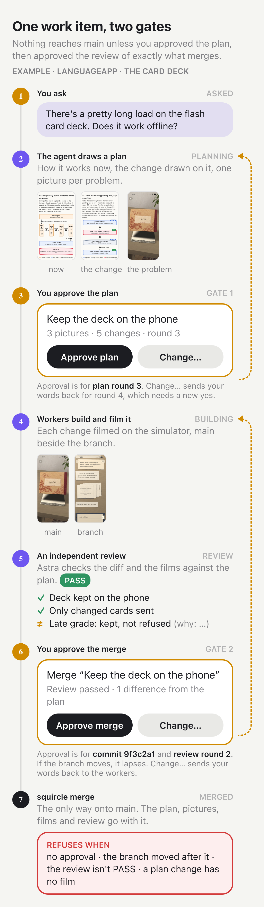
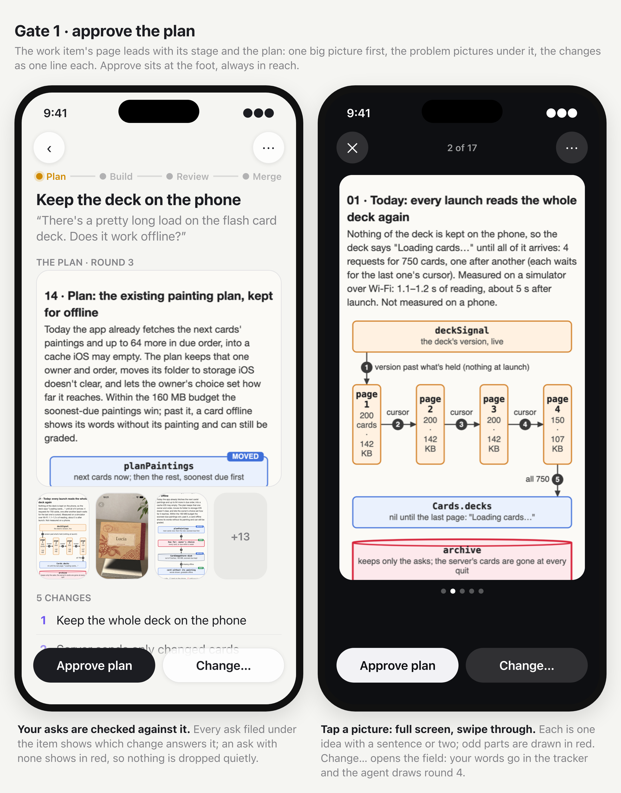
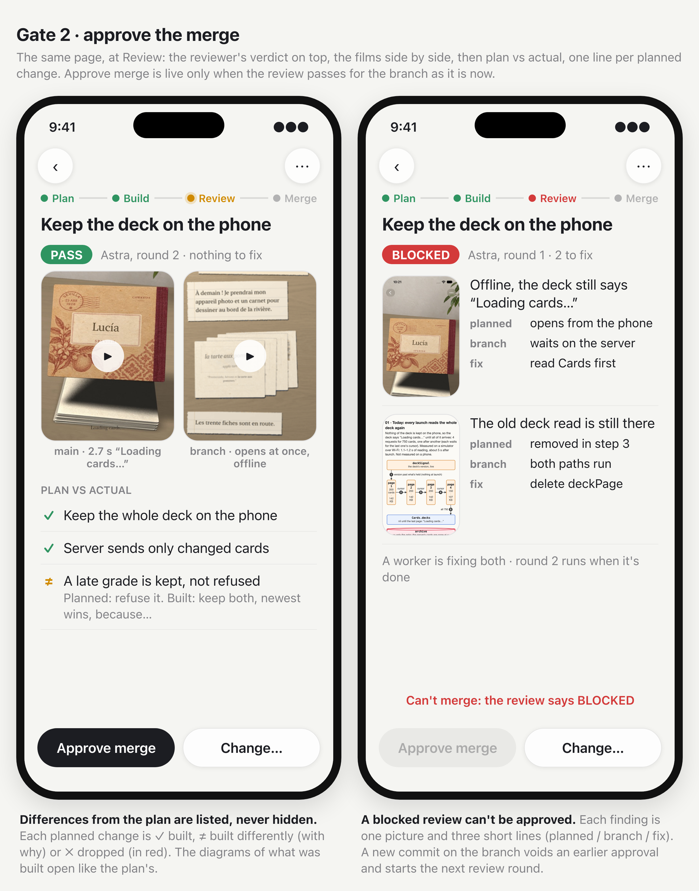
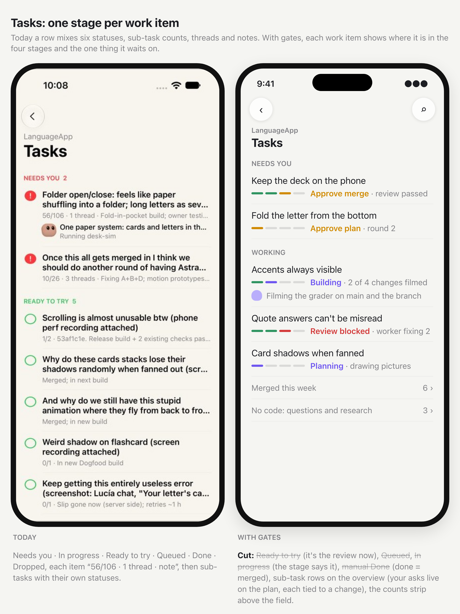
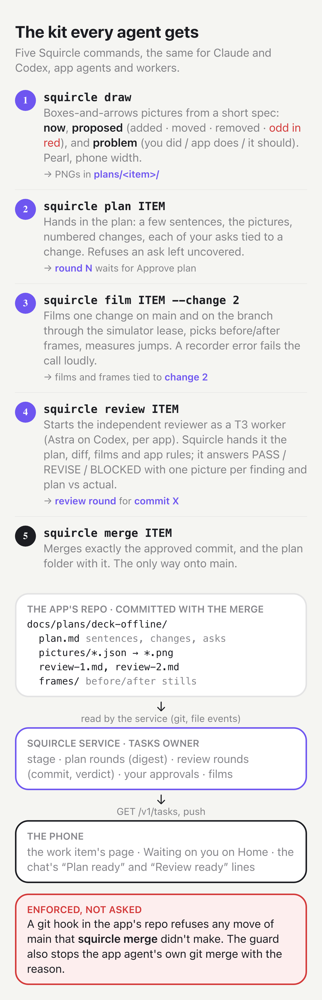
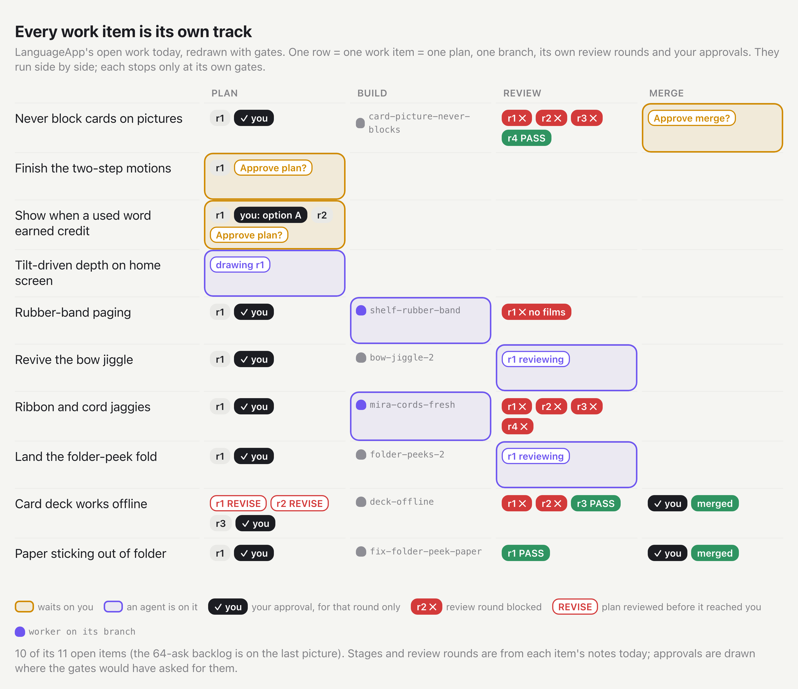
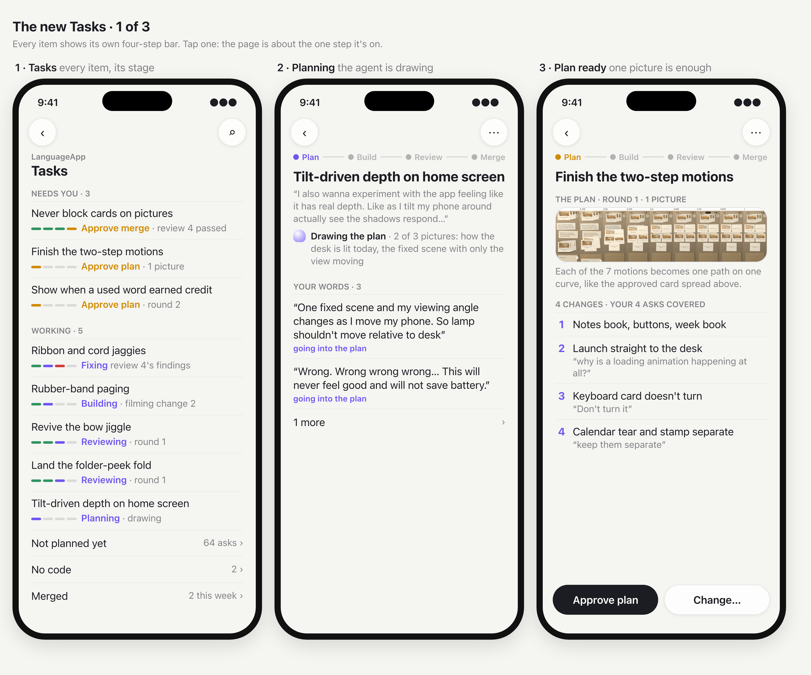
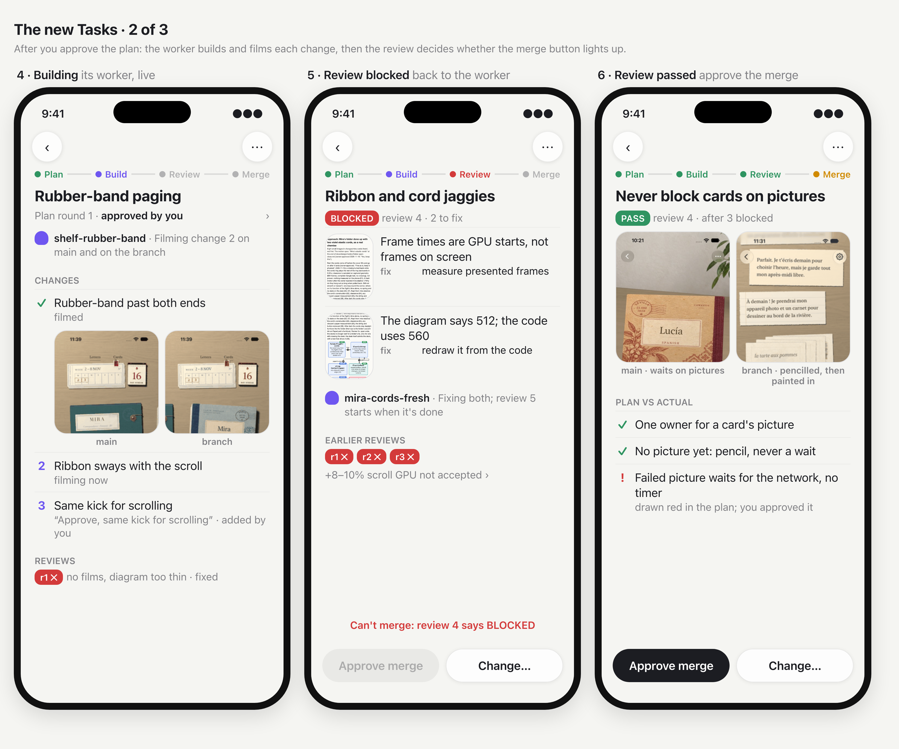
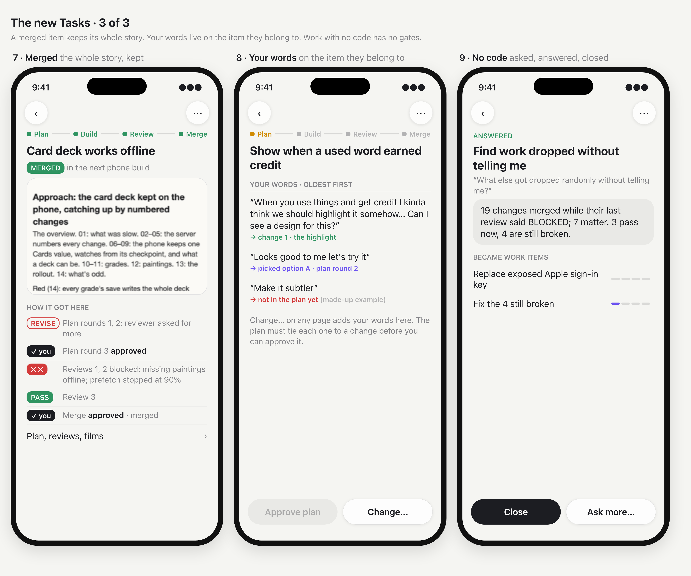
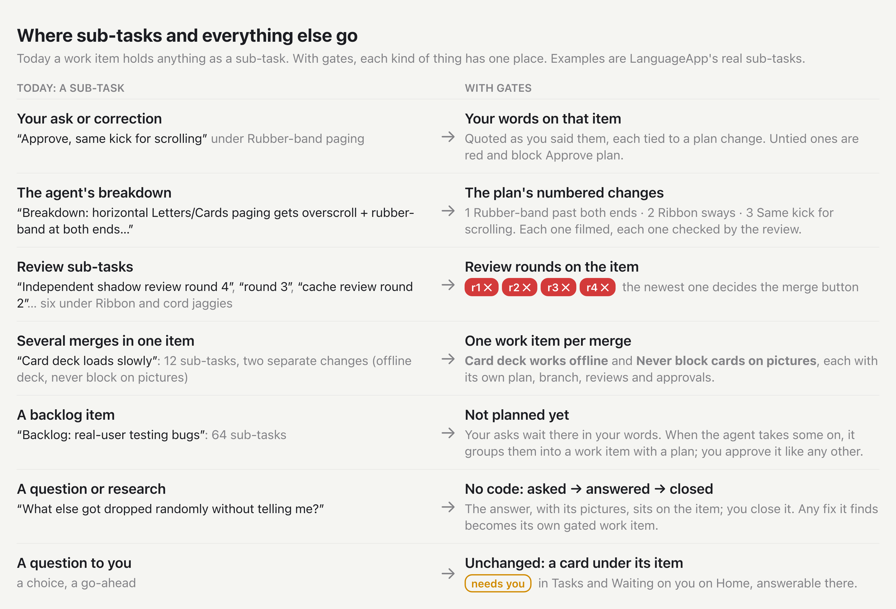

# Proposal: visual gates (plan approval, merge approval)

**Status: approved by the user and built, 2026-11-20** (see [tasks](../task-tracking.md#gates-2026-11-20-user-decision) and [gates.md](../gates.md)). `squircle review` is `review start` / `review submit`.

User: "I want the visual diagrams and visual review assets to be some tools
or skills or something baked into the harness. I should be able to see the
visual plans for each task and approve; then see the review output and
implementation details as visualizations and approve those for the agent to
merge."

This takes LanguageApp's hand-run process (its AGENTS.md "Mandatory
process", 2026-11-20) into Squircle so every app gets it. Pictures first;
the text below them is the detail. Sources for the pictures are in
[visual-gates/src](visual-gates/src) (`python3 src/render.py` redraws them
with headless Chrome). The phone mockups use real LanguageApp pictures and
screenshots; the "branch" frame is a stand-in.

## The lifecycle



A work item that changes code moves through four stages: **Plan → Build →
Review → Merge**. Two of the steps are yours and nothing else moves past
them. Items that change no code (questions, research) have no gates.

## The phone







## The kit



## How each task is tracked, and the new Tasks

User: "I'm not following how each task is tracked independently, how do I
see the state of each task, what does the tasks ui look like now". Drawn
from LanguageApp's real open work (2026-11-20): titles, asks, branches and
review rounds are from its tracker and notes; approvals are drawn where the
gates would have asked. The "branch" screenshots and the "Make it subtler"
ask are stand-ins.



Each work item is one unit: one plan (its rounds), one branch and its
worker(s), its own review rounds, your two approvals. Items never share a
stage; ten can sit at ten different points.







- **Overview**: Needs you (an approval or a question), then Working, each
  row with its four-step bar and the one thing happening; then folded lines
  for Not planned yet, No code and Merged.
- **An item's page** is about its current step: the agent drawing; the plan
  with Approve; the worker live with each change's films; the blocked
  review's findings with merge greyed; the passed review with plan vs
  actual and Approve merge; the merged story, every round in order.
- **Your words** live on their item, oldest first, each marked with the
  change that answers it; Change… on any page adds to them.



Sub-tasks as a general bucket go. Your asks become the item's words; the
agent's breakdown becomes the plan's numbered changes; review sub-tasks
become review rounds; an item with two merges becomes two items; a backlog
becomes "Not planned yet"; questions and research are No code items
(asked → answered → closed by you), and any fix they find becomes its own
gated item. Questions to you are unchanged.

## 1. Gates as state, enforced

One value per work item, in the tasks owner (`src/fsm/tasks/`), replacing
the status for code work:

```rust
enum Gate {
    Planning { round: u32 },                                  // agent drawing
    PlanWaiting { round: u32, plan: Digest },                 // needs you
    Building { plan: Approved },                              // workers
    Reviewing { plan: Approved, head: Commit },               // reviewer running
    ReviewDone { plan: Approved, review: Review },            // PASS: needs you; else back to work
    Merged { plan: Approved, review: Review, commit: Commit },
    Dropped,
}
struct Approved { round: u32, plan: Digest }
struct Review { round: u32, head: Commit, verdict: Verdict, digest: Digest }
```

- **Approvals are bound.** The phone sends what it showed (`plan round +
  digest`, or `review round + commit`); the service refuses an approval for
  anything that is no longer current. A new plan round needs a new yes.
- **The branch moving voids the merge approval.** The service sees the
  branch ref change as a file event (`src/kq.rs`), not a poll, and the
  item goes back to Building. No timers anywhere.
- **`squircle merge ITEM`** merges exactly the approved commit, and only
  when the review at that commit is PASS and you approved it. It is the one
  way onto the base branch. This alone stops "19 merged while the review
  said BLOCKED".
- **Enforced through the app agent** (user, 2026-11-20: "No hook; the app
  agent's guard is enough"): the guard (Claude and Codex agents both load
  it) refuses the app agent's own `git merge`/`push`/`update-ref` of the
  base branch and points it at `squircle merge`. Workers never merge; their
  briefs say so. No git hook in app repos.
- **Change…** puts your words in the tracker as an ask under the item
  (tracker first, as now) and wakes the agent; the item goes back a stage.
- **Short replies aren't approvals** (LA note #5): only the button
  approves. The agent cannot approve or merge for you.

Locks: none; it is letters to the one tasks owner, as today.

## 2. The kit (tools every agent gets)

| Command | Makes | Replaces in LA |
| --- | --- | --- |
| `squircle draw` | PNGs from a short JSON spec: **now**, **proposed** (added, moved, removed, odd in red), **problem** (you did / app does / it should). Pearl, phone width, one idea each. | `scripts/architecture.ts` plan pictures |
| `squircle plan ITEM` | Hands in `docs/plans/<item>/plan.md`: a few sentences, the pictures, numbered changes, each open ask tied to a change. Refuses an ask left uncovered ("what else got dropped?"). | `docs/plans/<name>.md` |
| `squircle film ITEM --change N --side main\|branch` | Labels a simulator recording (the existing lease) as evidence for a change, picks before/after frames, measures jumps (review-clip's frame diff, no model). A recorder error fails loudly. | `tools/review-clip` measuring |
| `squircle review ITEM` | Starts the independent reviewer as a T3 worker (per app, LA: Codex Astra) in a fresh thread at the branch head, with the plan, diff, films and the app's rules. Its `review-N.md` must give PASS/REVISE/BLOCKED, one line per planned change (✓ built, ≠ differently and why, ✗ dropped), and each finding as a picture plus planned / branch / fix. `review submit` refuses a review missing a change's line, or a change missing its film. | `docs/audit/*.md`, `review-clip` model call |
| `squircle merge ITEM` | The merge, with the plan folder. | the agent's `git merge` |

Everything an item produces lives in the app's repo under
`docs/plans/<item>/` and lands on main with the merge; films stay in
Squircle's attachments (frames go in the repo). The service reads the folder
by git and file events, parses `plan.md` and `review-N.md`, and serves them
in `GET /v1/tasks`. The phone draws them natively (pictures, changes,
verdict) and opens the Markdown in the existing reader.

The service runs no model: the reviewer is an ordinary T3 worker on a
provider CLI, like every other piece of delegated work.

## 3. The phone

- **A work item's page leads with its stage track and what it waits on.**
  At Plan: the big picture, the strip of problem pictures (tap: full screen,
  swipe), the changes as one line each, your asks tied to them, Approve plan
  / Change… at the foot. At Review: the verdict, main and branch films side
  by side, plan vs actual, Approve merge / Change…. Approve merge is greyed,
  with the reason, unless the review is PASS for the branch as it is now.
- **Waiting on you** on Home shows the same two kinds of card, one at a
  time, with the first picture.
- **The chat** says "Plan ready" / "Review ready" as a line that opens the
  page; no plan text in chat.
- **Cut from Tasks**: Ready to try (it is the review), Queued and In progress
  (the stage says it), manual Done (done is merged), sub-task rows on the
  overview and the agent's own breakdown sub-tasks (the plan's numbered
  changes replace them), the counts strip above the field. Kept: your asks
  in your words (shown on the plan), Drop, questions, History, search.

## 4. How agents are told

- **Plugin (`app-agent.md`)**: one short "Gates" paragraph: for code work,
  `plan`, wait for approval, brief workers with the approved plan, have them
  `film` each change, `review`, wait, `merge`. Codex agents get the same
  text through the same note.
- **Per-turn note**: lists items in gate terms ("Keep the deck: review
  BLOCKED, 2 findings"; "Fold the letter: plan round 2 waiting on the
  user").
- **Worker briefs** (`thread spawn` appends): the approved plan's path, the
  changes they own, "film each with `squircle film`", "never merge".
- **`squircle help gates`** holds the formats and examples, so the plugin
  stays short. Reply style is unchanged: one or two sentences and a picture.

## 5. LanguageApp, and what stays per app

- `squircle gates enable APP` writes a small per-app file in the app's repo
  (`.squircle/gates.toml`): base branch, reviewer provider and model, rule
  documents the reviewer must enforce (LA: `docs/engineering-preferences.md`,
  `docs/design/motion/`), merge checks (LA: `bun run typecheck`, `test`,
  `check:contract`, `check:architecture`).
- **LA keeps** its feature diagrams, `how-it-is-built.html`, motion specs and
  `check:architecture`; they are its rules, read by the reviewer.
- **LA changes**: new plans go to `docs/plans/<item>/`; old plans and audits
  stay where they are. `review-clip`'s measuring moves into `squircle film`;
  its direct `codex exec` call goes (the reviewer is a T3 worker). LA's
  "Mandatory process" section shrinks to a pointer.
- **Items in flight**: the agent imports an existing plan as round 1 and the
  last audit as a review round. Nothing is approved from history: you tap
  once.

## Decided (user, 2026-11-20)

- "Every code change; a plan can be one picture."
- "Yes, gate Squircle too": this repo's commit-on-main habit ends when gates ship.
- "No hook; the app agent's guard is enough."

## Unknown, not tested

- Rendering pictures: LA uses headless Chrome; a small WebKit snapshot
  helper may be better. Not tried.
- Whether T3's Codex instance offers the Astra model to a reviewer worker.
- How agents keep to the `plan.md`/`review-N.md` formats; `submit` refuses
  bad ones, but the refusal loop is unmeasured.
- Filming main and branch needs two builds per change; the cost per item is
  unmeasured.

## Build order

1. Gate state, bound approvals, `merge`, the guard (tests only for the
   transitions and the plan/review parsers).
2. The page's stage track, Approve/Change, Waiting on you, Tasks cuts.
3. `draw`, then `plan`. 4. `film`. 5. `review`. 6. LA moves over.
